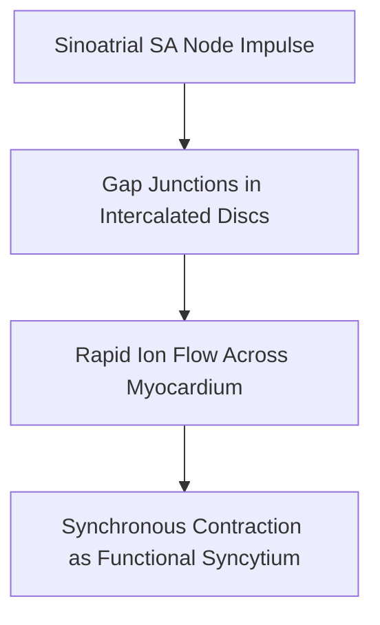

# Quick Study — 4.3 Cardiac Muscle — Myocardial Architecture

**MindmapPath**: `UNIT 6: ANIMAL TISSUE > Muscular Tissue > Cardiac / Heart Muscle`
**Depth Level**: `L-2 Sub-Topic`

---

## Must-Know Key Concepts

- **Exclusive Cardiac Location**: Confined strictly to the middle wall (**myocardium**) of the heart; involuntary, autorhythmic, and non-fatiguing throughout life.
- **Branched Cylindrical Architecture**: Short cylindrical cells with central nucleus, displaying light transverse striations and anastomosing branching networks.
- **Intercalated Discs**: Diagnostic cellular junctions featuring **Desmosomes** (mechanical anchoring during contraction) and **Gap Junctions** (rapid electrical ion conduction across myocardium).
- **High Aerobic Capacity**: Packed with dense mitochondria (~40% cell volume) and rich coronary capillary network preventing fatigue.

### Sub-Topic Process Flowchart

## Key Sub-Topic Infographics

*Figure: Cardiac Heart Muscle Overview*

*Figure: Cardiac Muscle — Involuntary, Branched, Non-fatiguing*

*Figure: Intercalated Discs (Desmosomes & Gap Junctions)*
