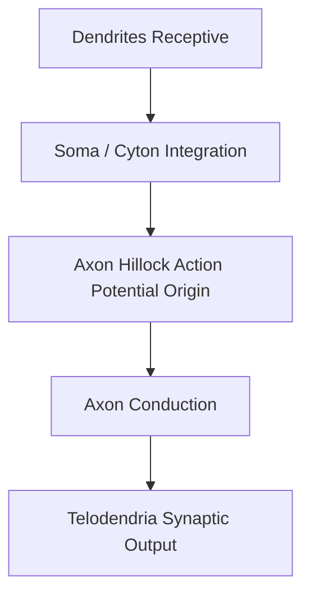

# Quick Study — 5.2 Neurone — Structural and Functional Neural Architecture

**MindmapPath**: `UNIT 6: ANIMAL TISSUE > Nervous Tissue > Neurone`
**Depth Level**: `L-2 Sub-Topic`

---

## Must-Know Key Concepts

- **Unit of Nervous System**: Neurons are structural and functional excitable units specialized for receiving, conducting, and transmitting nerve impulses.
- **Structural Parts**: **Soma / Cyton** (cell body containing nucleus & **Nissl's granules** RER/ribosomes) and **Neurites** (**Dendrites** short branched centripetal processes; **Axon** single long centrifugal process ending in synaptic telodendria).
- **Myelin Sheath**: **Myelinated** (wrapped in lipid sheath with **Nodes of Ranvier** for rapid saltatory conduction) vs **Non-myelinated** (continuous slow conduction).
- **Structural Types**: Apolar (Hydra), Pseudopolar (dorsal root ganglion), Unipolar (embryo), Bipolar (retina/olfactory), Multipolar (cerebral cortex).
- **Functional Direction**: Sensory/Afferent, Motor/Efferent, Interneuron/Adjustor.

### Sub-Topic Process Flowchart

## Key Sub-Topic Infographics

*Figure: Neurone Overview*

*Figure: Neurone Parts — Soma and Neurites (Axon & Dendrites)*

*Figure: Nissl's Granules in Soma and Dendrites*

*Figure: Node of Ranvier & Myelin Sheath Conduction*

*Figure: Neuronal Direction (Sensory, Motor, Interneuron)*

*Figure: Neuronal Structural Types (Unipolar, Bipolar, Multipolar)*

*Figure: Gray Matter vs White Matter Organization*
