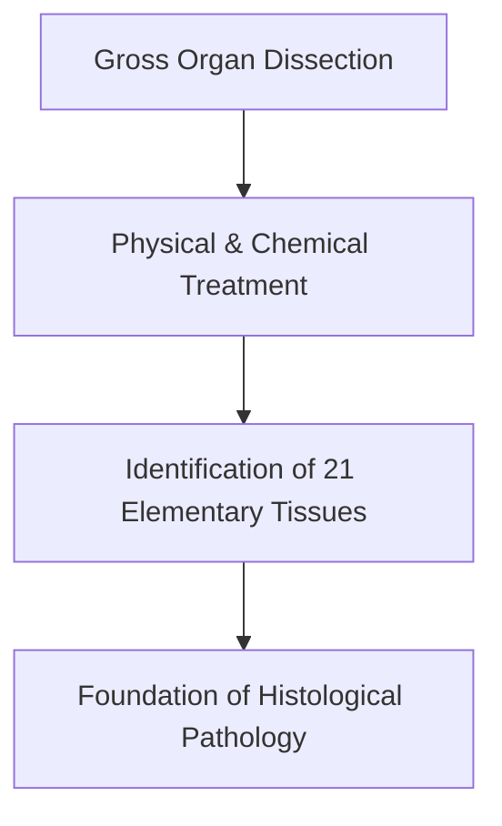

# Quick Study — 1.1 Xavier Bichat — Architect of Histology

**MindmapPath**: `UNIT 6: ANIMAL TISSUE > History & Overview > Xavier Bichat`
**Depth Level**: `L-2 Sub-Topic`

---

## Must-Know Key Concepts

- **Coined the Term 'Tissue'**: Marie François Xavier Bichat (1771–1802) introduced the French term *tissu* in 1792 to describe macroscopic structural layers of the body.
- **Founder & Father of Animal Histology**: Bichat is historically recognized as the founder and father of modern histology as an independent anatomical science.
- **Distinguished 21 Elementary Tissues**: Identified and classified 21 distinct tissue types in human organs solely through gross anatomical dissection, chemical treatment, and maceration without microscopic aid.
- **Organ Tissue Theory**: Postulated that human organs are complex assemblies of simpler elementary tissue membranes, and that disease primarily affects individual tissue components rather than whole organs.

### Sub-Topic Process Flowchart

## Key Sub-Topic Infographics

*Figure: Xavier Bichat — Founder and Architect of Animal Histology*

*Figure: Animal Histology Overview and Hierarchy*
