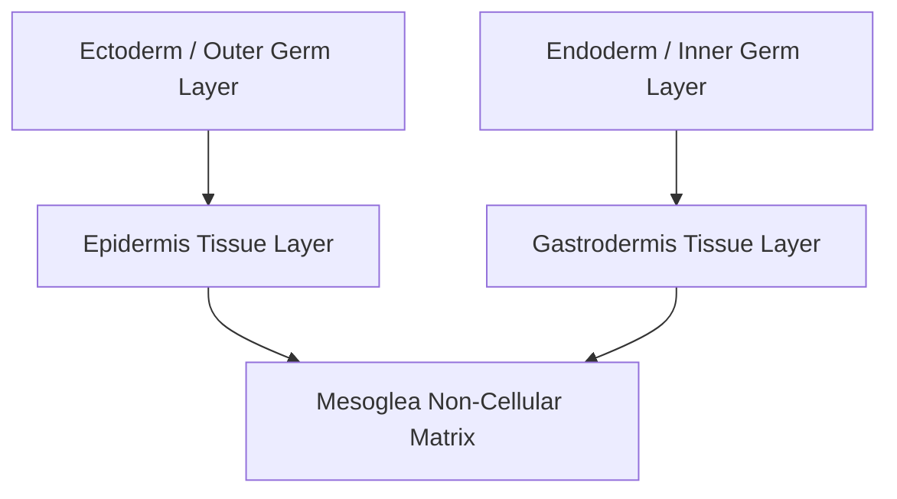

# Quick Study — 1.4 Phylum Coelenterata — Evolutionary Origin of Animal Tissues

**MindmapPath**: `UNIT 6: ANIMAL TISSUE > History & Overview > Phylum Coelenterata`
**Depth Level**: `L-2 Sub-Topic`

---

## Must-Know Key Concepts

- **First Phylum with Animal Tissues**: Phylum Coelenterata (Cnidaria) represents the earliest evolutionary animal group to attain a true **tissue grade of body organization**.
- **Diploblastic Body Wall**: Possesses two embryonic germinal tissue layers: an outer **ectoderm** (epidermis) and an inner **endoderm** (gastrodermis), separated by an acellular gel-like **mesoglea**.
- **Specialized Tissue Cells**: Features specialized epithelial cells including epitheliomuscular cells, primitive nerve nets, and unique defensive **cnidocytes** (stinging cells).
- **Evolutionary Milestone**: Represents the major phylogenetic transition from loose cellular aggregates (Porifera) to true integrated tissue systems.

### Sub-Topic Process Flowchart

## Key Sub-Topic Infographics

*Figure: Phylum Coelenterata — Evolution of Tissue Grade of Organization*
