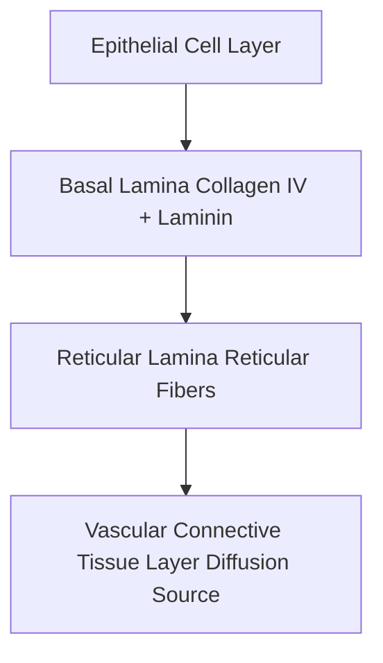

# Quick Study — 2.1 Surfaces & General Characteristics of Epithelial Tissue

**MindmapPath**: `UNIT 6: ANIMAL TISSUE > Epithelial Tissue > General Features & Surfaces`
**Depth Level**: `L-2 Sub-Topic`

---

## Must-Know Key Concepts

- **Coverage & Protection**: Epithelial tissue forms continuous protective sheets covering body surfaces, body cavities, and hollow internal organs.
- **Body Cavity Surface Count**: Displays variable surface count boundaries depending on coelomic architecture: 2 surfaces in Acoelomate animals, 3 surfaces in Pseudocoelomates, and 4 surfaces in Coelomate animals.
- **Minimal Matrix & Avascularity**: Characterized by extremely tight cell packing with negligible intercellular matrix and total **avascularity** (no direct blood vessels; nourished via basement membrane diffusion).
- **Specialized Intercellular Junctions**: Held firmly by tight junctions (zonula occludens), adherens junctions, desmosomes (macula adherens), and gap junctions (nexus).

### Sub-Topic Process Flowchart

## Key Sub-Topic Infographics

*Figure: General Features of Epithelial Tissue*

*Figure: Cell Junctions in Epithelial Tissue (Tight, Adherens, Desmosomes, Gap)*

*Figure: The Epithelial Basement Membrane Gateway*
