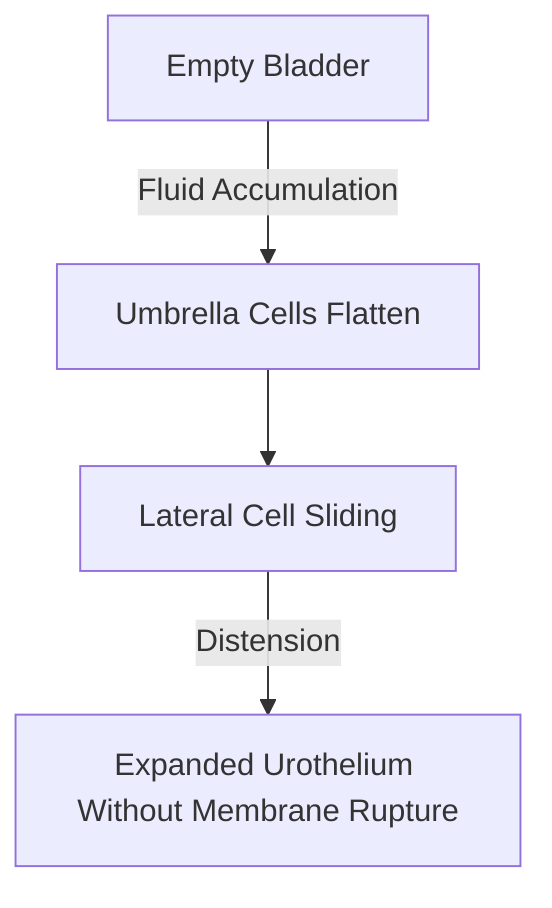

# Quick Study — 2.3 Compound Epithelium — Multi-Layered & Transitional Epithelia

**MindmapPath**: `UNIT 6: ANIMAL TISSUE > Epithelial Tissue > Compound Epithelium`
**Depth Level**: `L-2 Sub-Topic`

---

## Must-Know Key Concepts

- **Multi-Layered Structure**: Composed of two or more cell layers resting on a basement membrane; specialized primarily to withstand mechanical wear, abrasion, and chemical stress.
- **Stratified Squamous Epithelium**: Surface layers composed of flattened squamous cells. Subtypes: **Keratinized** (dead keratin-filled surface layer, e.g. skin epidermis) and **Non-Keratinized** (moist living surface layer, e.g. esophagus, pharynx, vagina).
- **Stratified Cuboidal & Columnar**: Rare multi-layered epithelia found in large excretory ducts of sweat glands, salivary glands, and male urethra.
- **Transitional Epithelium (Urothelium)**: Multi-layered (4–6 layers) stretchable plastic epithelium lining renal pelvis, ureters, and urinary bladder; umbrella cells flatten without tearing during organ distension.

### Sub-Topic Process Flowchart

## Key Sub-Topic Infographics

*Figure: Guide to Compound Epithelial Tissues*

*Figure: Stratified Epithelium Types and Functions (Keratinized vs Non-Keratinized)*

*Figure: Transitional Epithelium (Urothelium) Structure and Function*
