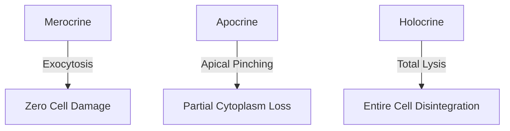

# Quick Study — 2.4 Modified & Glandular Epithelium

**MindmapPath**: `UNIT 6: ANIMAL TISSUE > Epithelial Tissue > Modified & Glandular Epithelium`
**Depth Level**: `L-2 Sub-Topic`

---

## Must-Know Key Concepts

- **Modified Epithelia**: Specialized structural adaptations including Ciliated (Kino-ciliated 9+2 vs Stereo-ciliated 0+0), Brush-bordered (microvilli), Neuro-sensory (taste buds), Pigmented (retina), and Germinal (gonads).
- **Glandular Epithelium**: Epithelial cells specialized for synthesis and secretion of metabolic products.
- **Classification by Ducts**: Exocrine (secretes via ducts onto surface), Endocrine (ductless; secretes hormones directly into blood), Heterocrine/Mixed (pancreas).
- **Classification by Secretion Mode**: **Merocrine** (exocytosis, no cell loss), **Apocrine** (apical cytoplasm pinches off, e.g. mammary glands), **Holocrine** (entire cell ruptures and dies, e.g. sebaceous glands).
- **Classification by Cell Count & Architecture**: Unicellular (goblet cells) vs Multicellular; Simple (tubular, alveolar) vs Compound (tubular, alveolar, tubulo-alveolar).

### Sub-Topic Process Flowchart

## Key Sub-Topic Infographics

*Figure: Modified Epithelium Types and Functions Overview*

*Figure: Modified Ciliated Epithelium Specialisations (Kino-ciliated 9+2 vs Stereo-ciliated 0+0)*

*Figure: Specialised Brush-Bordered Epithelium Guide*

*Figure: Glandular Epithelium Classification Overview (Ducts, Consistency, Secretion Mode)*
