# Lesson 1: Foundations, Nature, Elements, and Models of Communication

---

## Course & Lesson Overview

Communication is at the core of all human interaction, societal progress, and cultural continuity. In an increasingly interconnected and technology-driven environment, understanding the mechanics of communication is essential for personal empowerment, academic success, and civic engagement.

### Learning Competencies & Objectives
By the end of this lesson, learners are expected to:
1. Explain the fundamental nature, definitions, and step-by-step processes of human communication.
2. Differentiate between linear, interactive, and transactional models of communication.
3. Identify and evaluate each essential element of communication, including participants, messages, channels, feedback, noise, and context.
4. Distinguish the crucial role of feedback in preventing communication breakdowns and ensuring mutual understanding.
5. Apply principles of digital etiquette (netiquette), house rules, and ethical standards in both face-to-face and online communication environments.

---

## 1. Course Introduction & Public Speaking in a Digital Age

### 1.1 The Importance of Studying Communication and Public Speaking
Public speaking is defined as **a sustained, formal presentation by a speaker to an audience** (Verderber, Sellnow, & Verderber, 2017). Although individuals communicate daily in informal settings, structured oral communication equips individuals with two distinct advantages:

* **Empowerment**: To be empowered means having the resources, information, and confidence to take action to achieve a desired goal (Beebe & Beebe, 2017). Former presidential speechwriter James Humes described public speaking as *"the language of leadership"*, observing that whenever an individual speaks before a group, they are auditioning for leadership. Competent oral communication empowers individuals to voice ideas, resolve community issues, and persuade others.
* **Employment**: Surveys of human resource managers and corporate executives across industries consistently rank oral communication and interpersonal presentation skills as the single most desirable attribute in job candidates. Regardless of technical specialization, professional advancement relies on the ability to articulate ideas clearly and persuasively.

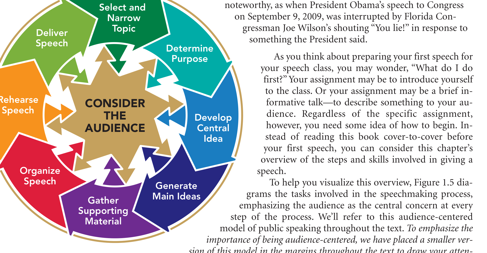
*Figure 1.1: The Audience-Centered Model of Public Speaking (Beebe & Beebe, 2017, Figure 1.5). The audience serves as the core focal point influencing every stage of speech preparation, rehearsal, and delivery.*

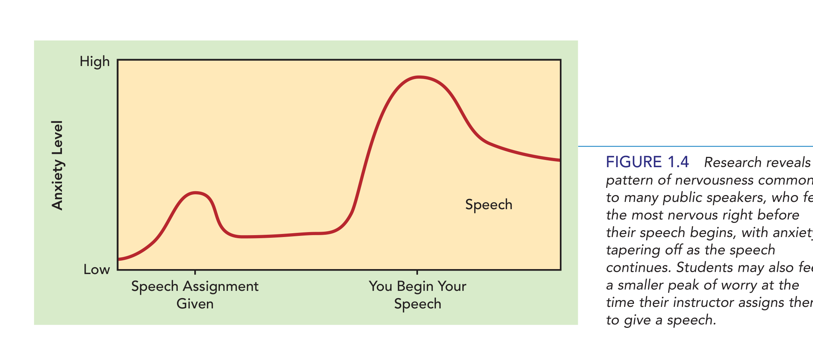
*Figure 1.2: Empirical pattern of public speaking apprehension across speech preparation and performance stages (Beebe & Beebe, 2017, Figure 1.4).*

### 1.2 Public Speaking as a Liberal Art and Civic Right
Since ancient Greece and Rome, public speaking has been revered as a **liberal art** and a fundamental **civic right**. In democratic societies:
* Free speech serves as the bedrock of governance and civic debate.
* The study of communication teaches individuals **how to think rather than what to think**, cultivating critical thinking skills necessary to analyze public arguments, discern reliable data from misinformation, and expose manipulative rhetoric.

### 1.3 Communication in the Digital Age
The explosion of **Information and Communication Technology (ICT)** has transformed the channels through which messages travel:
* **Mediated Channels**: Technology-enhanced auditory and visual platforms (e.g., videoconferencing, webinars, live streams, interactive forums).
* **Virtual Presence**: A simulated sense of co-presence enabled by digital platforms, allowing real-time interaction despite physical geographical separation.
* **Blending of Contexts**: The traditional boundary between public speaking (formal oral presentation to an immediate audience) and mass communication (messages transmitted via media to vast, anonymous audiences) has blurred. Contemporary speeches are frequently recorded, livestreamed, clipped, and analyzed across global digital networks.

---

## 2. House Rules, Digital Civility, and Online Etiquette (Netiquette)

Effective communication requires an environment of mutual respect, psychological safety, and clear operational expectations. In both face-to-face classrooms and virtual environments, communicators must adhere to structured behavioral norms.

### 2.1 Group Ground Rules
Whether meeting in person or via digital platforms, establishing group ground rules ensures productive interaction:
1. **Punctuality and Readiness**: Arriving on time, testing audio-visual equipment in advance, and having relevant materials prepared.
2. **Turn-Taking**: Practicing disciplined conversational turn-taking; using digital features (e.g., "Raise Hand") or verbal cues rather than talking over others.
3. **Attentive Presence**: Minimizing multitasking (e.g., checking social media, texting, or browsing unrelated sites during discussions or presentations).
4. **Constructive Engagement**: Focusing critiques on ideas and arguments rather than personal attributes of the speaker.

### 2.2 Core Netiquette Guidelines
**Netiquette** refers to the social and behavioral etiquette rules applicable to communicating over computer networks (Verderber et al., 2017). Key guidelines include:

* **Tone and Decorum**: Express messages politely and professionally. Avoid the use of all-capital letters (ALL CAPS), which in digital communication is interpreted as shouting.
* **Mindful Use of Visual Embellishments**: Use emoticons, emojis, and informal abbreviations sparingly and appropriately according to the formality of the context.
* **Brevity and Conciseness**: Keep written posts and virtual oral remarks focused and to the point to respect listeners' time and bandwidth.
* **Avoiding Flaming**: Refrain from aggressive, inflammatory, or insulting language ("flaming"). When disagreements arise, communicate assertively yet tactfully.
* **Accountability and Verification**: Verify facts before sharing information to prevent the spread of digital falsehoods or unverified claims.

### 2.3 Ethical Responsibilities of Speakers and Listeners
Ethics are a set of moral principles held by a society, group, or individual that differentiate right from wrong (Verderber et al., 2017). Ethical communication is audience-centered and guided by five foundational standards:

1. **Honesty**: Communicating truthfully and accurately. Ethical speakers avoid misrepresenting data, fabricating sources, or distorting facts.
   * *Plagiarism*: Presenting the ideas, words, or created works of another as one's own by failing to credit the source.
   * *Cyberplagiarism*: Extracting texts or multimedia materials from the Internet without appropriate citation.
2. **Integrity**: Aligning verbal advocacy with personal practice ("practicing what one preaches").
3. **Fairness**: Presenting evidence impartially, acknowledging alternative viewpoints, and admitting potential personal biases.
4. **Respect**: Honoring the dignity, diverse perspectives, and cultural backgrounds of listeners; using inclusive language.
5. **Responsibility**: Recognizing that words carry consequences; advocating positions that genuinely support the welfare of listeners and society.

> [!NOTE]
> ### National Communication Association (NCA) Credo for Communication Ethics
> *"Ethical communication is fundamental to responsible thinking, decision making, and the development of relationships and communities within and across contexts, cultures, channels, and media. Moreover, ethical communication enhances human worth and dignity by fostering truthfulness, fairness, responsibility, personal integrity, and respect for self and others."*

---

## 3. Defining Communication

Scholars across disciplines define communication through distinct lenses, highlighting its multidimensional nature:

```
                          ┌──────────────────────────┐
                          │      COMMUNICATION       │
                          └─────────────┬────────────┘
         ┌──────────────────────────────┼──────────────────────────────┐
         ▼                              ▼                              ▼
  Process-Centered             Relational/Meaning-Centered     Systemic/Symbolic
(McCornack / Sipacio)               (Verderber / Beebe)             (Wood)
"Sharing & conveying         "The process of creating      "Systemic process of
messages across channels,     shared meaning between        interacting with & through
contexts, & cultures."        senders and receivers."       symbols to create meaning."
```

### 3.1 Primary Scholarly Definitions
* **McCornack (2014) & Sipacio & Balgos (2016)**:
  > Communication is a process of sharing and conveying messages or information from one person to another within and across channels, contexts, media, and cultures.
* **Verderber, Sellnow, & Verderber (2017)**:
  > Communication is the process of creating shared meaning.
* **Beebe & Beebe (2017)**:
  > Communication is the process of presenting a message to an audience and co-creating understanding through symbolic interaction.
* **Julia T. Wood (2012)**:
  > Communication is a systemic process in which people interact with and through symbols to create and interpret meanings.

### 3.2 Key Characteristics of Wood’s Systemic Framework
Wood's definition provides a comprehensive academic foundation characterized by four interrelated dimensions:

1. **Communication is a Process**: It is ongoing, dynamic, and continuous. It does not have a static beginning or end; communicative interactions are always in motion, building upon past events and shaping future engagements.
2. **Communication is Systemic**: It occurs within an interconnected web of systems (e.g., physical environment, cultural background, societal structures, emotional states). The parts of a system interact; a change in any single variable (such as room temperature, cultural etiquette, or participant mood) influences the entire communicative encounter.
3. **Communication Involves Symbols**: Symbols are representations of things, thoughts, feelings, and phenomena. Symbols are:
   * *Arbitrary*: Words have no natural or intrinsic connection to the objects they represent.
   * *Ambiguous*: Words have multiple meanings based on individual interpretation and context.
   * *Abstract*: Words represent concepts and generalizations rather than tangible realities.
4. **Communication Involves Meaning**: Meaning is created rather than discovered. Meaning operates on two levels:
   * *Content Level of Meaning*: The literal, explicit information conveyed by words (e.g., "Please submit the report by 5:00 PM").
   * *Relationship Level of Meaning*: The subtle indicators of how participants regard one another, communicating power, status, warmth, or distance through tone, posture, and facial expression (e.g., whether the request is delivered with respect or harsh condescension).

---

## 4. Nature and Steps of the Communication Process

### 4.1 Nature of Communication
1. **Communication is a continuous process**: Messages flow dynamically rather than as isolated, discrete events.
2. **Communication is inherently relational**: It occurs between two or more participants (individual with self in intrapersonal communication, or with others).
3. **Communication is multimodal**: It is enacted through spoken words, written words, physical actions (nonverbal cues), vocal inflections, or a combination of verbal and nonverbal channels.
4. **Communication is irreversible and unrepeatable**: Once uttered or sent, a message cannot be completely retracted or recreated under identical conditions.

### 4.2 The Six-Step Communication Cycle
The mechanics of communication follow a six-stage sequential cycle:

```
[1. Idea Generation] ──► [2. Encoding] ──► [3. Transmission]
                                                  │
                                                  ▼
[6. Feedback]        ◄── [5. Decoding] ◄── [4. Reception]
```

1. **Idea Generation**: The speaker (source) conceives an idea, intention, sentiment, or piece of information that needs to be expressed.
2. **Encoding**: The speaker translates the internal mental concepts and images into recognizable verbal words, vocal inflections, or nonverbal actions (symbols).
3. **Transmission**: The speaker sends the encoded message across chosen channels (sound waves, visual gestures, written text, digital signals).
4. **Reception**: The receiver senses and collects the incoming auditory, visual, or physical signals.
5. **Decoding**: The receiver translates and interprets the encoded symbols, assigning cognitive and affective meaning based on personal background, experiences, and situational context.
6. **Feedback**: The receiver formulates and sends back verbal or nonverbal responses, signaling whether the message was understood, misunderstood, accepted, or rejected.

#### Concrete Application Example (from Sipacio & Balgos, 2016)
* **Step 1 (Idea Generation)**: Daphne recognizes that she cares for Rico, her suitor, but only as a friend.
* **Step 2 (Encoding)**: Daphne chooses how to articulate this sensitively in their native tongue: *"Rico, mahal kita bilang kaibigan."*
* **Step 3 (Transmission)**: She vocalizes the words directly to Rico face-to-face.
* **Step 4 (Reception)**: Rico listens to Daphne's spoken words and observes her solemn facial expression.
* **Step 5 (Decoding)**: Rico processes the meaning of her statement within the context of their previous dates, realizing her romantic feelings are absent, and experiences emotional heartache.
* **Step 6 (Feedback)**: Rico frowns, falls silent, and looks away, nonverbally signaling his disappointment and pain.

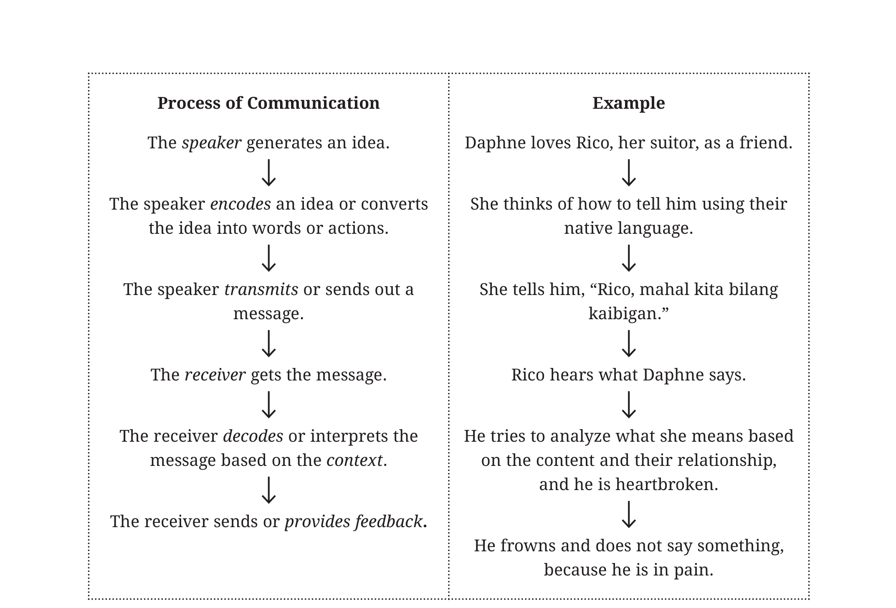
*Figure 1.3: Visual sequence of the communication cycle from idea generation to feedback in the Daphne and Rico interaction (Sipacio & Balgos, 2016, p. 11).*

---

## 5. Essential Elements of Communication

The communication process is comprised of discrete components that interact to facilitate or hinder shared understanding:

| Element | Definition & Scholarly Role | Concrete Example |
| :--- | :--- | :--- |
| **Speaker (Source)** | The originator who initiates the communicative act, forms the intent, and encodes the message. | A professor presenting a lecture; a student delivering a presentation. |
| **Message** | The verbal utterances, visual representations, and nonverbal behaviors conveyed to the receiver. | The spoken arguments, data slides, and nonverbal gestures during a speech. |
| **Encoding** | The cognitive process of converting internal thoughts, emotions, and ideas into communicative symbols. | Selecting precise vocabulary, vocal inflections, and pacing to convey urgency. |
| **Channel** | The vehicle, route, or medium through which the encoded message travels from sender to receiver. | Airwaves carrying acoustic voice, face-to-face visual signals, digital video stream. |
| **Receiver** | The intended target or audience who hears, sees, and decodes the message. | The students attending the lecture; the audience listening to a webinar. |
| **Decoding** | The mental process of interpreting and attributing meaning to received symbols. | An audience member understanding technical vocabulary based on prior study. |
| **Feedback** | The verbal and nonverbal reactions provided by the receiver indicating how the message is received. | Nods of agreement, puzzled expressions, follow-up questions during Q&A. |
| **Context** | The multidimensional environment and circumstances in which the interaction occurs. | A formal boardroom meeting vs. an informal conversation at a café. |
| **Interference (Noise)** | Any stimulus that distorts, interrupts, or impedes the transmission or comprehension of meaning. | Outside traffic sounds, a severe migraine, cultural misinterpretation. |

### 5.1 Noise and Interference Types
Noise is categorized into distinct forms:
* **Physical (External) Noise**: Extraneous environmental stimuli (e.g., loud air conditioners, lawn mowers, construction noise, mobile phone alerts, poor internet connectivity).
* **Internal Noise**:
  * *Physiological Noise*: Biological barriers within the sender or receiver (e.g., illness, exhaustion, hunger, hearing impairment, pain).
  * *Psychological Noise*: Mental, emotional, or cognitive distractions (e.g., preoccupation with an upcoming exam, biases, anger, anxiety, daydreaming).
* **Semantic Noise**: Confusion caused by linguistic barriers, ambiguous phrasing, excessive technical jargon, or culturally specific idioms that the listener cannot interpret.

### 5.2 Contextual Levels of Communication
Context shapes the formality, structure, and expectations of interaction across multiple operational levels:
1. **Intrapersonal Communication**: Communication within oneself ("self-talk"). Involves thinking, planning, evaluating choices, self-regulation, and internal processing.
2. **Interpersonal Communication**: Communication between two people who share an identifiable relationship (e.g., parent-child dialogue, two peers discussing a project, counselor-client consultation).
3. **Small Group Communication**: Interaction among approximately 3 to 10 individuals cooperating toward a shared objective (e.g., group project teams, family meetings, corporate committees).
4. **Public Communication**: Communication where one primary speaker addresses an audience of more than 10 people, predominantly through a structured, sustained oral presentation.
5. **Mass Communication**: Highly mediated communication generated by institutions and distributed through mass media (television, newspapers, digital platforms, podcasts) to large, dispersed, and anonymous audiences.

### 5.3 The Rhetorical Situation (Verderber et al., 2017 / Lloyd Bitzer)
Public speaking operates at the convergence of three foundational factors known as the **Rhetorical Situation**:

```
                       ┌──────────────────────┐
                       │       SPEAKER        │
                       └──────────┬───────────┘
                                  │
                                  ▼
                     ┌──────────────────────────┐
                     │   RHETORICAL SITUATION   │
                     │       (Exigence)         │
                     └──────┬────────────┬──────┘
                            │            │
            ┌───────────────┘            └───────────────┐
            ▼                                            ▼
┌──────────────────────┐                     ┌──────────────────────┐
│       AUDIENCE       │                     │       OCCASION       │
└──────────────────────┘                     └──────────────────────┘
```

* **Speaker**: The originator whose background, credibility, ethics, delivery skills, and motives shape the discourse.
* **Audience**: The specific group of listeners. Effective speakers conduct **Audience Analysis** (examining listeners' demographic and psychographic profiles) to practice **Audience Adaptation** (customizing content, examples, and tone to listeners' needs).
* **Occasion & Setting**: The purpose, physical venue, cultural expectations, and time constraints surrounding the communicative event.
* **Exigence**: A real or perceived urgent need, imperfection, or crisis that puts pressure on people and can be addressed or resolved through discourse (Bitzer, 1968). For instance, an institutional policy flaw or a natural disaster creates an exigence that compels leaders to speak out and propose actionable solutions.

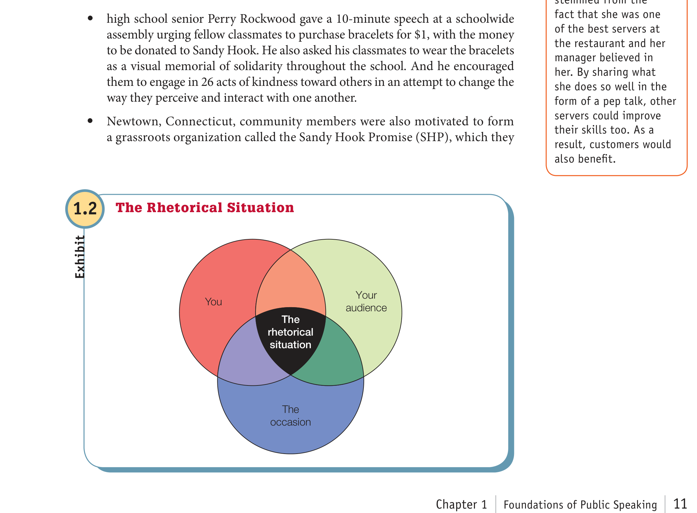
*Figure 1.4: The Rhetorical Situation Venn Diagram (Verderber, Sellnow, & Verderber, 2017, Exhibit 1.2). Effective public address occurs at the intersection of Speaker, Audience, and Occasion to resolve a central exigence.*

---

## 6. Communication Models

Communication scholars have developed conceptual models to diagram and explain the communication process. These models have evolved from simple linear transmission frameworks into interactive and transactional systems.

### 6.1 Linear Models (Communication as Action / One-Way)

```
[Source] ──(Encodes)──► [Message] ──► [Channel / Noise] ──► [Receiver] ──(Decodes)──► [Destination]
```

#### Harold Lasswell’s Model (1948)
Lasswell formulated a straightforward verbal model centered on five questions:
$$\text{Who} \longrightarrow \text{Says What} \longrightarrow \text{In Which Channel} \longrightarrow \text{To Whom} \longrightarrow \text{With What Effect?}$$
* Focuses on political communication, propaganda, and mass persuasion.
* Assumes a direct, unmediated effect on the audience.

#### Shannon-Weaver Mathematical Model (1949)
Known as the *"mother of all communication models"*, Claude Shannon and Warren Weaver designed this model for the Bell Telephone Company to describe technical signal transmission:
1. **Information Source**: Originates the message.
2. **Transmitter**: Converts the message into a transmitted signal.
3. **Channel**: The medium carrying the signal.
4. **Noise Source**: Any extraneous static or interference affecting signal fidelity.
5. **Receiver**: Reconstructs the transmitted signal back into a message.
6. **Destination**: The final person or endpoint for whom the message was intended.

> [!WARNING]
> **Key Limitation of Linear Models**: Linear models depict communication as an asymmetrical, one-way conveyor belt where meaning is injected from speaker to passive listener. They omit **feedback**, failing to explain how listeners react or how communicators adapt their messages in real time.

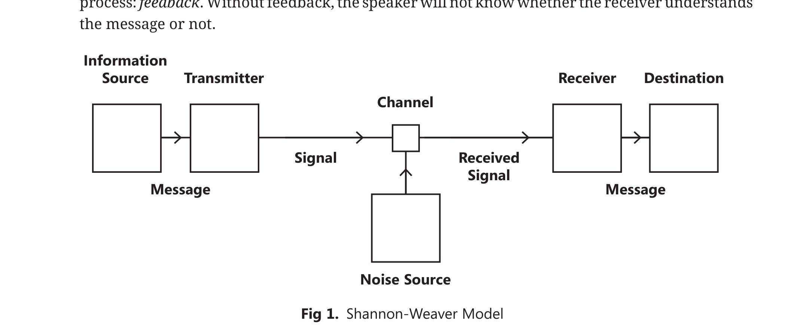
*Figure 1.5: The Shannon-Weaver Linear Model depicting signal transmission from source to destination across a noisy channel (Sipacio & Balgos, 2016, Fig. 1).*

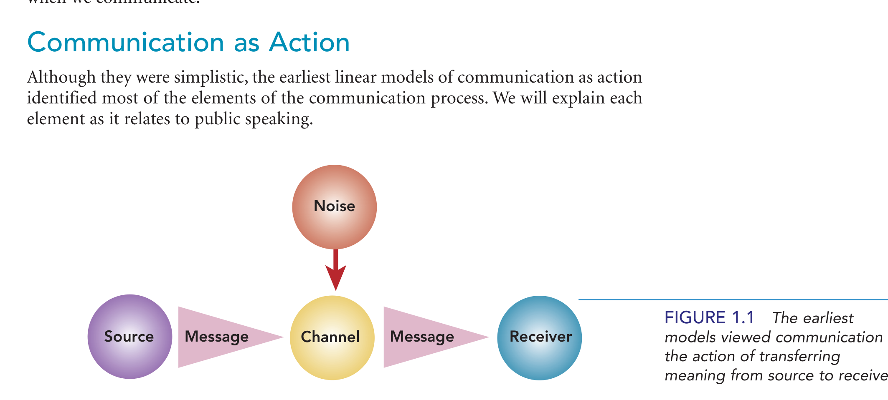
*Figure 1.6: Communication as Action (Beebe & Beebe, 2017, Figure 1.1). Earliest models viewed communication as a linear transfer of meaning from source to receiver.*

---

### 6.2 Interactive Models (Communication as Interaction / Circular)

```
                 ┌──────────────────────────────────────────────┐
                 │             Field of Experience              │
                 │                                              │
                 ▼                                              │
          ┌─────────────┐       Message / Signal       ┌────────┴────┐
          │   Sender    ├─────────────────────────────►│  Receiver   │
          │  (Encoder)  │                              │  (Decoder)  │
          │             │◄─────────────────────────────┤             │
          └─────────────┘           Feedback           └─────────────┘
```

#### Wilbur Schramm’s Interactive Model (1954)
Schramm revolutionized communication theory by introducing two essential elements missing from linear paradigms:
1. **Feedback**: Communication is circular rather than linear. Receivers continuously send responses back to the sender, allowing the sender to adjust the message.
2. **Field of Experience**: The sum of an individual’s cultural background, personal history, language proficiencies, beliefs, education, and values.
   * Communication succeeds only where the **fields of experience of the sender and receiver overlap**.
   * If there is little or no shared field of experience (e.g., two people speaking completely different languages or possessing divergent cultural assumptions), communication breakdown occurs.

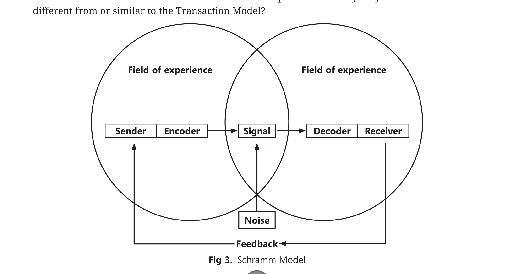
*Figure 1.7: Wilbur Schramm’s Interactive Model emphasizing overlapping fields of experience and circular feedback (Sipacio & Balgos, 2016, Fig. 3).*

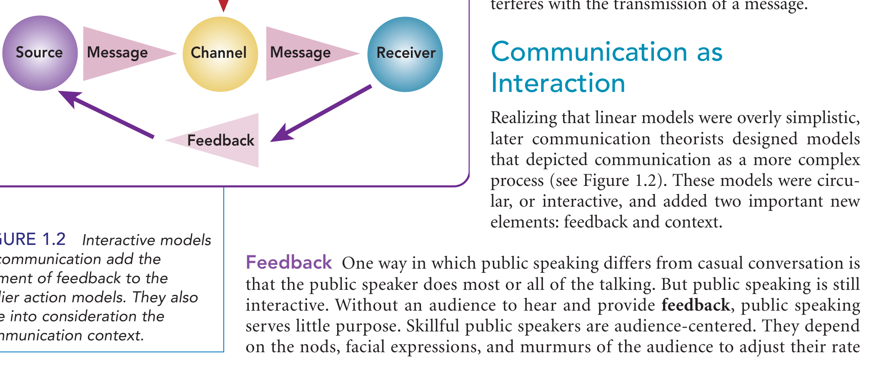
*Figure 1.8: Communication as Interaction (Beebe & Beebe, 2017, Figure 1.2). Adding feedback and situational context establishes an interactive exchange.*

---

### 6.3 Transactional Models (Communication as Transaction / Simultaneous & Dynamic)

```
        Communicator A                                     Communicator B
 ┌───────────────────────────┐                     ┌───────────────────────────┐
 │   Simultaneously Sends    │  Shared Meanings &  │   Simultaneously Sends    │
 │   and Receives Messages   │◄───────────────────►│   and Receives Messages   │
 │   (Transceiver)           │      Feedback       │   (Transceiver)           │
 └─────────────┬─────────────┘                     └─────────────┬─────────────┘
               │                                                 │
               └───────────── Continuous Co-Creation ────────────┘
                             Within Shared Context
```

#### Barnlund (1970), Wood (2012), & Verderber et al. (2017)
The transactional model is the most comprehensive contemporary representation of communication:
* **Simultaneous Transceiving**: Communicators do not take strict alternating turns as separate "senders" and "receivers." Instead, they act as **simultaneous senders and receivers** (transceivers). While you are speaking, you are concurrently receiving and decoding the listener's eye contact, posture, and facial micro-expressions.
* **Co-Creation of Meaning**: Meaning is not a pre-packaged parcel passed from one head to another. It is negotiated, constructed, and shared dynamically between participants within a mutual environment.
* **Irreversible & Ever-Changing**: Transactional communication acknowledges that the relationship between participants changes continuously as a result of each interaction.

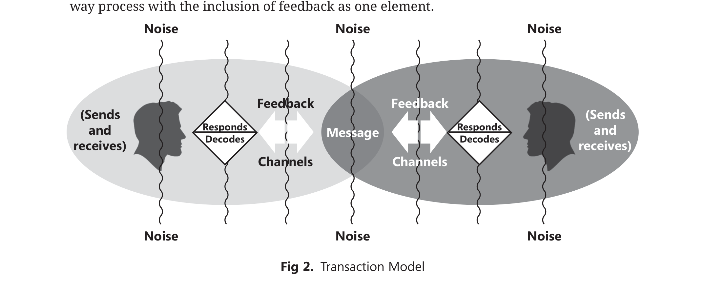
*Figure 1.9: Transactional Model of Communication featuring simultaneous encoding and decoding in an interactive context (Sipacio & Balgos, 2016, Fig. 2).*

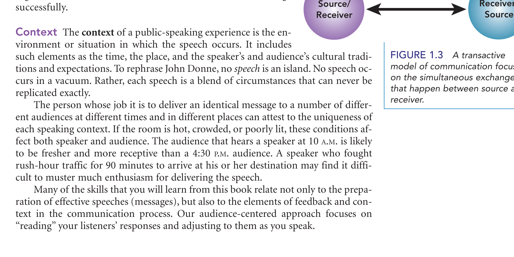
*Figure 1.10: Communication as Transaction (Beebe & Beebe, 2017, Figure 1.3). Senders and receivers act simultaneously as transceivers within shared physical and psychological contexts.*

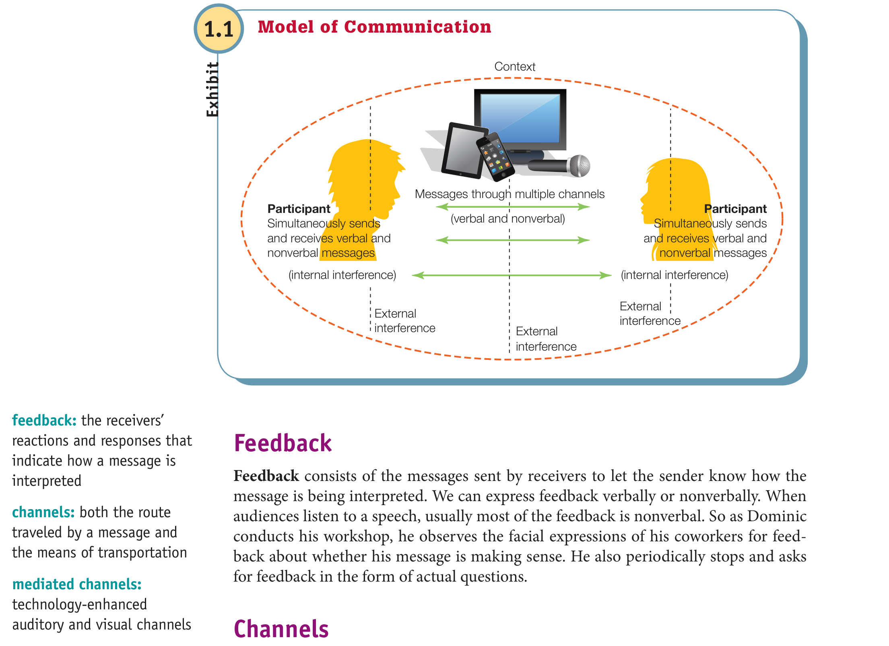
*Figure 1.11: Comprehensive Transactional Communication Model (Verderber, Sellnow, & Verderber, 2017, Exhibit 1.1). Illustrates participants, messages, continuous feedback channels, noise interference, and multilayered contexts (physical, social, historical, psychological, cultural).*

---

### 6.4 Comparative Synthesis of Communication Models

| Feature | Linear Models (Shannon-Weaver, Lasswell) | Interactive Models (Schramm) | Transactional Models (Barnlund, Wood, Verderber) |
| :--- | :--- | :--- | :--- |
| **Directionality** | One-way (linear, unidirectional). | Two-way (alternating, circular). | Multidirectional (simultaneous, concurrent). |
| **Participant Roles** | Distinct sender and receiver roles. | Alternating sender and receiver roles. | Simultaneous transceivers (co-communicators). |
| **Feedback** | Absent or ignored. | Present, but viewed as delayed/turn-based. | Immediate, continuous, verbal and nonverbal. |
| **Field of Experience** | Not addressed. | Explicitly highlighted as overlapping zones. | Integrated within shared sociocultural systems. |
| **Nature of Meaning** | Transmitted package from sender to receiver. | Reconstructed message shaped by shared knowledge. | Dynamically negotiated and co-created in context. |
| **Noise Inclusion** | Primarily physical/channel noise. | Physical and semantic noise. | Physical, physiological, psychological, semantic. |

---

## 7. Evaluating Communication Processes & Overcoming Breakdowns

### 7.1 The Seven Cs of Effective Communication
In *Effective Public Relations*, Professors Cutlip, Center, and Broom (2012) established the widely adopted **7 Cs of Effective Communication**:

1. **Completeness**: The communication must include all essential facts, explanations, and context necessary for the recipient to evaluate and respond appropriately.
2. **Conciseness**: The message must be direct and straight to the point, eliminating redundant phrasing and filler expressions without sacrificing clarity.
3. **Consideration**: The speaker adapts the message to the audience's background, educational level, mindset, and cultural expectations, building rapport.
4. **Concreteness**: The message is backed by specific facts, clear figures, and tangible real-world examples rather than vague generalities.
5. **Courtesy**: The speaker shows genuine respect for the listeners' culture, values, and perspectives, cultivating positive goodwill.
6. **Clearness**: The speaker uses plain, precise language and maintains focus on a defined primary objective to prevent confusion.
7. **Correctness**: The message demonstrates accuracy in facts, assertions, grammar, and pronunciation, bolstering speaker credibility.

### 7.2 Barriers to Communication and Strategic Solutions

```
┌───────────────────────┬──────────────────────────────────┬───────────────────────────────────────┐
│ Barrier Category      │ Concrete Manifestation           │ Practical Strategic Solution          │
├───────────────────────┼──────────────────────────────────┼───────────────────────────────────────┤
│ Emotional Barriers    │ Experiencing extreme stress,     │ Pause, practice emotional regulation, │
│                       │ anger, or frustration.           │ or postpone dialogue until calm.      │
├───────────────────────┼──────────────────────────────────┼───────────────────────────────────────┤
│ Use of Jargon         │ Using specialized terminology    │ Adapt vocabulary to layman's terms;   │
│                       │ unknown to general listeners.    │ define technical concepts clearly.    │
├───────────────────────┼──────────────────────────────────┼───────────────────────────────────────┤
│ Lack of Confidence    │ Shyness, stage fright, or        │ Prepare thoroughly, rehearse delivery,│
│                       │ communication apprehension.      │ and focus on audience engagement.     │
├───────────────────────┼──────────────────────────────────┼───────────────────────────────────────┤
│ Environmental Noise   │ Loud machinery, poor acoustics,  │ Relocate to a quieter area, use       │
│                       │ or technological audio lag.      │ audio amplification, or adjust volume.│
└───────────────────────┴──────────────────────────────────┴───────────────────────────────────────┘
```

---

## Formative Review & Self-Evaluation

To ensure mastery of Lesson 1 concepts, review and respond to the following evaluation prompts:

1. **Model Differentiation**: Compare the Shannon-Weaver Model with the Transactional Model. How does the inclusion of simultaneous feedback transform our understanding of the communicator's role?
2. **Role of Feedback**: In a public presentation, identify three specific nonverbal cues an audience might display and describe how an ethical, audience-centered speaker should adapt to each.
3. **Application Scenario**: A software developer is presenting a new application interface to a non-technical marketing client. Identify two potential communication barriers (e.g., semantic noise, divergent fields of experience) and formulate concrete strategies to achieve shared meaning.
4. **Ethical Evaluation**: How does the National Communication Association (NCA) Credo guide your responsibility as a listener when an oral presenter expresses views that contradict your personal beliefs?
