# Modyul 1: Mga Konseptong Pangwika

### Asignatura: Komunikasyon at Pananaliksik sa Wika at Kulturang Pilipino (KOMUPIL)

**Baitang 11 / Senior High School Core Subject | Gabay sa Pag-aaral (Linggo 1–3)**

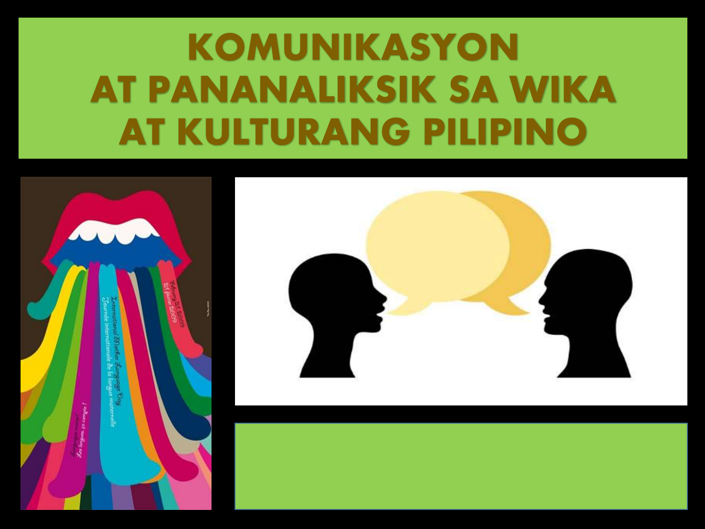

*Pigura 1: Pabalat ng Modyul sa Komunikasyon at Pananaliksik sa Wika at Kulturang Pilipino.*

---

## Talaan ng Nilalaman

1. [Pambungad at mga Kasanayang Pampagkatuto](#pambungad-at-mga-kasanayang-pampagkatuto)

2. [Aralin 1: Kahulugan at Katangian ng Wika](#aralin-1-kahulugan-at-katangian-ng-wika)

   - [1.1 Etimolohiya at Kalikasan ng Wika](#11-etimolohiya-at-kalikasan-ng-wika)

   - [1.2 Mga Pakahulugan mula sa mga Dalubwika](#12-mga-pakahulugan-mula-sa-mga-dalubwika)

   - [1.3 Siyam (9) na Pangunahing Katangian ng Wika](#13-siyam-9-na-pangunahing-katangian-ng-wika)

   - [1.4 Kahalagahan ng Wika sa Lipunan](#14-kahalagahan-ng-wika-sa-lipunan)

3. [Aralin 2: Kasaysayan at Pag-unlad ng Wikang Pambansa](#aralin-2-kasaysayan-at-pag-unlad-ng-wikang-pambansa)

   - [2.1 Kronolohikal na Yugto ng Wikang Pambansa](#21-kronolohikal-na-yugto-ng-wikang-pambansa)

   - [2.2 Talahanayan ng mga Batas, Kautusan, at Proklamasyon](#22-talahanayan-ng-mga-batas-kautusan-at-proklamasyon)

   - [2.3 Pagsusuri sa Video: *Kasaysayan ng Wikang Pambansa* ni Dr. Bienvenido Lumbera](#23-pagsusuri-sa-video-kasaysayan-ng-wikang-pambansa-ni-dr-bienvenido-lumbera)

4. [Aralin 3: Baryasyon at Barayti ng Wika](#aralin-3-baryasyon-at-barayti-ng-wika)

   - [3.1 Homogeneous at Heterogeneous na Wika](#31-homogeneous-at-heterogeneous-na-wika)

   - [3.2 Linggwistikong Komunidad (Speech Community)](#32-linggwistikong-komunidad-speech-community)

   - [3.3 Unang Wika (L1) at Ikalawang Wika (L2)](#33-unang-wika-l1-at-ikalawang-wika-l2)

   - [3.4 Pitong (7) Barayti ng Wika](#34-pitong-7-barayti-ng-wika)

   - [3.5 Register ng Wika at mga Antas Nito](#35-register-ng-wika-at-mga-antas-nito)

5. [Aralin 4: Mga Isyu at Sitwasyong Pangwika sa Lipunang Pilipino](#aralin-4-mga-isyu-at-sitwasyong-pangwika-sa-lipunang-pilipino)

   - [4.1 Wikang Pambansa, Wikang Opisyal, at Wikang Panturo](#41-wikang-pambansa-wikang-opisyal-at-wikang-panturo)

   - [4.2 Monolingguwalismo, Bilingguwalismo, at Multilingguwalismo (MTB-MLE)](#42-monolingguwalismo-bilingguwalismo-at-multilingguwalismo-mtb-mle)

   - [4.3 Gahum ng Wikang Ingles at Pagsusuri sa *Speak in English Zone* ni Joel Malabanan](#43-gahum-ng-wikang-ingles-at-pagsusuri-sa-speak-in-english-zone-ni-joel-malabanan)

   - [4.4 Pakikibaka ng Tanggol Wika: CMO Blg. 20, Serye 2013 at Intelektwalisasyon](#44-pakikibaka-ng-tanggol-wika-cmo-blg-20-serye-2013-at-intelektwalisasyon)

   - [4.5 Sitwasyong Pangwika sa Kasalukuyang Lipunang Pilipino](#45-sitwasyong-pangwika-sa-kasalukuyang-lipunang-pilipino)

6. [Talasalitaan / Glosaryo ng mga Konseptong Pangwika](#talasalitaan--glosaryo-ng-mga-konseptong-pangwika)

7. [Mga Tanong sa Pagbabalik-Aral at Pagsusuri](#mga-tanong-sa-pagbabalik-aral-at-pagsusuri)

8. [Pagsasanay at Pagsusulit na may Susi sa Pagwawasto](#pagsasanay-at-pagsusulit-na-may-susi-sa-pagwawasto)

9. [Talaan ng mga Pinagkunang Sanggunian](#talaan-ng-mga-pinagkunang-sanggunian)

---

## Pambungad at mga Kasanayang Pampagkatuto

Ang modyul na ito ay inihanda para sa asignaturang **Komunikasyon at Pananaliksik sa Wika at Kulturang Pilipino (KOMUPIL)** sa Senior High School. Saklaw nito ang **Modyul 1: Mga Konseptong Pangwika** na nakalaan para sa **Linggo 1 hanggang 3** ayon sa Kurikulum ng Kagawaran ng Edukasyon (DepEd) at sa opisyal na Topic Guide ng kurso.

```

┌────────────────────────────────────────────────────────────────────────────────────────┐

│             MODYUL 1: MGA KONSEPTONG PANGWIKA SA WIKANG FILIPINO (LINGGO 1–3)          │

├──────────────────────────┬──────────────────────────┬──────────────────────────────────┤

│ ARALIN 1: Kahulugan at   │ ARALIN 2: Pag-unlad ng   │ ARALIN 3: Baryasyon at Barayti   │

│ Katangian ng Wika        │ Wikang Pambansa          │ • Homogeneous vs. Heterogeneous  │

│ • Gleason, Sapir, Hill   │ • Panahon ng Katutubo    │ • Linggwistikong Komunidad       │

│ • Masistemang Balangkas  │   hanggang Saligang      │ • Unang Wika (L1) at L2          │

│ • Arbitraryo at Kultura  │   Batas ng 1987          │ • Dayalek, Sosyolek, Idyolek     │

│ • Dinamiko at Politika   │ • Pagsusuri kay Lumbera  │ • Register (Field, Tenor, Mode)  │

├──────────────────────────┴──────────────────────────┴──────────────────────────────────┤

│ ARALIN 4: Mga Isyu at Sitwasyong Pangwika sa Lipunang Pilipino                         │

│ • Pambansa vs. Opisyal vs. Panturo (Art. XIV, Sek. 6–9)                                │

│ • Bilingguwalismo (BEP) at Multilingguwalismo (MTB-MLE sa ilalim ng RA 10533)          │

│ • Gahum ng Ingles at Pagsusuri sa Awit na "Speak in English Zone" (Joel Malabanan)     │

│ • Pagtatanggol sa Wikang Filipino: CMO Blg. 20, s. 2013 at Tanggol Wika (San Juan)    │

└────────────────────────────────────────────────────────────────────────────────────────┘

```

### Mga Pamantayang Pangnilalaman at Pagganap

* **Pamantayang Pangnilalaman**: Nauunawaan ang mga konsepto, elementong kultural, kasaysayan, at gamit ng wika sa lipunang Pilipino.

* **Pamantayan sa Pagganap**: Nakagagawa ng isang sanaysay o pananaliksik na nagpapakita ng pagsusuri sa sitwasyong pangwika sa isang tiyak na pamayanan o larangan.

### Mga Kasanayang Pampagkatuto (Learning Competencies)

1. **Natutukoy ang mga kahulugan at kabuluhan ng mga konseptong pangwika** (F11PT – Ia – 85).

2. **Naiuugnay ang mga konseptong pangwika sa mga napakinggan/napanood na sitwasyong pangkomunikasyon** sa radyo, telebisyon, at social media (F11PN – Ia – 86).

3. **Nagagamit ang kaalaman sa modernong teknolohiya sa pag-unawa sa mga konseptong pangwika** (F11EP – Ic – 30).

4. **Naipapaliwanag nang pasalita at pasulat ang kasaysayan at pag-unlad ng Wikang Pambansa** (F11PS – Ib – 86).

5. **Naiisa-isa ang mga barayti ng wika at naipaliliwanag ang pagkakaiba ng homogeneous at heterogeneous na wika** (F11PB – Ic – 87).

6. **Nakasusulat ng paninindigan hinggil sa mga kontemporaryong isyung pangwika** sa edukasyon at lipunan.

---

## Aralin 1: Kahulugan at Katangian ng Wika

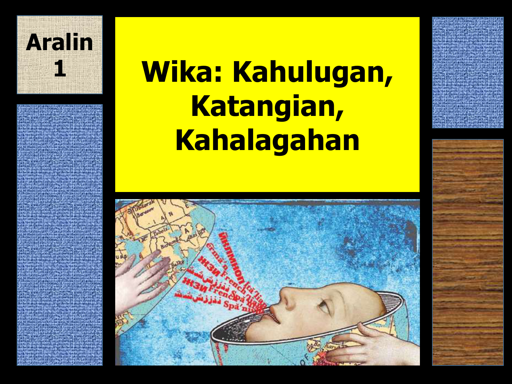

*Pigura 2: Aralin 1 — Pangkalahatang Balangkas ng Wika: Kahulugan, Katangian, at Kahalagahan.*

### 1.1 Etimolohiya at Kalikasan ng Wika

Ang salitang **wika** sa Pilipinas ay pinaniniwalaang nag-ugat sa salitang Malay na *ujap* at sa salitang Sanskrit na **vicara**, na nangangahulugang *"pag-iisip, pagmumuni, pagsasalita, o pagpapahayag ng ideya."*

Sa mga kanluraning wika, ang katumbas nitong salita sa Ingles na **language** ay nagmula sa Lumang Pranses na *langage*, na hinango naman sa salitang Latin na **lingua**, na ang literal na kahulugan ay **"dila"** o **"lengguwahe."** 

Bakit iniugnay ang wika sa dila? Ang dila ay ang pinakamahalagang organo sa loob ng bibig ng tao na gumagalaw at pumiporma upang makalikha ng iba't ibang artikulado at makabuluhang tunog. Dahil dito, sa maraming wika sa daigdig, ang salitang "dila" ay ginagamit ding kasingkahulugan ng wika (halimbawa: *katutubong dila* o *mother tongue*).

```

                          ┌──────────────────────────┐

                          │           WIKA           │

                          │   (Latin: Lingua / Dila) │

                          └─────────────┬────────────┘

         ┌──────────────────────────────┼──────────────────────────────┐

         ▼                              ▼                              ▼

     Biyolohikal /                  Kognitibo /                   Kultural at

      Artikulador                   Sikolohikal                    Panlipunan

Nalilikha sa pamamagitan ng    Nagsisilbing imbakan at        Nagbubuklod sa mga tao sa

artikulasyon ng dila, baga,    daluyan ng mga ideya,          isang pamayanan; salamin ng

at babagtingang tinig.         damdamin, at mithiin ng tao.   kultura at pambansang diwa.

```

Sa pangkalahatan, ang wika ay:

> Isang masistemang kalipunan ng mga tunog, sagisag, at panuntunang pinagkasunduan ng isang pangkat ng mga tao upang maipahayag ang kanilang iniisip, nadarama, karanasan, at mga mithiin sa buhay.

---

### 1.2 Mga Pakahulugan mula sa mga Dalubwika

Iba't iba ang pagpapakahulugan ng mga dalubhasa sa wika batay sa kanilang disiplina (linggwistika, antropolohiya, at sosyolohiya):

#### 1. Henry Allan Gleason Jr. (1961)

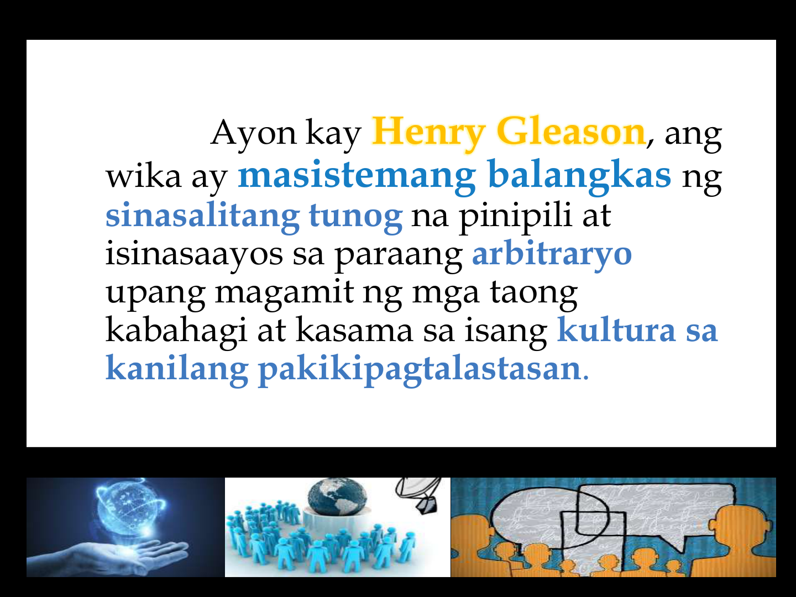

*Pigura 3: Klasikong Depinisyon ng Wika ayon kay Propesor Henry Allan Gleason Jr. (1961) — Masistemang balangkas ng sinasalitang tunog na pinipili at isinasaayos sa paraang arbitraryo.*

Ang depinisyon ni Henry Gleason ang pinakatanyag at pinakapundamental na batayan sa pag-aaral ng wika sa Pilipinas:

> *"Ang wika ay masistemang balangkas ng sinasalitang tunog na pinipili at isinasaayos sa paraang arbitraryo upang magamit ng mga taong kabahagi at kasama sa isang kultura sa kanilang pakikipagtalastasan."*

Hinihimay sa depinisyong ito ang limang pangunahing sangkap:

1. **Masistemang Balangkas**: May siyentipiko at lohikal na kaayusan ang wika mula tunog hanggang diskurso.

2. **Sinasalitang Tunog**: Nagmumula sa aparatong pambigkas ng tao.

3. **Pinipili at Isinasaayos**: May sadyang proseso ng pagpili ng salita upang maging epektibo ang mensahe.

4. **Arbitraryo**: Napagkasunduan ng komunidad at walang likas na koneksyon ang salita sa tinutukoy nito.

5. **Kultura**: Hindi maihihiwalay ang wika sa pamumuhay at paniniwala ng mga taong gumagamit nito.

#### 2. Archibald A. Hill (1958)

> *"Ang wika ang pangunahin at pinakatiyak na anyo ng simbolikong gawaing pantao."*

Binibigyang-diin ni Hill na ang wika ang pinakamataas na uri ng gawaing simboliko. Tanging tao lamang ang may kakayahang lumikha ng masalimuot na sistema ng mga simbolo na may kahulugan kahit wala sa harap ang aktuwal na bagay (*displacement*).

#### 3. Edward Sapir (1921)

> *"Ang wika ay isang likas at makataong pamamaraan ng paghahatid ng mga kaisipan, damdamin, at mithiin sa pamamagitan ng kusang-loob na paglikha ng mga sagisag."*

Para kay Sapir, ang wika ay hindi instinktibo o biyolohikal tulad ng paghinga o pagkalam ng sikmura; ito ay natututuhan ng tao sa loob ng isang lipunan sa pamamagitan ng kultura.

#### 4. John B. Carroll (1964)

> *"Ang wika ay isang sistema ng mga sagisag na binubuo at tinatanggap ng lipunan, na bunga ng unti-unting paglinang sa loob ng maraming dantaon."*

Ipinapaliwanag ni Carroll na ang wika ay panlipunang institusyon na nagbabago at pinatitibay ng kasaysayan at kolektibong kasunduan ng mga mamamayan.

#### 5. Loreto Todd (1987)

> *"Ang wika ay isang set o kabuuan ng mga sagisag na ginagamit sa komunikasyon. Ang mga tunog at sagisag na ito ay arbitraryo at sistematiko. Dahil dito, walang dalawang wikang magkapareho, bagamat bawat isa ay may sariling set ng mga tuntunin."*

#### 6. Joseph Bram (1955)

> *"Ang wika ay nakabalangkas na sistema ng mga arbitraryong simbolo at tunog na binibigkas, at sa pamamagitan nito’y nagkakaroon ng interaksyon ang isang pangkat ng tao."*

#### 7. Consuelo J. Paz, Vivencio R. Jose, at Arnold M. Azurin (2003)

> *"Ang wika ay tulay sa pagitan ng mga tao, salamin ng kanilang kamalayan, at bukal ng kanilang pambansang kaluluwa."*

---

### 1.3 Siyam (9) na Pangunahing Katangian ng Wika

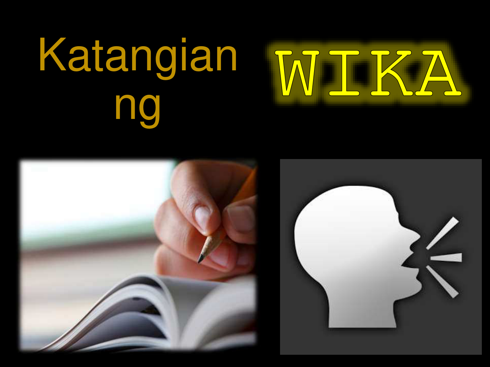

*Pigura 4: Dayagram ng Masistemang Balangkas ng Wika mula sa Tunog (Ponolohiya) patungong Salita (Morpolohiya) at Pangungusap (Sintaksis).*

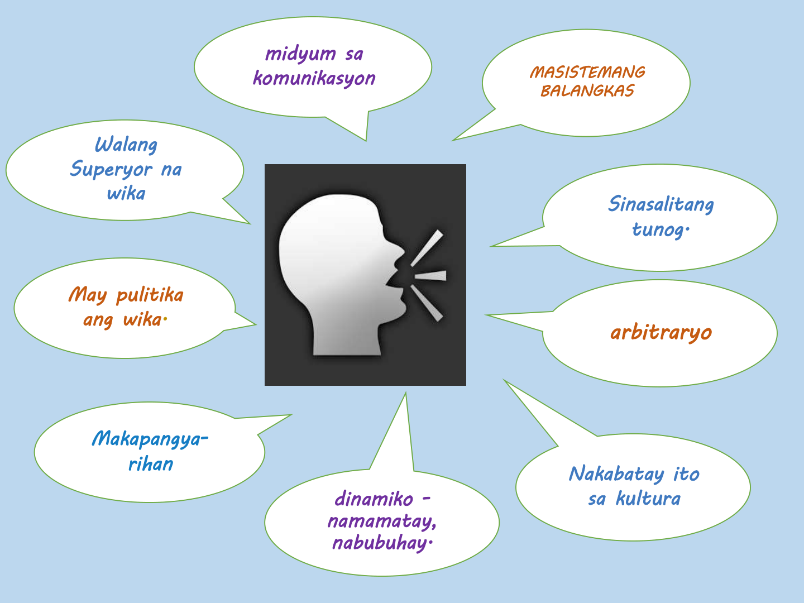

*Pigura 5: Buod ng mga Pangunahing Katangian ng Wika (Sinasalitang Tunog, Arbitraryo, Nakabatay sa Kultura, at Dinamiko).*

Batay sa mga aralin sa *KOMUPIL Modyul (pahina 19–20)* at pagsusuri nina Paz et al. (2003), ang wika ay nagtataglay ng siyam na katangian:

```

┌────────────────────────────────────────────────────────────────────────────────────────┐

│                        SIYAM (9) NA KATANGIAN NG WIKA                                  │

├──────────────────────────┬──────────────────────────┬──────────────────────────────────┤

│ 1. Masistemang Balangkas │ 2. Sinasalitang Tunog    │ 3. Pinipili at Isinasaayos       │

│ (May antas: ponema ──►   │ (Nalilikha ng vocal      │ (Iniaangkop sa kausap, layunin,  │

│  morpema ──► sintaks)    │  apparatus ng tao)       │  at sitwasyon)                   │

├──────────────────────────┼──────────────────────────┼──────────────────────────────────┤

│ 4. Arbitraryo            │ 5. Ginagamit at Buhay    │ 6. Nakabatay sa Kultura          │

│ (Pinagkasunduan ng       │ (Namamatay kapag hindi   │ (Magkabuhol ang wika at kultura; │

│  linggwistikong grupo)   │  na sinasalita)          │  kambal na entidad)              │

├──────────────────────────┼──────────────────────────┼──────────────────────────────────┤

│ 7. Dinamiko at Nagbabago │ 8. Makapangyarihan at    │ 9. Walang Superyor na Wika       │

│ (Patuloy na lumalago,    │    May Pulitika          │ (Lahat ng wika ay may sariling   │

│  humihiram, at nag-iiba) │ (May ideolohiya at gahum)│  kakayahan at gramatika)         │

└──────────────────────────┴──────────────────────────┴──────────────────────────────────┘

```

#### 1. Ang Wika ay Masistemang Balangkas

Ang bawat wika sa daigdig ay may sinusunod na tiyak at lohikal na kaayusan. Walang wika ang nabuo nang basta-basta lamang. Binubuo ito ng dalawang magkatambal na balangkas:

$$\text{Tunog (Ponolohiya)} \longrightarrow \text{Salita (Morpolohiya)} \longrightarrow \text{Pangungusap (Sintaksis)} \longrightarrow \text{Mensahe (Diskurso)}$$

* **Ponolohiya**: Pag-aaral ng makabuluhang tunog (**ponema**). Sa wikang Filipino, mayroong **21 ponema** (16 na katinig: /p, t, k, ʔ, b, d, g, m, n, ŋ, s, h, l, r, w, y/ at 5 patinig: /a, e, i, o, u/).

* **Morpolohiya**: Pag-aaral ng pagbuo ng salita mula sa pinakamaliit na yunit ng kahulugan (**morpema**), tulad ng salitang-ugat, panlapi, at pag-uulit.

* **Sintaksis**: Pag-aaral ng estruktura ng mga pangungusap. Sa Filipino, malaya at mabisa ang paggamit ng:

  * *Karaniwang Ayos* (Panaguri muna bago Paksa): *"Nagluto si Inay ng sinigang."* (Likas at karaniwang gamit)

  * *Di-Karaniwang Ayos* (Paksa muna bago Panaguri na may panandang *ay*): *"Si Inay ay nagluto ng sinigang."*

* **Semantika at Diskurso**: Pagbibigay ng kahulugan sa mga salita batay sa konteksto at ang pagkakaugnay-ugnay ng mga pangungusap upang makabuo ng makabuluhang pahayag.

#### 2. Ang Wika ay Sinasalitang Tunog

Ang wika ay nagsisimula sa tunog na nalilikha ng ating vocal apparatus. Ang hangin na nanggagaling sa baga ay dumaraan sa pumapalag na babagtingang tinig (vocal cords) sa babagtingan (larynx), at hinuhubog ng mga artikulador (dila, ngipin, labi, ngalangala) at resonador (guwang ng bibig at ilong). Hindi lahat ng tunog ay wika; ang mga tunog lamang na may kahulugan at ginagamit sa pakikipagtalastasan ang itinuturing na wika.

#### 3. Ang Wika ay Pinipili at Isinasaayos

Upang maunawaan tayo ng ating kapwa, maingat nating pinipili ang mga salita at paraan ng pagpapahayag batay sa ating kausap, okasyon, at pook. Halimbawa, magkaiba ang paraan ng pakikipag-usap ng isang mag-aaral sa kanyang guro kumpara sa kanyang kaibigan o kabarkada:

* Sa guro: *"Magandang umaga po, maaari po bang magtanong hinggil sa takdang-aralin?"*

* Sa kabarkada: *"Uy, 'tol, ano nga ulit 'yung assignment natin?"*

#### 4. Ang Wika ay Arbitraryo

Ang salitang arbitraryo ay nangangahulugang walang likas o direktang kaugnayan ang tunog ng salita sa bagay na kinakatawan nito. Ang tawag sa isang bagay ay napagkasunduan lamang ng mga taong nabibilang sa isang linggwistikong komunidad. 

Halimbawa, ang hayop na tumatahol ay tinatawag na:

* **Aso** sa Tagalog

* **Ayam** sa Bikolano

* **Iro** sa Cebuano at Hiligaynon

* **Asu** sa Kapampangan at Pangasinense

* **Dog** sa Ingles

* **Perro** sa Espanyol

* **Inu** sa Japanese

Walang sinuman ang makapagsasabi kung bakit "aso" ang itinawag ng mga Tagalog kundi dahil iyon ang napagkasunduan sa kanilang kultura.

#### 5. Ang Wika ay Ginagamit at Buhay

Ang wika ay kasangkapan sa komunikasyon. Upang manatiling buhay, kailangan itong gamitin sa tahanan, paaralan, pamahalaan, palengke, at lansangan. Kapag ang isang wika ay hindi na ginagamit at wala nang katutubong tagapagsalita, ito ay unti-unting namamatay at nagiging **patay na wika (dead language)**, tulad ng wikang Latin at Sinaunang Griyego.

#### 6. Ang Wika ay Nakabatay sa Kultura

Hindi maaaring paghiwalayin ang wika at kultura. Sinasalamin ng wika ang kapaligiran, kabuhayan, paniniwala, at kaugalian ng mga taong gumagamit nito. 

Isang malinaw na patunay nito sa kulturang Pilipino ay ang mayamang bokabularyo natin para sa butil ng bigas at palay:

```

┌────────────────────────────────────────────────────────────────────────────────────────┐

│            PAGPAPAKITA NG KULTURA SA WIKA: ANG BOKABULARYO NG BIGAS                    │

├─────────────────────┬──────────────────┬───────────────────────────────────────────────┤

│ Anyo / Yugto        │ Salitang Filipino│ Katumbas sa Ingles (Walang Tiyak na Pagkakaiba)│

├─────────────────────┼──────────────────┼───────────────────────────────────────────────┤

│ Halaman sa bukid    │ Palay            │ Rice / Unhusked rice                          │

│ Nabayong butil      │ Bigas            │ Rice / Milled rice                            │

│ Naisaing na         │ Kanin            │ Rice / Cooked rice                            │

│ Malamig na tirang   │ Bahaw            │ Cold leftover rice                            │

│ Sangag na may bawang│ Sinangag         │ Fried rice                                    │

│ Dumikit sa puwit ng │ Tutong           │ Burnt rice / Scorched rice                    │

│ Malabnaw na lugaw   │ Lugaw / Am       │ Rice porridge / Rice broth                    │

│ Matamis na kakanin  │ Puto / Kakanin   │ Rice cake                                     │

└─────────────────────┴──────────────────┴───────────────────────────────────────────────┘

```

Sa wikang Ingles, iisang salitang *"rice"* lamang ang ginagamit dahil hindi palay ang pangunahing sentro ng kanilang agrikultura at pagkain sa kasaysayan. Sa Pilipinas, bawat yugto ng palay ay may tiyak na katawagan dahil ito ang pundasyon ng ating buhay at lipunan.

#### 7. Ang Wika ay Dinamiko at Patuloy na Nagbabago

Ang wika ay patuloy na nagbabago kasabay ng paglipas ng panahon, pag-unlad ng teknolohiya, at pagbabago ng lipunan. Lumilikha tayo ng mga bagong salita (neolohismo) at nanghihiram sa ibang wika:

* **Mga Bagong Salita**: *Marites* (tsismosa), *Lodi* (idol), *Petmalu* (malupit), *Werpa* (power), *Awit* (awts + sakit).

* **Teknolohiya at Social Media**: *I-google, mag-vlog, i-share, mag-selfie, i-unfriend*.

* **Mga Salitang Nagbabago ang Kahulugan**: Ang salitang *"salumpuwit"* at *"salipawpaw"* ay naging luma at napalitan ng *upuan/silya* at *eroplano*.

#### 8. Ang Wika ay Makapangyarihan at May Pulitika

Ang wika ay hindi neutral. Ito ay ginagamit upang magpakilos, mang-akit, magturo, at pamunuan ang isang bansa. May kakayahan ang wika na magtakda ng kapangyarihan (gahum o *hegemony*). Ang wikang ginagamit sa korte, kongreso, at mga aklat-aralin ang nagdidikta kung sinong uri sa lipunan ang may hawak ng kapangyarihan.

#### 9. Walang Superyor o Mababang Wika

Ayon sa makaagham na pag-aaral ng linggwistika, **lahat ng wika ay pantay-pantay**. Walang wikang mas magaling, mas sibilisado, o mas mahusay kaysa sa iba. Ang Ingles ay hindi mas mataas kaysa sa Filipino; ang Tagalog ay hindi mas mataas kaysa sa Cebuano, Ilokano, o Waray. Bawat wika ay may sapat na kakayahan at estruktura upang ipahayag ang kaisipan at kultura ng mga taong gumagamit nito.

---

### 1.4 Kahalagahan ng Wika sa Lipunan

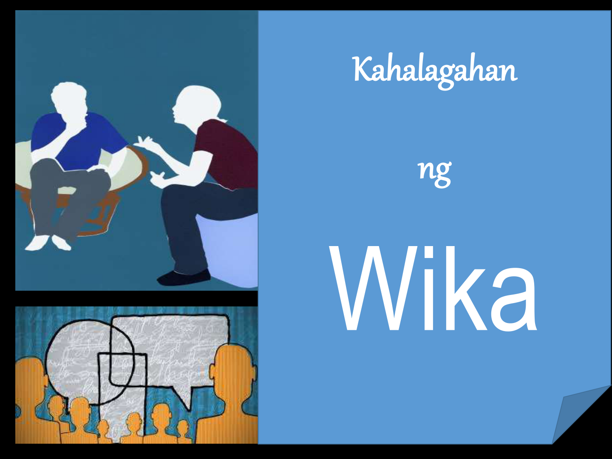

*Pigura 6: Ang Kahalagahan at Tungkulin ng Wika sa Ugnayang Pantao, Pagkakaunawaan, at Pambansang Pagkakakilanlan.*

Ayon sa *KOMUPIL Modyul (pahina 21–25)*, ang wika ay may apat na pangunahing gampanin sa lipunan:

1. **Instrumento sa Komunikasyon**: Paraan upang magkaunawaan, makapagpalitan ng kaisipan, at maisakatuparan ang pang-araw-araw na gawain.

2. **Sagisag ng Pambansang Pagkakakilanlan**: Ang wikang pambansa ang nagbubuklod sa damdamin at diwa ng mga mamamayang Pilipino.

3. **Imbakan at Tagapagpadaloy ng Kultura at Karunungan**: Dito nakatala ang ating kasaysayan, panitikan, mga kuwentong-bayan, at katutubong kaalaman.

4. **Salamin ng Lipunan at Kamalayan**: Inilalarawan ng wika ang tunay na kalagayang panlipunan, pang-ekonomiya, at pampulitika ng bansa.

---

## Aralin 2: Kasaysayan at Pag-unlad ng Wikang Pambansa

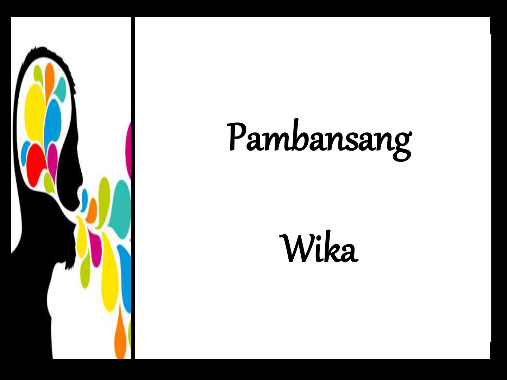

*Pigura 7: Aralin 2 — Pahapyaw na Kasaysayan at Masalimuot na Proseso ng Pagpili sa Wikang Pambansa ng Pilipinas.*

Ang pagkakaroon ng wikang pambansa sa Pilipinas ay bunga ng mahaba, masalimuot, at makasaysayang pakikibaka ng mga Pilipino para sa sariling identidad at kalayaan.

```

┌────────────────────────────────────────────────────────────────────────────────────────┐

│             KRONOLOHIKAL NA PAG-UNLAD NG WIKANG PAMBANSA NG PILIPINAS                  │

└──────────────────────────────────────────┬─────────────────────────────────────────────┘

                                           │

  ┌────────────────────────────────────────┴──────────────────────────────────────────┐

  │ 1. PANAHON NG KATUTUBO: Mga katutubong wikang Austronesian; pagsulat sa BAYBAYIN.  │

  └────────────────────────────────────────┬──────────────────────────────────────────┘

                                           │

  ┌────────────────────────────────────────┴──────────────────────────────────────────┐

  │ 2. PANAHON NG ESPANYOL (1565–1898): Praylokrasya; hindi itinuro ang Espanyol sa    │

  │    masa; Katipunan (1892) ginamit ang Tagalog sa rebolusyon.                       │

  └────────────────────────────────────────┬──────────────────────────────────────────┘

                                           │

  ┌────────────────────────────────────────┴──────────────────────────────────────────┐

  │ 3. SALIGANG BATAS NG BIAK-NA-BATO (1897): Tagalog ang opisyal na wika ng pamahalaan│

  └────────────────────────────────────────┬──────────────────────────────────────────┘

                                           │

  ┌────────────────────────────────────────┴──────────────────────────────────────────┐

  │ 4. PANAHON NG AMERIKANO (1898–1935): Batas Blg. 74 ipinataw ang Ingles bilang      │

  │    panturo; Thomasites; 1925 Monroe Survey nagpatunay ng kabiguan ng Ingles.       │

  └────────────────────────────────────────┬──────────────────────────────────────────┘

                                           │

  ┌────────────────────────────────────────┴──────────────────────────────────────────┐

  │ 5. SALIGANG BATAS NG 1935 (Art. XIV, Sek. 3): Pagbuo ng wikang pambansa batay sa  │

  │    isa sa mga katutubong wika sa Pilipinas.                                        │

  └────────────────────────────────────────┬──────────────────────────────────────────┘

                                           │

  ┌────────────────────────────────────────┴──────────────────────────────────────────┐

  │ 6. BATAS KOMONWELT BLG. 184 (1936): Pagtatatag ng Surian ng Wikang Pambansa (SWP) │

  │    sa pamumuno ni Jaime C. de Veyra (Waray).                                       │

  └────────────────────────────────────────┬──────────────────────────────────────────┘

                                           │

  ┌────────────────────────────────────────┴──────────────────────────────────────────┐

  │ 7. KAUTUSANG TAGAPAGPAGANAP BLG. 134 (1937): Iprinisenta ni Pang. Manuel L. Quezon│

  │    ang TAGALOG bilang batayan ng Wikang Pambansa ("Ama ng Wikang Pambansa").       │

  └────────────────────────────────────────┬──────────────────────────────────────────┘

                                           │

  ┌────────────────────────────────────────┴──────────────────────────────────────────┐

  │ 8. KAUTUSANG TAGAPAGPAGANAP BLG. 263 (1940): Pagtuturo ng Tagalog sa mga paaralan │

  │    at paglilimbag ng Balarila at Tagalog-English Vocabulary.                       │

  └────────────────────────────────────────┬──────────────────────────────────────────┘

                                           │

  ┌────────────────────────────────────────┴──────────────────────────────────────────┐

  │ 9. PANAHON NG HAPON (1942–1945): "Gintong Panahon"; Military Order No. 2 ginawang │

  │    opisyal na wika ang Tagalog at Nihongo; ipinagbawal ang Ingles.                 │

  └────────────────────────────────────────┬──────────────────────────────────────────┘

                                           │

  ┌────────────────────────────────────────┴──────────────────────────────────────────┐

  │ 10. BATAS KOMONWELT BLG. 570 (1946): Tagalog naging opisyal na wika ng Republika. │

  │     Proklama Blg. 186 itinakda ang Linggo ng Wika (Agosto 13–19).                  │

  └────────────────────────────────────────┬──────────────────────────────────────────┘

                                           │

  ┌────────────────────────────────────────┴──────────────────────────────────────────┐

  │ 11. KAUTUSANG PANGKAGAWARAN BLG. 7 (1959): Tinawag na "PILIPINO" ang wikang       │

  │     pambansa sa pamumuno ni Kalihim Jose E. Romero.                                │

  └────────────────────────────────────────┬──────────────────────────────────────────┘

                                           │

  ┌────────────────────────────────────────┴──────────────────────────────────────────┐

  │ 12. SALIGANG BATAS NG 1973 (Art. XV, Sek. 3): Pagbuo ng wikang tatawaging         │

  │     "FILIPINO"; ipinatupad ang Bilingual Education Policy (BEP 1974).              │

  └────────────────────────────────────────┬──────────────────────────────────────────┘

                                           │

  ┌────────────────────────────────────────┴──────────────────────────────────────────┐

  │ 13. SALIGANG BATAS NG 1987 (Art. XIV, Sek. 6–9): "Ang wikang pambansa ng Pilipinas│

  │     ay FILIPINO." RA 7104 itinatag ang Komisyon sa Wikang Filipino (KWF).          │

  └────────────────────────────────────────────────────────────────────────────────────┘

```

---

### 2.1 Kronolohikal na Yugto ng Wikang Pambansa

#### 1. Panahon ng Katutubo

Bago pa man dumating ang mga mananakop, mayaman na sa sariling wika at panitikan ang mga katutubo sa kapuluan. Ang mga wika sa Pilipinas ay kabilang sa malaking pamilya ng mga **wikang Austronesian (Malayo-Polynesian)**. Mayroon na ring sariling sistema ng pagsulat ang ating mga ninuno—ang **Baybayin**. Binubuo ito ng **17 titik**: 3 patinig (/a/, /e-i/, /o-u/) at 14 na katinig (/ba, ka, da/ra, ga, ha, la, ma, na, nga, pa, sa, ta, wa, ya/). Gumagamit ng tuldok o kudlit sa itaas upang maging tunog /e-i/ ang katinig, at sa ibaba upang maging tunog /o-u/.

#### 2. Panahon ng mga Espanyol (1565–1898)

Nang sakupin ng Espanya ang Pilipinas, ipinatupad ang pamamahala sa ilalim ng krus at espada. Bagamat may mga Kautusang Real mula sa Espanya (noong 1596, 1634, at ang Dekretong Pang-edukasyon ng 1863) na nag-uutos na ituro ang wikang Espanyol sa mga katutubo, **sinadyang suwayin at hadlangan ito ng mga prayleng Espanyol**.

Naisip ng mga prayle na kapag natuto ng Espanyol ang mga Pilipino, magkakaroon sila ng kamalayan, magkakaisa, at maghihimagsik laban sa kolonyal na pamahalaan. Sa halip na ituro ang Espanyol, ang mga prayle mismo ang nag-aral ng mga katutubong wika (Tagalog, Bisaya, Ilokano, Bikol) at sumulat ng mga unang aklat sa gramatika at bokabularyo upang mapadali ang pagpapalaganap ng Kristiyanismo.

#### 3. Panahon ng Rebolusyong Pilipino (1896–1898)

Sa Panahon ng Propaganda, sumulat sa wikang Espanyol sina Jose Rizal, Marcelo H. del Pilar, at Graciano Lopez Jaena upang maipaabot sa pamahalaan sa Madrid ang mga repormang hinihingi ng Pilipinas. 

Subalit nang sumiklab ang Rebolusyon sa pamumuno ng Katipunan (KKK) noong 1892, pinili nina Andres Bonifacio at Emilio Jacinto ang **Tagalog** bilang wika ng kanilang mga kautusan, pahayagan (*Kalayaan*), at panitikan upang gisingin ang damdaming makabayan ng masang Pilipino.

Noong Nobyembre 1, 1897, pinagtibay ang **Saligang Batas ng Biak-na-Bato**. Sa ilalim ng Artikulo VIII nito, nakasaad:

> *"Ang wikang Tagalog ang siyang magiging opisyal na wika ng Pamahalaang Rebolusyonaryo."*

Ito ang kauna-unahang pagkakataon sa ating kasaysayan na ang isang katutubong wika ay itinalaga bilang opisyal na wika ng pamahalaan.

#### 4. Panahon ng mga Amerikano (1898–1935)

Kasunod ng Kasunduan sa Paris (1898), sinakop ng Estados Unidos ang Pilipinas sa ilalim ng patakarang *"Benevolent Assimilation"* ni Pangulong William McKinley.

* **Batas Blg. 74 ng Komisyon ng Pilipinas (1901)**: Itinatag ang libreng pampublikong sistema ng edukasyon at iniutos na **Ingles ang tanging wikang panturo**. Dumating ang mga Amerikanong guro sakay ng barkong *USS Thomas* na tinawag na mga **Thomasites**.

* **Patakarang "Speak English Only"**: Mahigpit na ipinagbawal ang pagsasalita ng Tagalog at iba pang katutubong wika sa loob ng mga paaralan. Ang mga mag-aaral na nahuhuling nagsasalita ng sariling wika ay pinagbabayad ng multa, pinapahiya, o pinaparusahan.

* **Monroe Survey Commission (1925)**: Nagsagawa ng komprehensibong pag-aaral ang komisyong pinamunuan ni Dr. Paul Monroe. Ang kanilang ulat ay nagpatunay na **hindi naging epektibo ang paggamit ng Ingles bilang wikang panturo**; nahihirapan ang mga batang Pilipino sa pagbasa, matematika, at pag-unawa dahil dayuhan ang wikang ginagamit.

#### 5. Panahon ng Komonwelt (1935–1946)

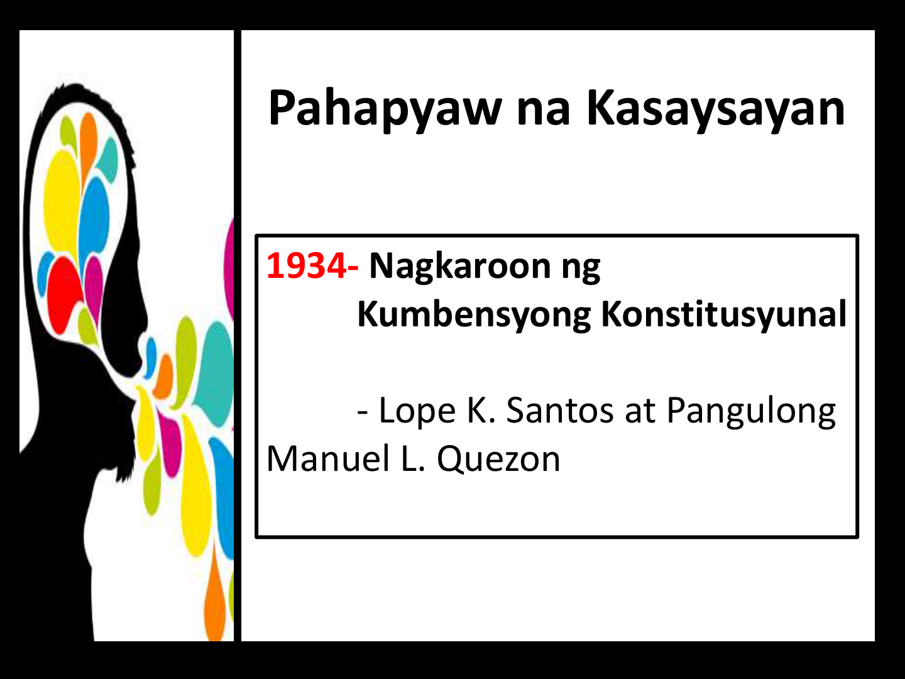

*Pigura 8: Ang Kumbensyong Konstitusyunal ng 1934 at ang adbokasiya nina Lope K. Santos at Pangulong Manuel L. Quezon para sa isang katutubong wika.*

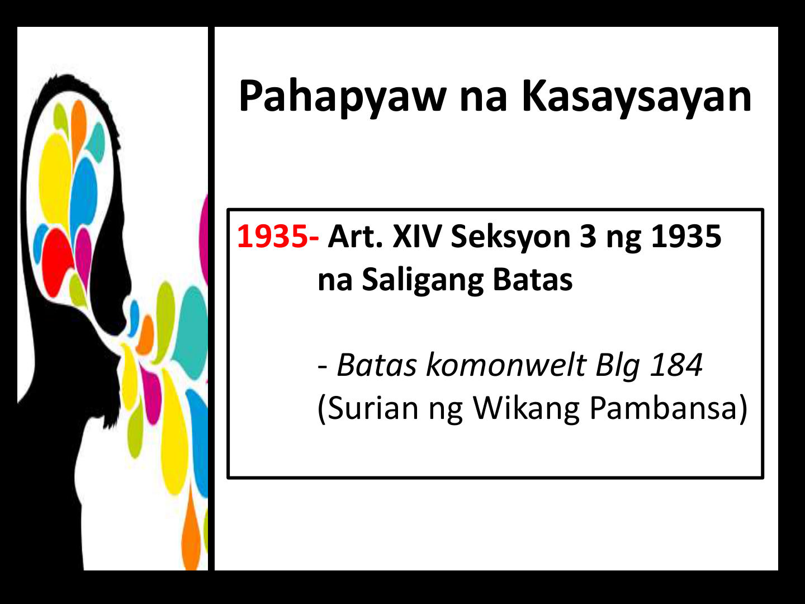

*Pigura 9: Saligang Batas ng 1935 (Artikulo XIV, Seksiyon 3) at Batas Komonwelt Blg. 184 na nagtatag sa Surian ng Wikang Pambansa (SWP).*

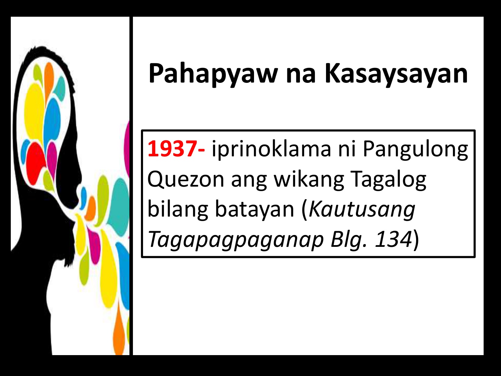

*Pigura 10: Kautusang Tagapaganap Blg. 134 (1937) ni Pangulong Quezon — Pagpapahayag sa Tagalog bilang batayan ng Wikang Pambansa.*

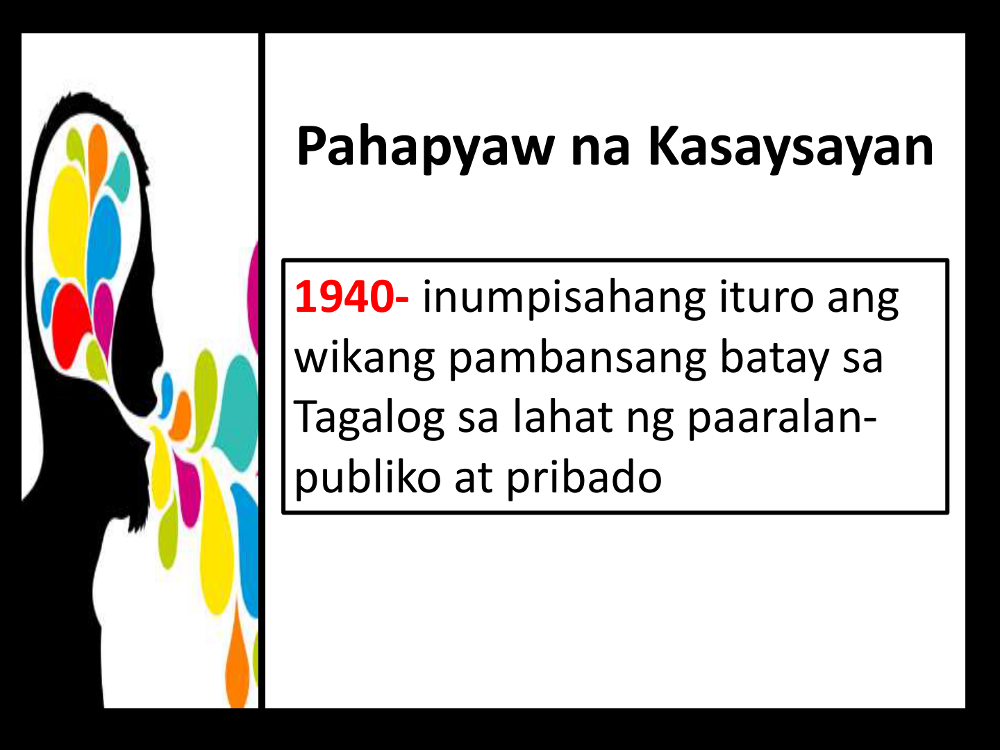

*Pigura 11: Kautusang Tagapaganap Blg. 263 (1940) — Pagpapahintulot sa pagpapalimbag ng Diksyunaryo at Balarila, at pagtuturo ng wika sa mga paaralan.*

Nang maitatag ang Pamahalaang Komonwelt, pinangunahan nina Lope K. Santos at Pangulong Manuel L. Quezon ang paggigiit na magkaroon ng sariling wikang pambansa ang Pilipinas.

* **Saligang Batas ng 1935, Artikulo XIV, Seksyon 3**:

  > *"Ang Pambansang Asemblea ay gagawa ng mga hakbang tungo sa pagpapaunlad at pagpapatibay ng isang panlahat na wikang pambansa na batay sa isa sa mga umiiral na katutubong wika."*

* **Batas Komonwelt Blg. 184 (Nobyembre 13, 1936)**: Isinulat ni Norberto Romualdez ng Leyte; itinatag nito ang **Surian ng Wikang Pambansa (SWP)** upang magsaliksik at mag-aral kung aling katutubong wika ang karapat-dapat maging batayan ng wikang pambansa.

* **Komposisyon ng SWP Board**: Upang maging makatarungan at kumatawan sa buong bansa, hinirang ni Quezon ang mga kinatawan mula sa iba't ibang rehiyon sa pamumuno ni **Jaime C. de Veyra** (Samar-Leyte Waray) bilang Tagapangulo, kasama sina Santiago Fonacier (Ilokano), Filemon Sotto (Cebuano), Casimiro Perfecto (Bikolano), Felix Salas Rodriguez (Hiligaynon), Hadji Butu (Muslim), at Cecilio Lopez (Tagalog).

* **Kautusang Tagapagpaganap Blg. 134 (Disyembre 30, 1937)**: Ipinahayag ni Pangulong Quezon na ang **Tagalog ang magiging batayan ng Wikang Pambansa ng Pilipinas**. Dahil dito, kinilala si Manuel L. Quezon bilang **"Ama ng Wikang Pambansa."**

* **Kautusang Tagapagpaganap Blg. 263 (Abril 1, 1940)**: Ipinag-utos ang pagpapalimbag ng *A Tagalog-English Vocabulary* at ng balarilang isinulat ni Lope K. Santos na pinamagatang *Balarila ng Wikang Pambansa*. Iniutos din na simula **Hunyo 19, 1940**, ituturo ang wikang pambansa sa lahat ng paaralang publiko at pribado sa buong bansa.

#### 6. Panahon ng mga Hapones (1942–1945)

Noong Ikalawang Digmaang Pandaigdig, sinakop ng mga Hapones ang bansa. Sa ilalim ng kanilang patakarang *"Asya para sa mga Asyano,"* tinanggal nila ang impluwensya ng kulturang Amerikano:

* **Military Order No. 2 (1942)**: Ipinagbawal ang paggamit ng Ingles sa mga pampublikong tanggapan at paaralan. Idineklara ang **Tagalog at Nihongo (Hapones)** bilang mga opisyal na wika ng bansa.

* **Gintong Panahon ng Wikang Pambansa**: Dahil bawal ang Ingles, napilitan ang mga manunulat, mamamahayag, at mandudula na sumulat sa Tagalog. Namulaklak ang maikling kuwento, dula sa teatro, at pamamahayag sa sariling wika.

#### 7. Panahon ng Ikatlong Republika hanggang Bago ang 1972



*Pigura 12: Batas Komonwelt Blg. 570 (1946) — Proklamasyon ng Wikang Pambansang Pilipino at Ingles bilang mga Opisyal na Wika sa Araw ng Pagsasarili.*



*Pigura 13: Kautusang Pangkagawaran Blg. 7 (1959) ni Kalihim Jose E. Romero — Pagtatalaga sa pambansang katawagang "Pilipino" upang pawiin ang rehiyonalismo.*

* **Batas Komonwelt Blg. 570 (Hulyo 4, 1946)**: Sa araw ng pagpapahayag ng kasarinlan ng Pilipinas mula sa Amerika, pinagtibay na ang wikang pambansang batay sa Tagalog ay magiging isa sa mga **opisyal na wika ng Republika**.

* **Proklama Blg. 12 (1954) at Blg. 186 (1955)**: Nilagdaan ni Pangulong Ramon Magsaysay ang pagdiriwang ng **Linggo ng Wikang Pambansa** mula Agosto 13 hanggang 19 taon-taon, bilang pagpaparangal sa kaarawan ni Manuel L. Quezon (Agosto 19).

* **Kautusang Pangkagawaran Blg. 7 (Agosto 13, 1959)**: Upang pawiin ang rehiyonalistikong pagtutol ng mga di-Tagalog na nagsasabing ang wikang pambansa ay pabor lamang sa mga taga-Maynila, nagpalabas si Kalihim **Jose E. Romero** ng Kagawaran ng Edukasyon ng kautusan na nagsasaad:

  > *"Kailanma't tutukuyin ang Wikang Pambansa, ang salitang PILIPINO ang siyang gagamitin."*

#### 8. Saligang Batas ng 1973 at ang Edukasyong Bilingguwal

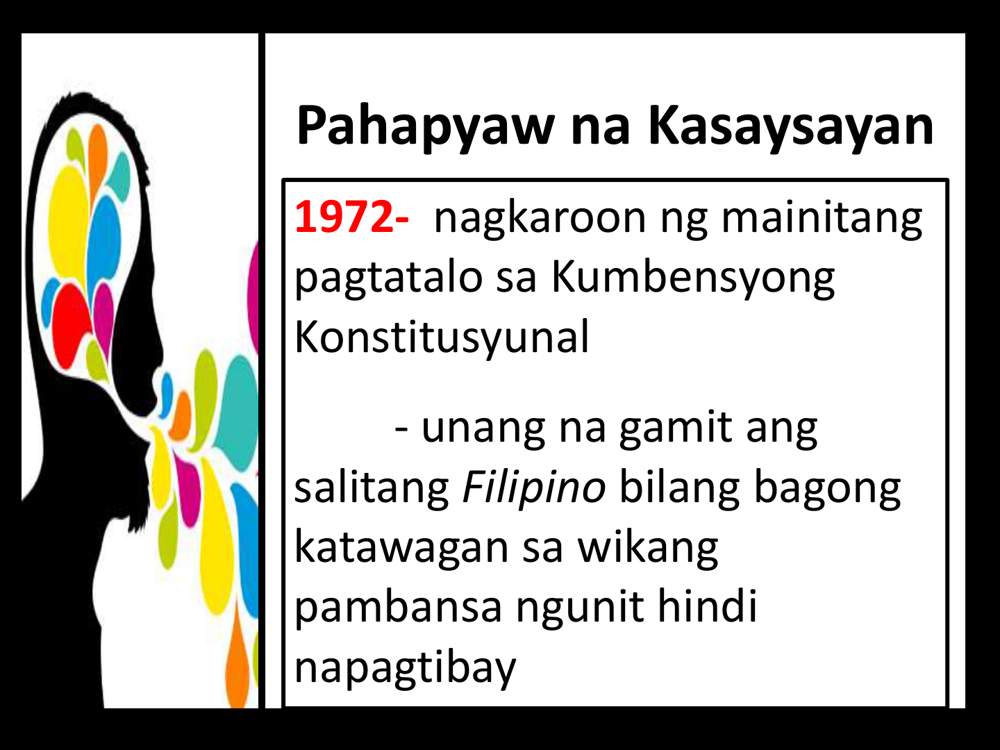

*Pigura 14: Ang Kumbensyong Konstitusyunal ng 1972 at Saligang Batas ng 1973 (Artikulo XV, Seksiyon 3) — Pormal na pagkilala at paglinang sa wikang tatawaging "Filipino".*

Sa 1971–1972 Kumbensyong Konstitusyunal, muling sumiklab ang mainitang debate sa wika. Maraming delegado mula sa Visayas at Mindanao ang tumutol sa "Pilipino" dahil itinuturing pa rin itong Tagalog na binihisan lamang.

Bunga nito, sa **Saligang Batas ng 1973 (Artikulo XV, Seksyon 3, Talata 2)**, itinakda:

> *"Ang Pambansang Asemblea ay gagawa ng mga hakbang tungo sa paglinang at pormal na pagpapatibay ng isang panlahat na wikang pambansa na tatawaging FILIPINO."*

Dito pormal na pumasok ang titik **'F'**, na nagpapahiwatig ng pagbubukas ng wika sa impluwensya ng iba pang mga wika sa Pilipinas.

* **Kautusang Pangkagawaran Blg. 25, s. 1974**: Ipinatupad ng Kagawaran ng Edukasyon at Kultura ang **Patakarang Edukasyong Bilingguwal (Bilingual Education Policy)**—ang magkahiwalay na paggamit ng Pilipino at Ingles bilang wikang panturo sa mga tiyak na asignatura mula Grade 1 pataas.

#### 9. Kasalukuyang Panahon: Saligang Batas ng 1987

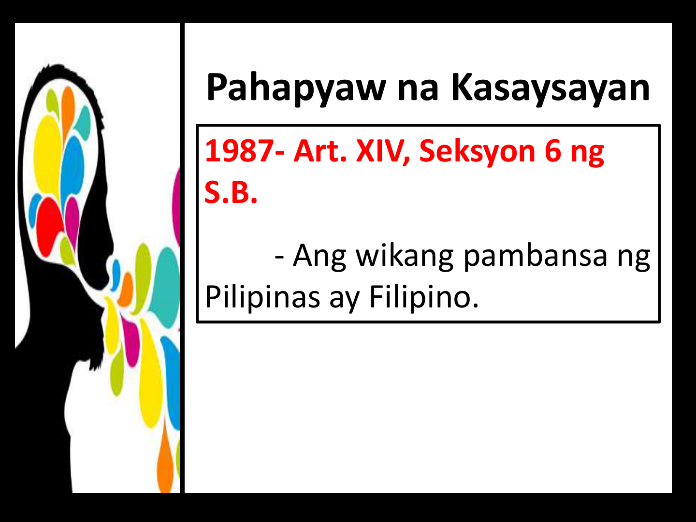

*Pigura 15: Saligang Batas ng 1987 (Artikulo XIV, Seksiyon 6) — Ang pambansang wika ng Pilipinas ay Filipino na dapat payabungin at pagyamanin salig sa mga umiiral na wika sa Pilipinas.*

Matapos ang EDSA People Power Revolution, binalangkas ang bagong Saligang Batas. Sa **Artikulo XIV ng Saligang Batas ng 1987**, pinal nang itinatag ang katayuan ng wikang pambansa:

* **Seksyon 6**:

  > *"Ang wikang pambansa ng Pilipinas ay Filipino. Samantalang nililinang, ito ay dapat payabungin at pagyamanin pa salig sa umiiral na wika sa Pilipinas at sa iba pang mga wika."*

* **Seksyon 7**:

  > *"Ukol sa layunin ng komunikasyon at pagtuturo, ang mga wikang opisyal ng Pilipinas ay Filipino at, hangga't walang ibang itinatadhana ang batas, Ingles."*

  > *"Ang mga wikang panrehiyon ay siyang mga pantulong na wikang opisyal sa mga rehiyon at magsisilbi na pantulong na mga wikang panturo roon."*

* **Seksyon 8**: Ang Konstitusyon ay dapat ipahayag sa Filipino at Ingles at dapat isalin sa mga pangunahing wikang panrehiyon, Arabic, at Kastila.

* **Seksyon 9**: Ipinag-utos ang pagtatatag ng isang komisyon sa wikang pambansa. Bunga nito, pinagtibay ang **Batas Republika Blg. 7104 (1991)** na lumikha sa **Komisyon sa Wikang Filipino (KWF)**.

* **Kautusang Tagapagpaganap Blg. 335 (1988)**: Nilagdaan ni Pangulong Corazon C. Aquino na nag-aatas sa lahat ng ahensya, departamento, at kawanihan ng pamahalaan na magsagawa ng mga hakbang upang gamitin ang Filipino sa mga opisyal na transaksyon, komunikasyon, at korespondensya.

* **Proklama Blg. 1041 (1997)**: Nilagdaan ni Pangulong Fidel V. Ramos na nagtatalaga sa buong buwan ng Agosto bilang **Buwan ng Wikang Pambansa**.

---

### 2.2 Talahanayan ng mga Batas, Kautusan, at Proklamasyon

| Taon | Batas / Kautusan | Nilalaman at Kahalagahang Pangkasaysayan |

| :--- | :--- | :--- |

| **1897** | **Saligang Batas ng Biak-na-Bato** (Art. VIII) | Tagalog ang opisyal na wika ng Pamahalaang Rebolusyonaryo. |

| **1901** | **Batas Blg. 74 ng Komisyon ng Pilipinas** | Pagtatatag ng pampublikong paaralan na Ingles ang tanging wikang panturo (Thomasites). |

| **1925** | **Monroe Survey Commission Report** | Napatunayan ang kabiguan ng purong Ingles sa pagtuturo sa mga batang Pilipino. |

| **1935** | **1935 Saligang Batas** (Art. XIV, Sek. 3) | Pagkakaroon ng wikang pambansa batay sa isa sa mga umiiral na katutubong wika. |

| **1936** | **Batas Komonwelt Blg. 184** | Pagtatatag ng Surian ng Wikang Pambansa (SWP) sa pamumuno ni Jaime C. de Veyra. |

| **1937** | **Kautusang Tagapagpaganap Blg. 134** | Iprinisenta ni Pangulong Quezon ang **Tagalog** bilang batayan ng wikang pambansa. |

| **1940** | **Kautusang Tagapagpaganap Blg. 263** | Pagpapalimbag ng *Balarila* at Diksiyonaryo; sinimulang ituro ang wika sa mga paaralan. |

| **1942** | **Military Order No. 2 (Hapones)** | Ipinagbawal ang Ingles; ginawang opisyal na wika ang Tagalog at Nihongo ("Gintong Panahon"). |

| **1946** | **Batas Komonwelt Blg. 570** | Pormal na ginawang opisyal na wika ng bansa ang pambansang wika. |

| **1954/55**| **Proklama Blg. 12 at Blg. 186** | Itinakda ni Pang. Magsaysay ang **Linggo ng Wika** tuwing Agosto 13–19 (kaarawan ni Quezon). |

| **1959** | **Kautusang Pangkagawaran Blg. 7** | Pinalitan ni Kalihim Jose E. Romero ang tawag sa wikang pambansa: naging **"PILIPINO"**. |

| **1973** | **1973 Saligang Batas** (Art. XV, Sek. 3) | Iniutos ang paglinang ng wikang pambansang kikilalaning **"FILIPINO"**. |

| **1974** | **Kautusang Pangkagawaran Blg. 25** | Pagpapatupad ng **Patakarang Edukasyong Bilingguwal** sa mga paaralan. |

| **1987** | **1987 Saligang Batas** (Art. XIV, Sek. 6–9) | Pinagtibay na ang wikang pambansa ng Pilipinas ay **FILIPINO**. |

| **1988** | **Kautusang Tagapagpaganap Blg. 335** | Iniutos ni Pang. Corazon Aquino ang paggamit ng Filipino sa lahat ng tanggapan ng pamahalaan. |

| **1991** | **Batas Republika Blg. 7104** | Pagtatatag ng **Komisyon sa Wikang Filipino (KWF)**. |

| **1997** | **Proklama Blg. 1041** | Pinalawig ni Pang. Ramos ang Linggo ng Wika upang maging **Buwan ng Wikang Pambansa** (buong Agosto). |

| **2013** | **Batas Republika Blg. 10533** | Enhanced Basic Education Act of 2013; ipinatupad ang **MTB-MLE** mula Kindergarten hanggang Grade 3. |

---

### 2.3 Pagsusuri sa Video: *Kasaysayan ng Wikang Pambansa* ni Dr. Bienvenido Lumbera

*(Sanggunian: Video Documentary mula sa Sentro ng Wikang Filipino – UP Diliman / NCCA; at Lumbera, 2000, Writing the Nation / Pag-akda ng Bansa, ph. 96–104)*

Sa bidyong panayam at dokumentaryo ni Pambansang Alagad ng Sining **Dr. Bienvenido Lumbera**, ibinahagi niya ang isang mapagpalayang pagsusuri sa kasaysayan ng wikang pambansa:

```

┌────────────────────────────────────────────────────────────────────────────────────────┐

│           MGA PANGUNAHING PUNTO NI DR. BIENVENIDO LUMBERA SA KASAYSAYAN NG WIKA        │

├────────────────────────────────────────────────────────────────────────────────────────┤

│ 1. Paghahati ng mga Espanyol: Ang hindi pagtuturo ng Espanyol sa mamamayan ay sadyang │

│    ginamit upang pigilan ang pagkakaisa ng mga katutubo at mapanatili ang kontrol.     │

│ 2. "Benevolent Assimilation" ng mga Amerikano: Ang pagpapataw ng Ingles ay mas banayad │

│    ngunit mas mapanganib na pananakop sapagkat binihag nito ang isipan ng mga Pilipino│

│    upang maging tapat sa kulturang dayuhan at maging konsiyumer ng kanilang produkto. │

│ 3. Ang Tagalog bilang Bukal ng Pagkakaisa: Pinili ang Tagalog noong 1937 hindi upang   │

│    yurakan ang ibang rehiyon, kundi dahil may buhay na gramatika at panitikan ito na   │

│    handang maging bukal ng pambansang komunikasyon.                                     │

│ 4. Ang Wikang Filipino Bilang Pag-akda sa Bansa: Ang Filipino ay hindi Tagalog lamang; │

│    ito ay isang bukas, buhay, at dinamikong wika na lumalago sa tulong ng mga salita   │

│    mula sa Cebuano, Ilokano, Hiligaynon, Maranao, at iba pang wika sa Pilipinas.       │

└────────────────────────────────────────────────────────────────────────────────────────┘

```

Ayon kay Lumbera, ang pakikibaka para sa wikang Filipino ay isang gawaing **kontra-gahum (counter-hegemony)**. Ang pagtataguyod sa sariling wika ay pagbawi sa ating sariling kaluluwa at pagtatatag ng isang bansang may tunay na malasakit sa masang Pilipino.

---

## Aralin 3: Baryasyon at Barayti ng Wika

Hindi iisa o pare-pareho ang paraan ng pagsasalita ng mga tao. Ang pagkakaiba-iba sa wika ay tinatawag na **baryasyon**. Nagaganap ito dahil ang mga tao ay nakatira sa magkakaibang lugar at nabibilang sa iba't ibang sektor ng lipunan.

### 3.1 Homogeneous at Heterogeneous na Wika

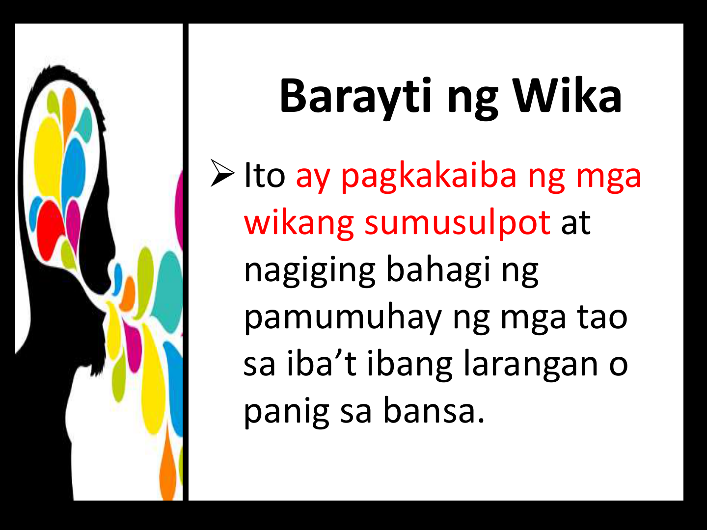

*Pigura 16: Aralin 3 — Konsepto ng Barayti at Baryasyon ng Wika na sumusulpot sa pamumuhay at kultura ng mga tao sa iba't ibang panig ng kapuluan.*

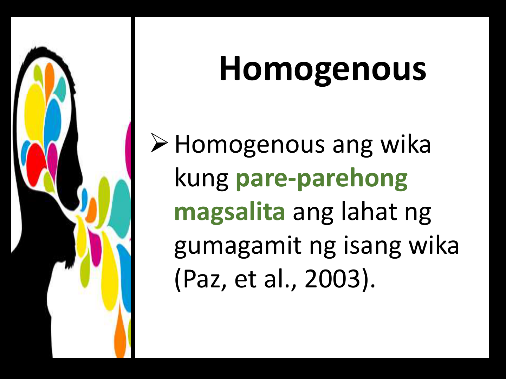

*Pigura 17: Homogeneous na Wika ayon kay Dr. Consuelo Paz, et al. (2003) — Ang teoretikal na kalagayan kung saan pare-parehong magsalita ang lahat ng gumagamit ng wika.*

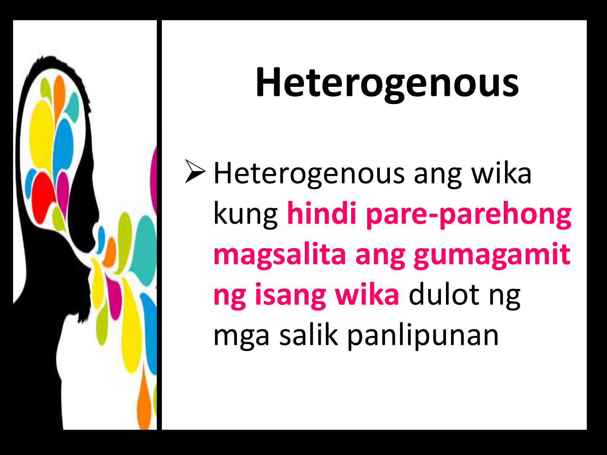

*Pigura 18: Heterogeneous na Wika — Pagkakaiba-iba at likas na baryasyon ng wika dulot ng mga salik na heograpiko, panlipunan, at okupasyonal.*

```

     HOMOGENEOUS NA PANANAW (Teoretikal)              HETEROGENEOUS NA PANANAW (Realidad)

  ┌──────────────────────────────────────┐          ┌──────────────────────────────────────┐

  │ • Iisa ang anyo at estruktura ng     │          │ • Likas na sari-sari at may iba't    │

  │   wika ng lahat ng nagsasalita nito. │          │   ibang barayti at estilo ang wika.  │

  │ • Walang baryasyon o pagkakaiba-iba. │    VS.   │ • Dulot ng heograpiya, lipunan,      │

  │ • Isa itong teoretikal na ideyal;    │          │   edad, edukasyon, at kasarian.      │

  │   hindi umiiral sa buhay na wika.    │          │ • Ito ang tunay na kalagayan ng      │

  │   (Paz et al., 2003)                 │          │   lahat ng natural na wika sa mundo. │

  └──────────────────────────────────────┘          └──────────────────────────────────────┘

```

* **Homogeneous na Wika**: Ang pananaw na ang wika ay pare-pareho at walang pagkakaiba ang paraan ng pagsasalita ng mga gumagamit nito (Paz et al., 2003). Sa linggwistika, ito ay isang abstract na konsepto lamang sapagkat sa totoong buhay, walang wikang ganap na homogeneous.

* **Heterogeneous na Wika**: Ang realidad na ang wika ay nagtataglay ng iba't ibang anyo, barayti, at pagkakaiba-iba dahil ang mga taong gumagamit nito ay may magkakaibang edad, kasarian, antas ng pamumuhay, edukasyon, at pinanggagalingang lugar.

---

### 3.2 Linggwistikong Komunidad (Speech Community)

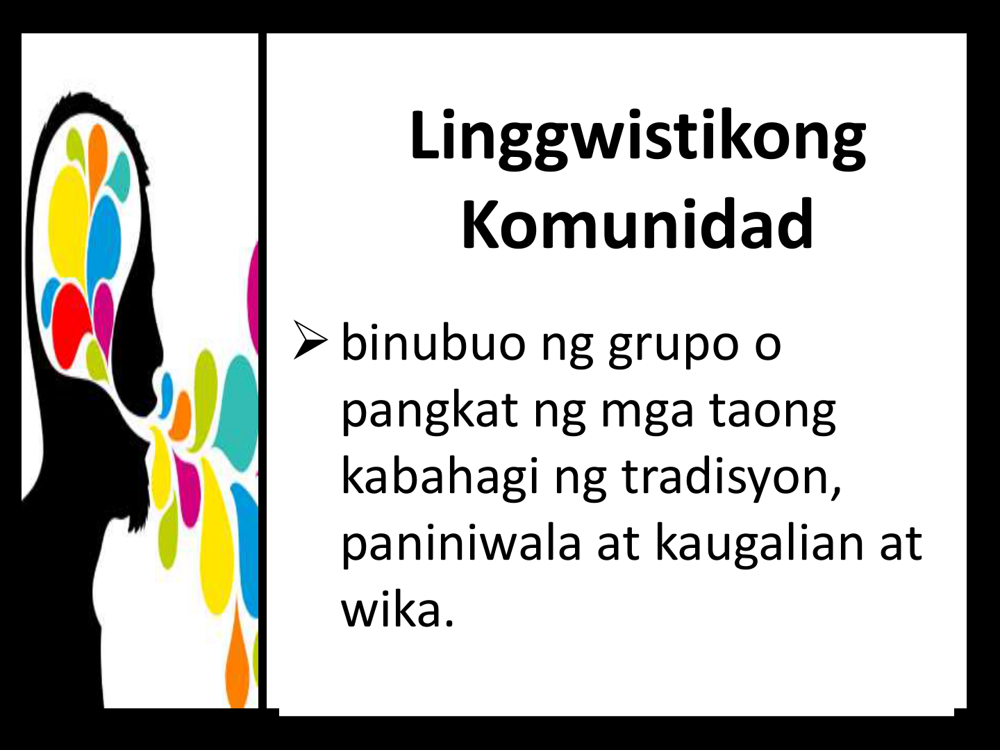

*Pigura 19: Konsepto ng Linggwistikong Komunidad (Speech Community) batay sa mga teorya nina John Gumperz (1968) at William Labov (1972).*

Ayon sa sosyolinggwistang si **John Gumperz (1968)** at **William Labov (1972)**:

> Ang **Linggwistikong Komunidad** ay isang pangkat o grupo ng mga taong may regular at kadalasang interaksyon sa pamamagitan ng isang wika, at nagbabahagi ng magkakatulad na pamantayan, tuntunin, at pagpapahalaga sa maayos at angkop na paggamit ng wika.

Sa loob ng isang linggwistikong komunidad, alam ng bawat isa kung kailan dapat maging pormal, kailan maaaring magbiro, at kung aling mga salita ang angkop sa kanilang kultura.

---

### 3.3 Unang Wika (L1) at Ikalawang Wika (L2)

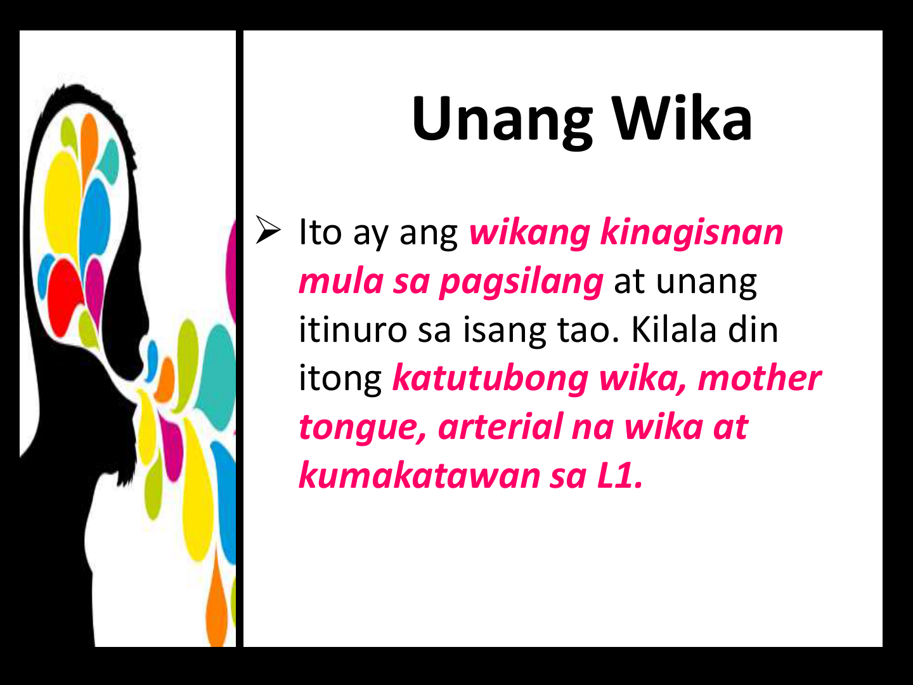

*Pigura 20: Unang Wika (L1) / Katutubong Wika / Mother Tongue — Ang wikang kinagisnan mula pagsilang at unang ginamit sa paglinang ng isipan at kamalayan.*

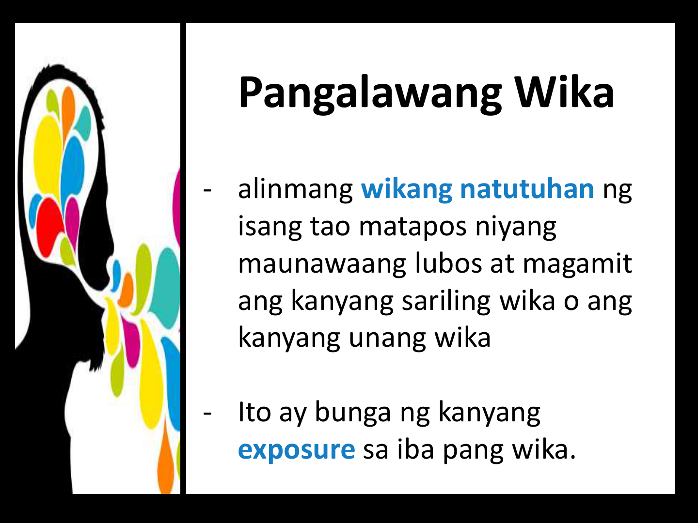

*Pigura 21: Ikalawang Wika (L2) — Alinmang karagdagang wikang natutuhan ng isang tao matapos niyang maunawaan at magamit ang kanyang sariling katutubong wika.*

```

┌──────────────────────────────────────┬──────────────────────────────────────┐

│ UNANG WIKA (L1 / Mother Tongue)      │ IKALAWANG WIKA (L2)                  │

├──────────────────────────────────────┼──────────────────────────────────────┤

│ • Wikang kinagisnan mula sa pagsilang│ • Alinmang wikang natutuhan matapos  │

│   (katutubong wika o arterial na wika)│   lubos na maunawaan at magamit ang  │

│ • Natututuhan nang likas sa loob ng  │   kanyang unang wika.                │

│   tahanan at pamilya.                │ • Bunga ng pormal na pag-aaral sa    │

│ • Dito nakasalig ang pinakamalalim na│   paaralan, impluwensya ng media, o  │

│   pag-iisip at damdamin ng tao.      │   pakikisalamuha sa ibang tao.       │

│ • Halimbawa: Isang batang Ilonggo na │ • Halimbawa: Pag-aaral ng Filipino at│

│   Hiligaynon ang unang natutuhan.    │   Ingles pagpasok sa elementarya.    │

└──────────────────────────────────────┴──────────────────────────────────────┘

```

* **Ikatlong Wika (L3)**: Karagdagang wikang natututuhan ng tao sa kanyang pagtanda dulot ng globalisasyon, pangingibang-bansa, o propesyon (hal. Espanyol, Nihongo, Mandarin, Pranses).

---

### 3.4 Pitong (7) Barayti ng Wika

Ayon sa pag-aaral ng sosyolinggwistika, nahahati ang barayti ng wika sa dalawang malaking dimensyon: **heograpikal** (batay sa lugar) at **sosyal** (batay sa katayuan sa lipunan). Mula rito ay umusbong ang pitong pangunahing barayti:

```

┌────────────────────────────────────────────────────────────────────────────────────────┐

│                               PITONG (7) BARAYTI NG WIKA                               │

├─────────────────────┬──────────────────────────────────────────────────────────────────┤

│ 1. Dayalek          │ Barayting panrehiyon o heograpikal batay sa lugar.               │

├─────────────────────┼──────────────────────────────────────────────────────────────────┤

│ 2. Idyolek          │ Indibidwal at personal na estilo ng pagsasalita ng isang tao.   │

├─────────────────────┼──────────────────────────────────────────────────────────────────┤

│ 3. Sosyolek         │ Barayting panlipunan batay sa pangkat, edad, kasarian, o klase.  │

├─────────────────────┼──────────────────────────────────────────────────────────────────┤

│ 4. Etnolek          │ Salitang nagmula sa mga katutubong etnolinggwistikong grupo.     │

├─────────────────────┼──────────────────────────────────────────────────────────────────┤

│ 5. Ekolek           │ Mga salitang karaniwang sinasalita sa loob ng tahanan.           │

├─────────────────────┼──────────────────────────────────────────────────────────────────┤

│ 6. Pidgin           │ Wikang walang pormal na estruktura; contact language ng dayuhan. │

├─────────────────────┼──────────────────────────────────────────────────────────────────┤

│ 7. Creole           │ Pidgin na naging likas na unang wika ng isang komunidad.         │

└─────────────────────┴──────────────────────────────────────────────────────────────────┘

```

#### 1. Dayalek (Dialect)

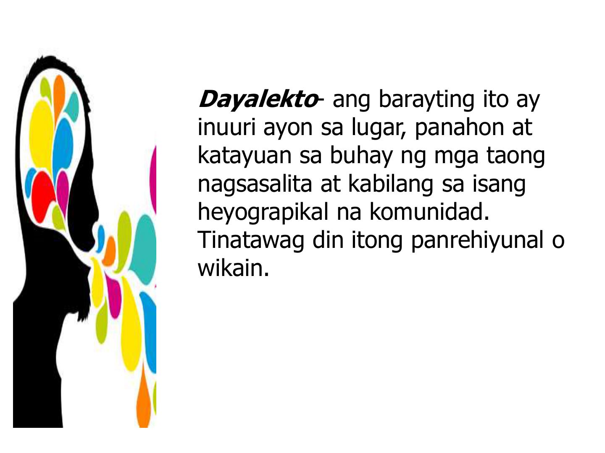

*Pigura 22: Barayti ng Wika: Dayalekto — Pagkakaiba-iba ng wika batay sa lugar, rehiyon, lalawigan, o panahong tinitirhan ng mga tagapagsalita.*

Ito ang barayti ng wikang nalilikha dahil sa pagkakahating heograpikal o distansya ng mga lugar. Bagamat parehong wika ang ginagamit, nagkakaiba ito sa punto, tono, bigkas, at ilang bokabularyo. Nagkakaunawaan pa rin ang mga nagsasalita nito (**mutual intelligibility**).

* **Tagalog-Batangas**: Kilala sa himig, paggamit ng *"ala eh!"*, at mga salitang gaya ng *mabanas* (mainit), *guyam* (langgam), at *lumamon* (kumain).

  * Halimbawa: *"Ala eh, bakit ga nagtutunganga ka pa diyan? Mag-urong ka na ng pinggan!"*

* **Tagalog-Bulacan**: Kilala sa malumanay, pormal, at matulaing pananagalog.

* **Tagalog-Maynila**: Mabilis, kaswal, at madalas haluan ng mga salitang Ingles (*Taglish*).

* **Cebuano-Cebu vs. Cebuano-Davao**: Ang Cebuano sa Davao ay may malakas na halong Tagalog (*"Dili lagi ko gusto ana, mag-kain na lang tayo."*).

#### 2. Idyolek (Idiolect)

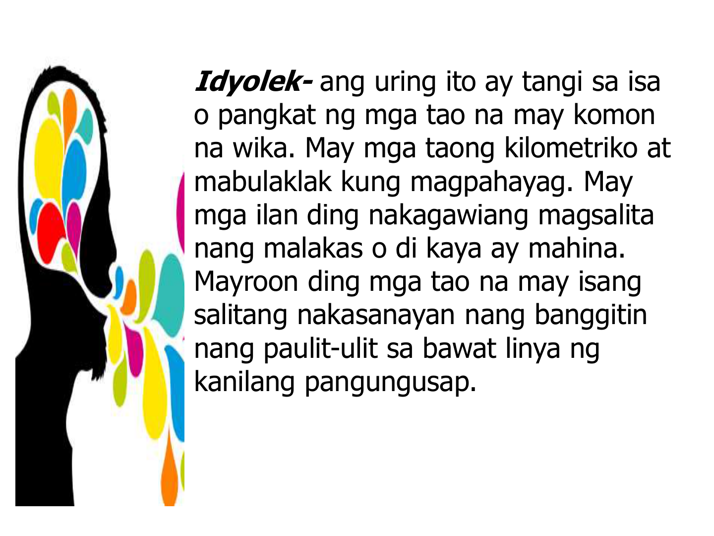

*Pigura 23: Barayti ng Wika: Idyolek — Ang natatangi, pansariling paraan ng pagsasalita, tono, punto, o berbal na tatak ng isang indibidwal.*

Ito ang natatanging personal na estilo at tatak ng pagsasalita ng isang indibidwal. Walang dalawang taong may magkaparehong idyolek dahil nakabatay ito sa boses, bilis ng pagsasalita, diin, at mga paboritong bukambibig:

* **Mike Enriquez**: *"Hindi namin kayo tatantanan!"* (Mabilis, malat, at mariin ang boses).

* **Noli de Castro**: *"Magandang Gabi, Bayan!"* (Mababa, baritono, at pormal).

* **Kris Aquino**: *"Aha, ha, ha! Nakakaloka, honest! Really!"* (Mataas ang tono at madalas mag-Ingles).

* **Ruffa Mae Quinto**: *"To the highest level na 'to, go, go, go!"*

#### 3. Sosyolek (Sociolect)

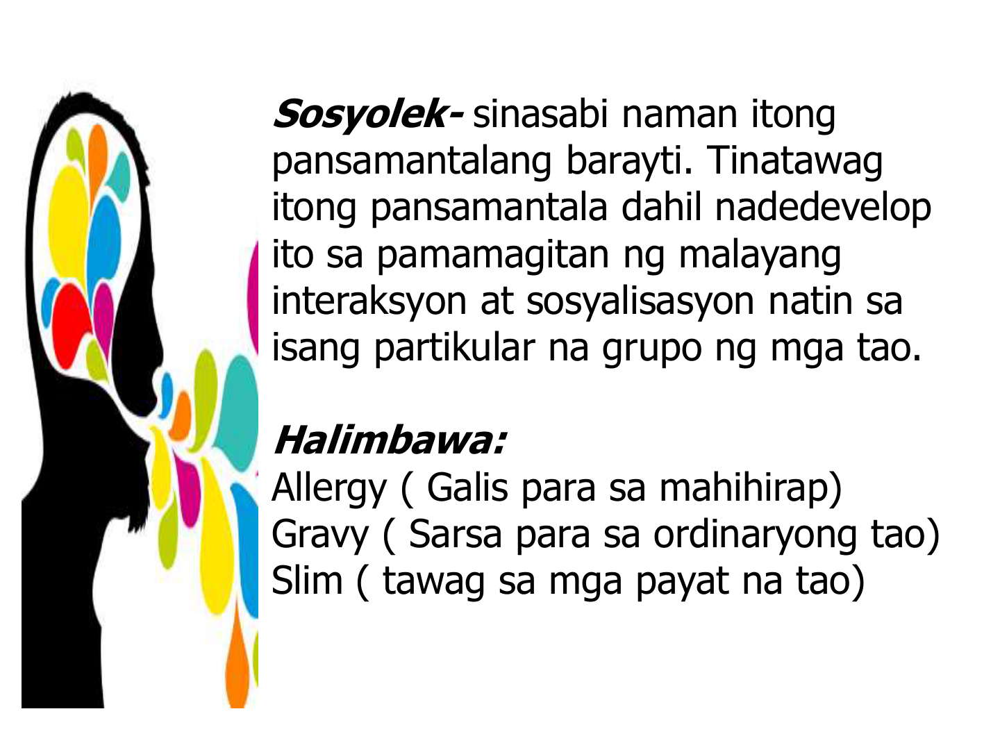

*Pigura 24: Barayti ng Wika: Sosyolek — Pansamantalang barayti na nalilikha batay sa pangkat panlipunan, edad, kasarian, at propesyon (Gay Lingo, Jejemon, Conyo, Jargon).*

Ito ang barayting panlipunan na nalilikha batay sa pangkat na kinabibilangan ng tao sa lipunan (edad, kasarian, propesyon, edukasyon, o antas sa buhay):

* **Gay Lingo / Swardspeak (Wikang Beki)**: Lihim na wika ng komunidad ng LGBTQ+ na binubuo sa pamamagitan ng pagbabaligtad ng tunog at paggamit ng mga pangalan ng artista:

  * *Churchill* = Chaka / Pangit

  * *Purita Kalaw* = Mahirap / Walang pera

  * *Kyawti* = Takot

  * *Gandang Gabi Vice* = Maganda

* **Jejemon**: Subkultura ng kabataan sa pagtetext kung saan binabago ang baybay ng mga salita gamit ang halo-halong numero, malalaki at maliliit na titik, at mga bantas:

  * *"3ow pFowh mHuztAh nAh pFowh qCkyoU?"* (Hello po, kumusta na po kayo?)

* **Conyo / Konyo**: Paraan ng pagsasalita ng mga kabataan mula sa maykayang pamilya na pinaghahalo ang Tagalog at Ingles na may kakaibang intonasyon:

  * *"Wait lang, make pila naman there, it’s so init kaya!"*

  * *"You are so mean naman to me, like, super hassle!"*

* **Jargon**: Tiyak at teknikal na bokabularyo ng isang partikular na propesyon o disiplina:

  * **Medisina**: *Diagnosis, biopsy, cardiac arrest, hypertension, triage*.

  * **Batas**: *Subpoena, habeas corpus, appellant, affidavit, fiscal*.

  * **Information Technology**: *Algorithm, cache, database, firewall, frontend*.

#### 4. Etnolek (Ethnolect)

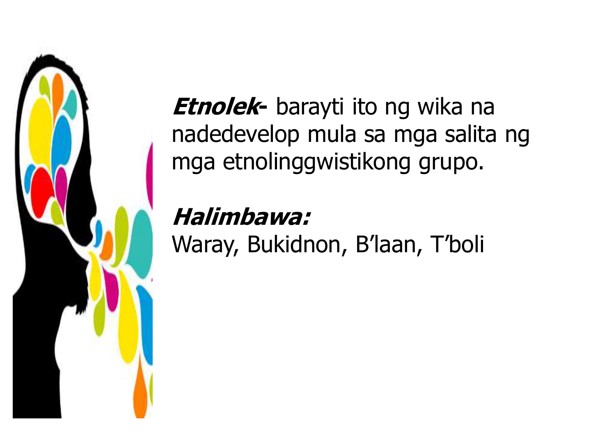

*Pigura 25: Barayti ng Wika: Etnolek — Barayti ng wika na nagmumula sa mga natatanging salita at tradisyon ng mga etnolinggwistikong grupo sa Pilipinas.*

Barayti ng wika na nagmula sa mga salita ng mga etnolinggwistikong grupo sa Pilipinas. Naglalarawan ito ng kanilang sagradong tradisyon, pamumuhay, at katutubong kultura:

* **Ivatan (Batanes)**: *Vakkul* (panakip sa ulo na gawa sa dahon ng voyavoy pananggalang sa araw at ulan).

* **Maranao / Meranaw (Mindanao)**: *Maratabat* (mataas na pagpapahalaga sa dangal, karangalan, at respeto sa sarili at angkan).

* **T'boli (South Cotabato)**: *T'nalak* (sagradong telang abaka na hinahabi batay sa mga disenyong nakikita ng kababaihan sa kanilang panaginip).

* **Ifugao (Kordilyera)**: *Hagabi* (mahabang bangkong kahoy na inuukit mula sa iisang puno bilang simbolo ng pagiging mayaman o *kadangyan*).

#### 5. Ekolek (Ecolect)

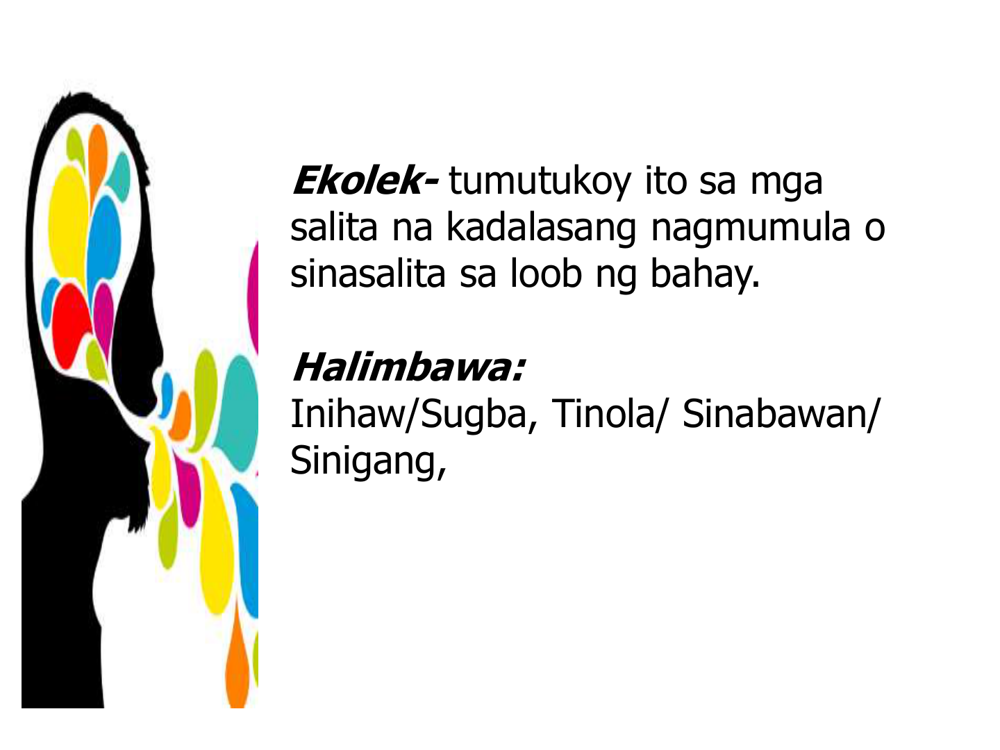

*Pigura 26: Barayti ng Wika: Ekolek — Mga salita at pantahanang bokabularyo na karaniwang sinasalita at nag-uugat sa loob ng pamilya.*

Mga salitang karaniwang ginagamit at sinasalita lamang sa loob ng tahanan o pamilya:

* *Tsibog / Lafang* (pagkain)

* *Palanggana / Batya* (hugasan)

* *Am-am* (sabaw ng sinaing para sa bata)

* *Papsy / Mumsy* (tawag sa magulang)

#### 6. Pidgin

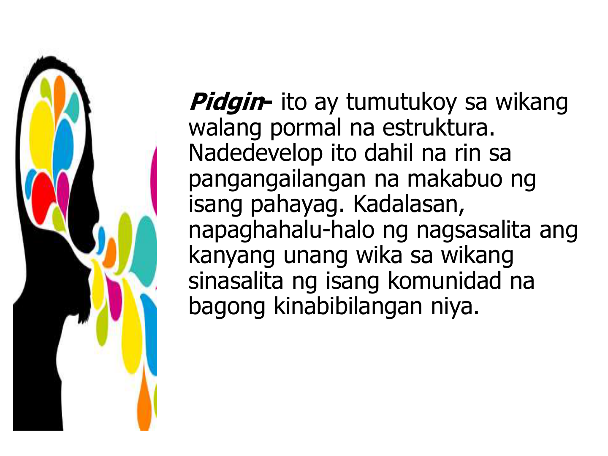

*Pigura 27: Barayti ng Wika: Pidgin — Ang wikang walang pormal na estruktura o "nobody's native language" na nabubuo sa pansamantalang pakikipagkalakalan ng magkaibang lahi.*

Ito ay tumutukoy sa wikang walang pormal na estruktura na nabubuo sa pagitan ng dalawang pangkat ng mga taong may magkaibang wika na kailangang mag-usap para sa kalakalan. Tinatawag itong **"nobody's native language"** dahil walang taong katutubong tagapagsalita nito:

* Halimbawa ng Pidgin Tagalog-Tsino noong panahon ng Intramuros: *"Suki, ikaw bili tinda mura-mura, bawas presyo, dali!"*

#### 7. Creole

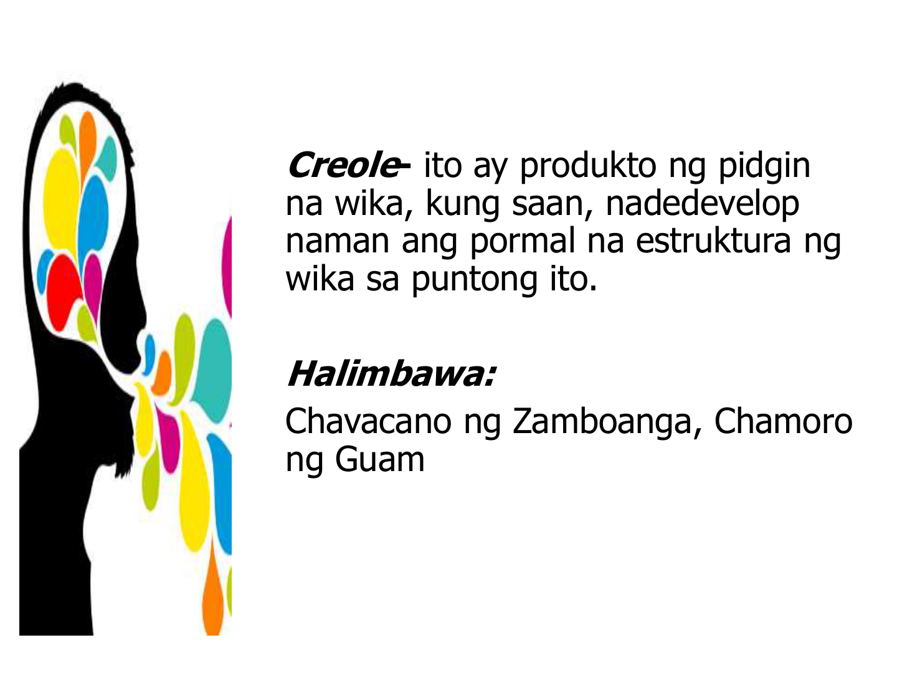

*Pigura 28: Barayti ng Wika: Creole — Ang pidgin na lumaganap, nagkaroon ng sariling pormal na balangkas ng gramatika, at naging katutubong wika ng isang komunidad (hal. Chavacano).*

Ito ay produkto ng pidgin na wika na naging likas o unang wika na ng sumunod na henerasyon sa isang komunidad. Nagkaroon na ito ng pormal na gramatika at malawak na bokabularyo:

* **Chavacano (Chabacano)**: Ang tanyag na creole sa Pilipinas na sinasalita sa **Lungsod ng Zamboanga**, Cavite City, at Ternate. Pinagsama nito ang bokabularyo ng wikang Espanyol at ang gramatika ng mga katutubong wikang Pilipino:

  * *Chavacano*: *"Donde tu ta anda?"* (Saan ka pupunta?)

  * *Espanyol*: *"¿A dónde vas?"*

  * *Tagalog*: *"Saan ka pupunta?"*

  * *Chavacano*: *"Ya mirá yo con Juan ayer."* (Nakita ko si Juan kahapon.)

---

### 3.5 Register ng Wika at mga Antas Nito

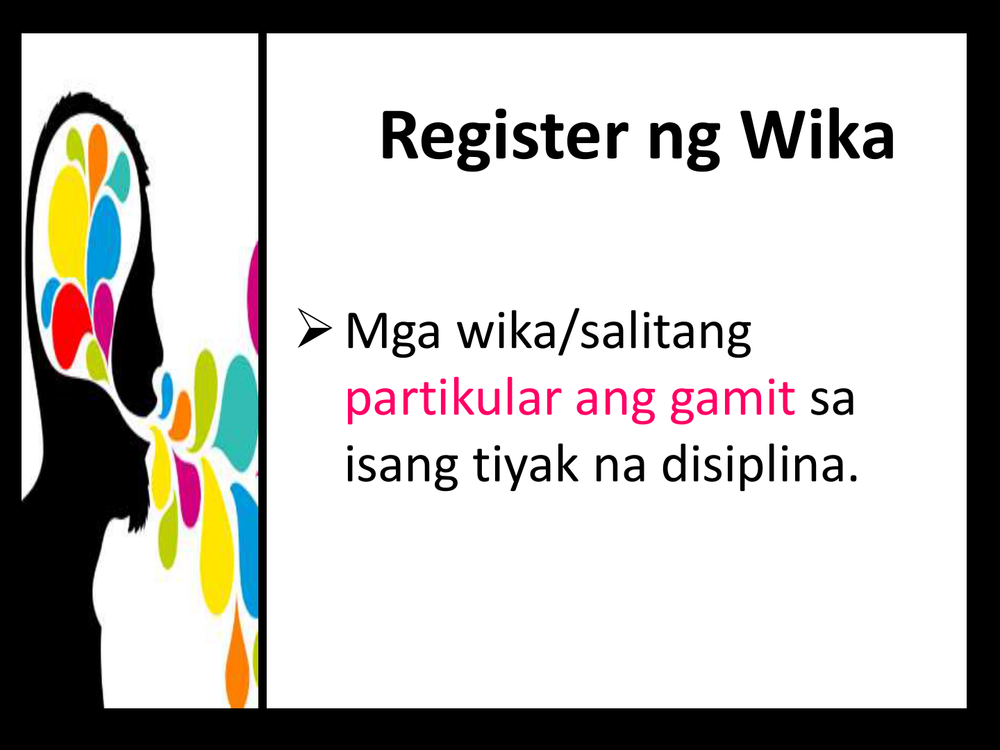

*Pigura 29: Register ng Wika — Paggamit ng tiyak na bokabularyo, terminolohiya, at estilong pangwika na umaakma sa partikular na larangan, propesyon, o disiplina.*

Ang **Register ng Wika** ay tumutukoy sa pag-aangkop ng wika batay sa sitwasyon, larangan, at taong kausap.

#### Triad ni Michael Halliday

Ayon kay M.A.K. Halliday, ang register ay nasusuri sa tatlong dimensyon:

1. **Larangan (Field)**: Ang paksa o gawaing pinag-uusapan (halimbawa: siyentipikong talakayan vs. tsismisan sa kanto).

2. **Tono / Kausap (Tenor)**: Ang relasyon ng mga nag-uusap at ang antas ng kapangyarihan o pamilyaridad (guro-estudyante, hukom-abogado, magkaibigan).

3. **Modo (Mode)**: Ang midyum na ginagamit sa pagpapahayag (pasalita, pasulat, video call, o text message).

#### Limang Antas ng Register ayon kay Martin Joos (1967)

```

┌────────────────────────────────────────────────────────────────────────────────────────┐

│                        LIMANG ANTAS NG REGISTER NI MARTIN JOOS                         │

├─────────────────────┬─────────────────────────────────┬────────────────────────────────┤

│ Antas ng Register   │ Paglalarawan                    │ Halimbawa sa Lipunan           │

├─────────────────────┼─────────────────────────────────┼────────────────────────────────┤

│ 1. Frozen (Estatiko)│ Hindi nagbabago; ritwalistiko;  │ Panatang Makabayan; Dasal na   │

│                     │ binabasa o binibigkas nang      │ Ama Namin; Pambansang Awit;    │

│                     │ eksakto sa seremonya.           │ Panunumpa sa Saligang Batas.   │

├─────────────────────┼─────────────────────────────────┼────────────────────────────────┤

│ 2. Pormal           │ Maingat at structured; walang   │ State of the Nation Address;   │

│                     │ balbal o pinaikling salita;     │ Lektura sa Unibersidad;        │

│                     │ karaniwang one-way delivery.    │ Tesis at Akademikong Papel.    │

├─────────────────────┼─────────────────────────────────┼────────────────────────────────┤

│ 3. Konsultatibo     │ Dalawahang komunikasyong        │ Konsultasyon sa Doktor;        │

│                     │ propesyonal; magalang at may    │ Pagpupulong ng Guro at Magulang│

│                     │ layuning magpalitan ng impormasyon│ Deposisyon sa Hukuman.       │

├─────────────────────┼─────────────────────────────────┼────────────────────────────────┤

│ 4. Kaswal           │ Impormal na usapan ng mga       │ Kuwentuhan ng magkakaklase;    │

│                     │ magkakaibigan at magkakasing-   │ tawanan sa canteen; usapan sa  │

│                     │ edad; may balbal at kolokyal.   │ group chat sa Messenger.       │

├─────────────────────┼─────────────────────────────────┼────────────────────────────────┤

│ 5. Intimayt (Intimate)│ Pribadong usapan ng mga taong │ Paglalambing ng mag-asawa o    │

│                     │ may malalim na relasyon; may    │ magkasintahan; lihim na wika ng│

│                     │ pahiwatig at lihim na kodigo.   │ pamilya.                       │

└─────────────────────┴─────────────────────────────────┴────────────────────────────────┘

```

---

## Aralin 4: Mga Isyu at Sitwasyong Pangwika sa Lipunang Pilipino

Ang kalagayan ng wika sa Pilipinas ay patuloy na nahaharap sa mga hamon dulot ng globalisasyon, kolonyal na mentalidad, at mga patakarang pangedukasyon.

### 4.1 Wikang Pambansa, Wikang Opisyal, at Wikang Panturo

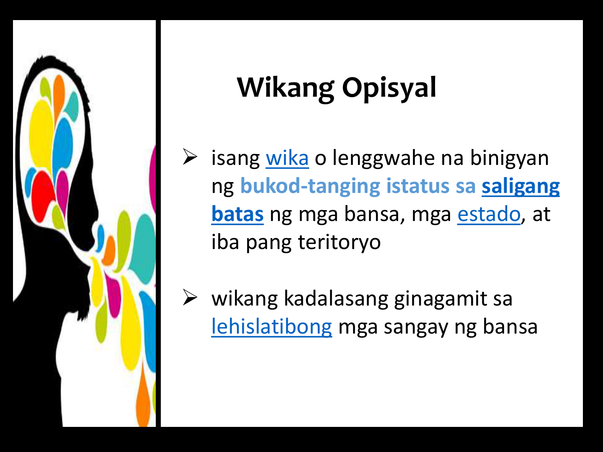

*Pigura 30: Aralin 4 — Konsepto ng Wikang Opisyal: Ang wikang itinakda ng batas para sa opisyal na komunikasyon, transaksyon, batas, at mga dokumento ng pamahalaan.*

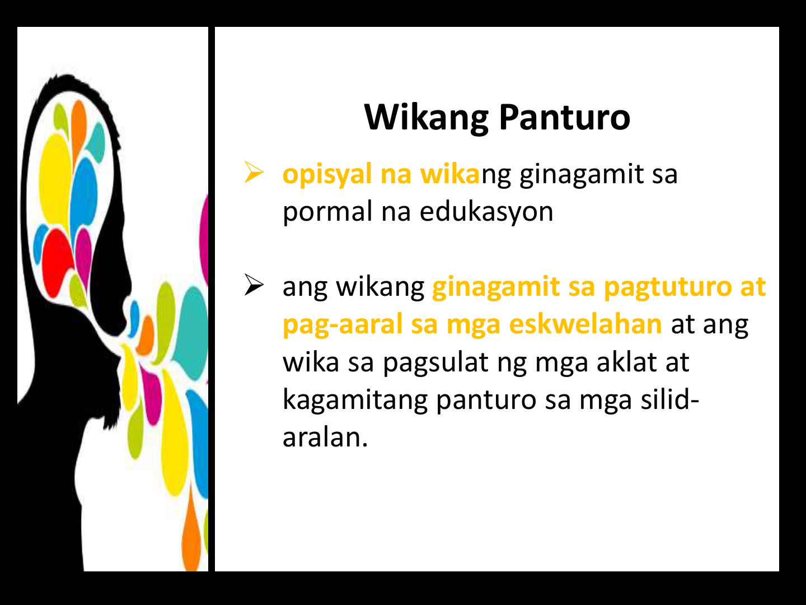

*Pigura 31: Konsepto ng Wikang Panturo — Ang opisyal na wikang ginagamit sa sistema ng pormal na edukasyon, pagtuturo sa klase, at pagsulat ng mga aralin.*

Sa ilalim ng Saligang Batas ng 1987, may tatlong tiyak na katayuan ang wika sa ating bansa:

```

┌────────────────────────────────────────────────────────────────────────────────────────┐

│                      TATLONG TIYAK NA KATAYUAN NG WIKA SA PILIPINAS                    │

├──────────────────────────┬──────────────────────────┬──────────────────────────────────┤

│ WIKANG PAMBANSA          │ WIKANG OPISYAL           │ WIKANG PANTURO                   │

├──────────────────────────┼──────────────────────────┼──────────────────────────────────┤

│ • FILIPINO (Art. XIV,    │ • FILIPINO at INGLES     │ • Katutubong Wika (K hanggang    │

│   Sek. 6).               │   (Art. XIV, Sek. 7).    │   Grade 3 / MTB-MLE).            │

│ • Simbolo ng pambansang  │ • Wikang itinakda ng     │ • FILIPINO at INGLES             │

│   identidad, kultura, at │   batas para sa mga      │   (Grade 4 hanggang Kolehiyo).   │

│   pagkakaisa ng sambayanan│ opisyal na transaksyon, │ • Wikang ginagamit sa pagtuturo, │

│                          │   dokumento, at hukuman. │   aklat, at pagsusulit.          │

└──────────────────────────┴──────────────────────────┴──────────────────────────────────┘

```

* **Wikang Pambansa**: Ang **Filipino** ang siyang kumakatawan sa pambansang identidad, kultura, at kasarinlan ng bansa.

* **Wikang Opisyal**: Ang **Filipino at Ingles** ang mga opisyal na wika sa komunikasyon ng pamahalaan, mga batas, liham-opisyal, at paglilitis sa korte. Ang mga wikang panrehiyon ay mga pantulong na wikang opisyal.

* **Wikang Panturo**: Ang wikang itinalaga ng Kagawaran ng Edukasyon upang gamitin sa loob ng silid-aralan sa pagtuturo at pagkatuto.

---

### 4.2 Monolingguwalismo, Bilingguwalismo, at Multilingguwalismo (MTB-MLE)

#### 1. Monolingguwalismo

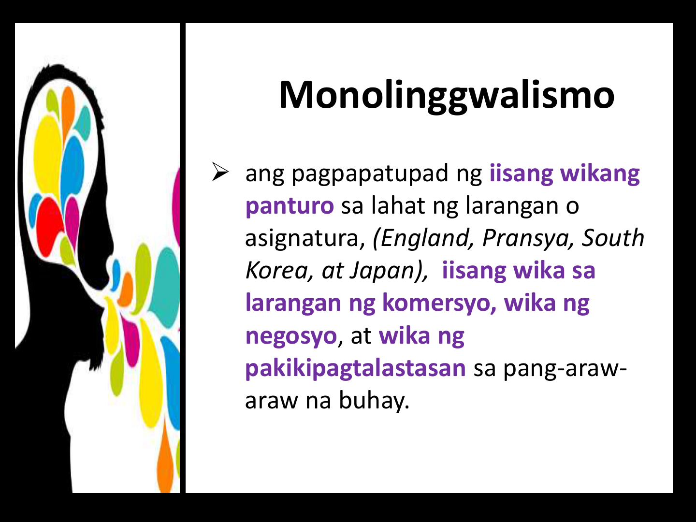

*Pigura 32: Konsepto ng Monolingguwalismo — Ang pagpapatupad ng iisang wika sa lahat ng larangan ng pambansang pamamahala, komersiyo, at edukasyon.*

Ang pagpapatupad ng **iisang wika lamang** bilang wikang panturo, wika ng komersyo, at wika ng pamahalaan sa buong bansa. Umiiral ito sa mga bansang tulad ng Pransya (Pranses), Hapon (Nihongo), at Timog Korea (Korean). Hindi ito angkop sa Pilipinas dahil sa pagkakaroon ng mahigit 170 katutubong wika.

#### 2. Bilingguwalismo

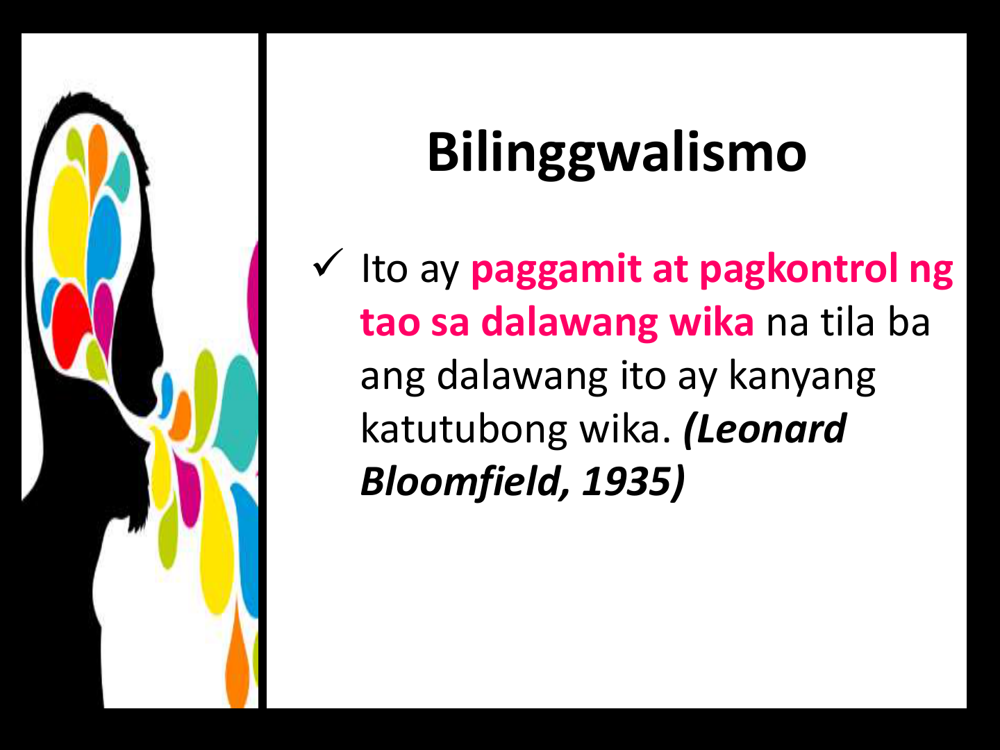

*Pigura 33: Bilingguwalismo ayon kay Leonard Bloomfield (1933) — Ang pagkakaroon ng magkatulad at ganap na kontrol ng tao sa dalawang wika (native-like control).*

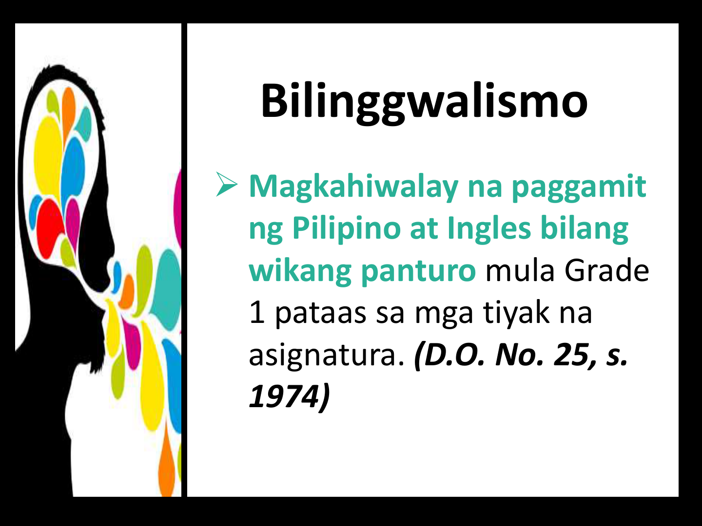

*Pigura 34: Patakarang Edukasyong Bilingguwal ng 1974 (DO Blg. 25) — Magkahiwalay na paggamit ng Pilipino at Ingles sa mga tiyak na asignatura mula Baitang 1 pataas.*

Ang kakayahan ng isang tao na makapagsalita at makagamit ng dalawang magkaibang wika.

* **Leonard Bloomfield (1935)**: Ang bilingguwalismo ay ang pagkakaroon ng perpekto at katutubong kontrol sa dalawang wika (*equilingualism*).

* **John Macnamara (1967)**: Ang bilingguwal ay sinumang may sapat na kakayahan sa kahit isa lamang sa apat na makrong kasanayan (pakikinig, pagsasalita, pagbasa, pagsulat) sa isa pang wika bukod sa kanyang unang wika.

* **Patakarang Edukasyong Bilingguwal (BEP - 1974 at 1987)**:

  * Sa ilalim ng Kautusang Pangkagawaran Blg. 25, s. 1974 at Blg. 52, s. 1987, hinati ang mga asignatura sa paaralan:

    * **Filipino**: Araling Panlipunan, Edukasyon sa Pagpapakatao, Musika, Sining, at Edukasyon sa Pagpapalakas ng Katawan.

    * **Ingles**: Science, Mathematics, Technology, at English Language.

  * **Puna sa BEP**: Nilimitahan nito ang Filipino sa mga paksang kultural at moral lamang, habang itinatak sa isipan ng mga mag-aaral na ang Ingles lamang ang wika ng agham, sipnayan, at karunungan.

#### 3. Multilingguwalismo at MTB-MLE

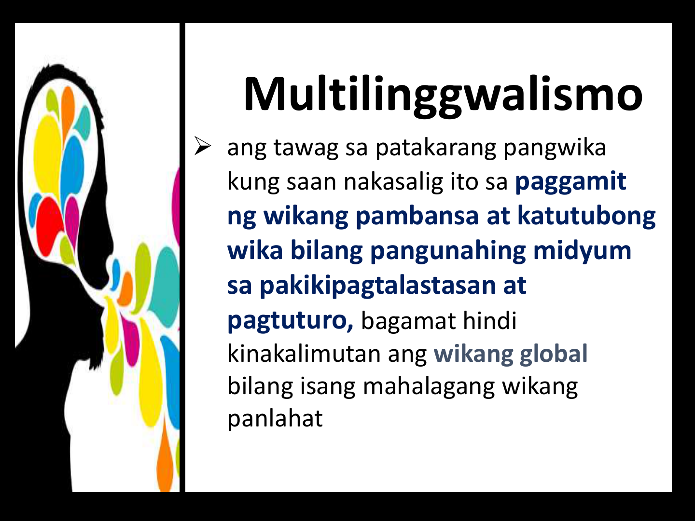

*Pigura 35: Multilingguwalismo at MTB-MLE (RA 10533) — Patakarang pangwika na nakasalig sa paggamit ng unang wika (mother tongue) bilang midyum ng pagtuturo mula Kindergarten hanggang Baitang 3.*

Ang Pilipinas ay isang multilingguwal na bansa na may **mahigit 170 buhay na katutubong wika**, kung saan may walong pangunahing wika: Tagalog, Cebuano, Ilokano, Hiligaynon, Waray, Kapampangan, Pangasinense, at Bikolano.

* **Batas Republika Blg. 10533 (Enhanced Basic Education Act of 2013 / K to 12 Law)**: Pormal na ipinatupad ang **Mother Tongue-Based Multilingual Education (MTB-MLE)**.

* **Paano Ipinapatupad ang MTB-MLE?**:

  * **Kindergarten hanggang Grade 3**: Ang **Unang Wika (Mother Tongue)** ng bata ang ginagamit na wikang panturo sa lahat ng asignatura. May 19 na lokal na wika ang opisyal na ginagamit sa iba't ibang rehiyon (kabilang ang Chavacano, Tausug, Maguindanaon, Meranaw, Ivatan, Sambal, Kinaray-a, at Yakan).

  * **Grade 4 pataas**: Unti-unting ipinapasok ang Filipino at Ingles bilang pangunahing wikang panturo.

* **Kahalagahan ng MTB-MLE**:

  * Napatunayan sa mga siyentipikong pag-aaral na mas mabilis matutong bumasa, sumulat, magbilang, at mag-isip nang kritikal ang bata kapag ang wikang ginagamit sa paaralan ay ang wikang sinasalita niya sa tahanan.

  * Pinatitibay nito ang pagpapahalaga sa katutubong kultura at iniiwasan ang pagkawala ng mga rehiyonal na wika sa bansa.

---

### 4.3 Gahum ng Wikang Ingles at Pagsusuri sa *Speak in English Zone* ni Joel Malabanan

*(Sanggunian: Awit at Tulang Sosyo-Politikal ni Joel Costa Malabanan)*

Sa maraming pribado at pampublikong paaralan sa bansa, matagal nang umiiral ang patakarang **"Speak in English Zone."** Ang patakarang ito ay masusing sinuri at pinuna ng makata, kompositor, at propesor na si **Joel Costa Malabanan** sa kanyang tanyag na awit:

```

┌────────────────────────────────────────────────────────────────────────────────────────┐

│             PAGSUSURI SA AWIT NA "SPEAK IN ENGLISH ZONE" NI JOEL MALABANAN             │

├────────────────────────────────────────────────────────────────────────────────────────┤

│ "Sa bawat sulok ng ating paaralan, may nakapaskil na 'Speak in English Zone'           │

│  Bawal magsalita sa sariling wika, kapag nahuli ka ay may karampatang multa..."        │

├────────────────────────────────────────────────────────────────────────────────────────┤

│ 1. Pagtatanim ng Kolonyal na Pagkabilanggo: Ipinaparamdam sa mga bata na ang sariling  │

│    wika ay mababa, atrasado, at dapat ikahiya sa loob ng institusyong pang-akademiko.  │

│ 2. Edukasyong Pang-Eksport ng Lakas-Paggawa: Sa halip na magsanay ng mga siyentipiko   │

│    at inhinyero para sa pambansang industriyalisasyon ng Pilipinas, hinuhubog ang mga  │

│    mag-aaral upang maging murang lakas-paggawa para sa dayuhan (call center, OFW).     │

│ 3. Pambubusal sa Karapatang Pangwika: Ang pagmumulta at pagpaparusa sa mga batang      │

│    nagsasalita ng Filipino o katutubong wika ay tahasang pagyurak sa kanilang identidad│

│ 4. Panawagan sa Paglaya: Pagtindig na ang tunay na kalayaan at pag-unlad ng bayan ay  │

│    magmumula lamang sa pagyakap sa sariling wika: "Sariling wika ang magpapalaya!"    │

└────────────────────────────────────────────────────────────────────────────────────────┘

```

Ayon kay Malabanan, ang "Speak in English Zone" ay hindi lamang simpleng patakaran sa paaralan; ito ay simbolo ng patuloy na **gahum (hegemony)** ng imperyalismong Amerikano sa edukasyon ng Pilipinas na naglalayong lumikha ng mga mamamayang maglilingkod sa dayuhang interes sa halip na maglingkod sa sariling bayan.

---

### 4.4 Pakikibaka ng Tanggol Wika: CMO Blg. 20, Serye 2013 at Intelektwalisasyon

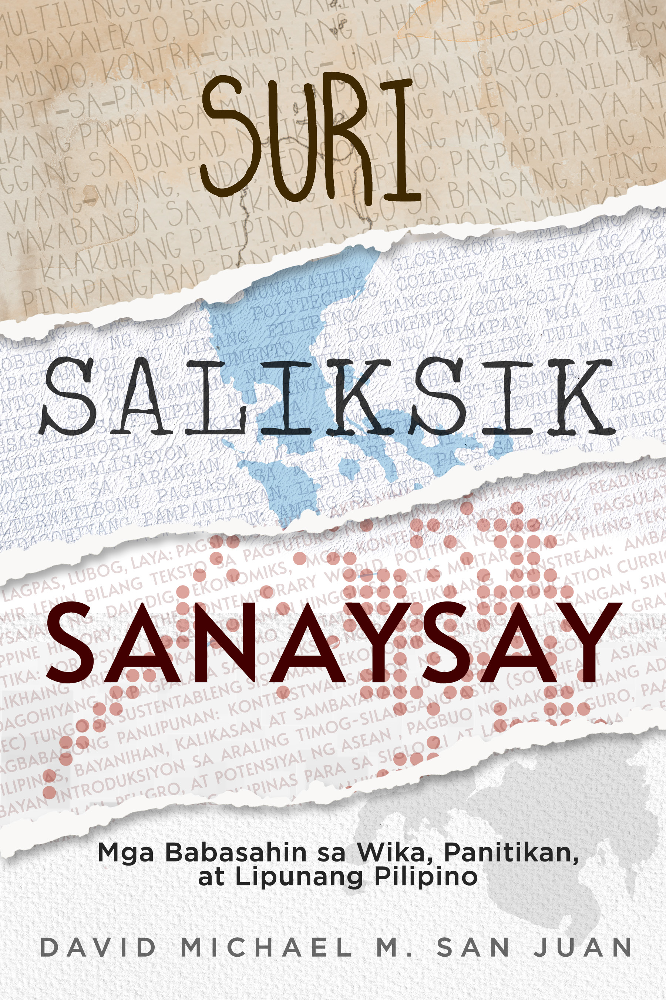

*Pigura 36: Aklat na "Suri, Saliksik, Sanaysay" ni Dr. David Michael M. San Juan ukol sa pakikibaka ng Tanggol Wika at pagtatanggol sa asignaturang Filipino sa kolehiyo.*

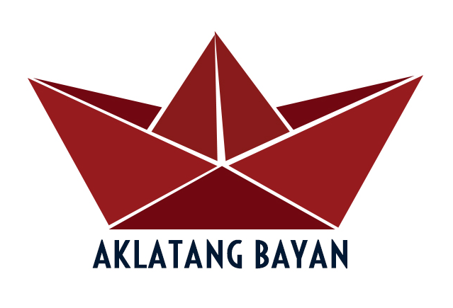

*Pigura 37: Opisyal na Tatak ng Sentro ng Wikang Filipino (SWF – UP Diliman) para sa Aklatang Bayan Online at pambansang intelektwalisasyon ng wikang Filipino.*

*(Sanggunian: David Michael M. San Juan, 2020, Suri, Saliksik, Sanaysay, ph. 130–169)*

Ang isa sa pinakamatinding banta sa wikang pambansa sa kasalukuyang siglo ay ang tangkang pagpatay sa asignaturang Filipino sa kolehiyo.

```

┌────────────────────────────────────────────────────────────────────────────────────────┐

│                       KASAYSAYAN NG PAKIKIBAKA NG TANGGOL WIKA                         │

└──────────────────────────────────────────┬─────────────────────────────────────────────┘

                                           │

  ┌────────────────────────────────────────┴──────────────────────────────────────────┐

  │ 1. HUNYO 28, 2013: Inilabas ng CHED ang CMO Blg. 20, Serye 2013 na nag-aalis sa    │

  │    mandatoryong 6 hanggang 9 na yunit ng Filipino at Panitikan sa Kolehiyo.        │

  └────────────────────────────────────────┬──────────────────────────────────────────┘

                                           │

  ┌────────────────────────────────────────┴──────────────────────────────────────────┐

  │ 2. HUNYO 21, 2014: Itinatag ang TANGGOL WIKA sa De La Salle University-Manila ng    │

  │    mahigit 500 delegado sa pamumuno nina Dr. David Michael San Juan at Lumbera.    │

  └────────────────────────────────────────┬──────────────────────────────────────────┘

                                           │

  ┌────────────────────────────────────────┴──────────────────────────────────────────┐

  │ 3. ABRIL 15, 2015: Nagsampa ang Tanggol Wika ng Petisyon sa Korte Suprema           │

  │    (G.R. No. 217451) upang ipadeklarang labag sa Saligang Batas ang CMO 20.        │

  └────────────────────────────────────────┬──────────────────────────────────────────┘

                                           │

  ┌────────────────────────────────────────┴──────────────────────────────────────────┐

  │ 4. ABRIL 21, 2015: Nagpalabas ang Korte Suprema ng TEMPORARY RESTRAINING ORDER     │

  │    (TRO) na pumigil sa CHED na ipatupad ang pag-aalis sa Filipino at Panitikan.     │

  └────────────────────────────────────────┬──────────────────────────────────────────┘

                                           │

  ┌────────────────────────────────────────┴──────────────────────────────────────────┐

  │ 5. OKTUBRE 2018 / MARSO 2019: Binawi ng Korte Suprema ang TRO at idineklarang legal│

  │    ang CMO 20; inilipat ng Tanggol Wika ang laban sa antas ng mga unibersidad.     │

  └────────────────────────────────────────────────────────────────────────────────────┘

```

#### Ang Pagsibol at Pakikibaka ng Tanggol Wika:

1. **Ang Banta ng CMO No. 20, s. 2013**:

   * Noong Hunyo 28, 2013, naglabas ang Commission on Higher Education (CHED) ng **CHED Memorandum Order (CMO) No. 20, Series of 2013** na nagbabalangkas ng bagong General Education Curriculum (GEC) sa antas tersyarya.

   * Sa bagong kurikulum, **ganap na tinanggal ang dating 6 hanggang 9 na yunit ng Filipino at Panitikan** sa kolehiyo, sa katwirang naituro na raw ang mga ito sa Senior High School (Grades 11 at 12).

2. **Pagtatatag ng Tanggol Wika (Hunyo 21, 2014)**:

   * Bilang pagtutol, nagtipon ang halos 500 guro, propesor, manunulat, at lider-estudyante mula sa mahigit 40 kolehiyo at unibersidad sa De La Salle University-Manila noong **Hunyo 21, 2014**.

   * Itinatag nila ang **Alyansa ng mga Tagapagtanggol ng Wikang Filipino (TANGGOL WIKA)** sa pangunguna nina **Dr. David Michael M. San Juan** (DLSU), Pambansang Alagad ng Sining **Dr. Bienvenido Lumbera**, at Dr. Antonio Contreras.

3. **Mga Pangunahing Argumento ng Tanggol Wika**:

   * **Paglabag sa Saligang Batas ng 1987**: Malinaw sa Artikulo XIV, Seksyon 6 na dapat puspusang itaguyod ng pamahalaan ang paggamit ng Filipino bilang wika ng pagtuturo sa lahat ng antas ng edukasyon. Ang pag-alis dito sa kolehiyo ay isang paglabag sa Konstitusyon.

   * **Intelektwalisasyon ng Wika**: Sa kolehiyo nagaganap ang mas mataas na pananaliksik, pagsasalin, at diskursong pang-akademiko. Kung aalisin ang Filipino sa kolehiyo, mapipigil ang paglago nito bilang wika ng agham, pilosopiya, ekonomiks, at batas, at mananatili itong wika lamang ng mababang antas.

   * **Katiyakan sa Trabaho ng mga Guro**: Malalagay sa panganib ang kabuhayan ng libo-libong guro ng Filipino at Panitikan sa buong bansa.

4. **Ang Laban sa Korte Suprema (G.R. No. 217451)**:

   * Noong **Abril 15, 2015**, pormal na nagsampa ng petisyon ang Tanggol Wika sa Korte Suprema.

   * Noong **Abril 21, 2015**, nagtagumpay ang Tanggol Wika nang magpalabas ang Korte Suprema ng isang **Temporary Restraining Order (TRO)** laban sa CHED.

5. **Ang Desisyon noong 2018–2019**:

   * Noong **Oktubre 9, 2018**, naglabas ng pinal na desisyon ang Korte Suprema (isinulat ni Justice Alfredo Benjamin Caguioa) na nagpawalang-bisa sa TRO at nagdeklara na legal ang CMO 20, sa pangangatwirang ang mandato ng CHED ay magtakda lamang ng pinakamababang kahingian (*minimum requirements*).

   * Sa kabila nito, patuloy ang tagumpay ng Tanggol Wika dahil napagtagumpayan nilang kumbinsihin ang maraming progresibong unibersidad (tulad ng UP, DLSU, PUP, UST, at Ateneo) na **magpanatili ng mandatoryong 6 hanggang 9 na yunit ng Filipino sa kanilang mga pamantasan**.

---

### 4.5 Sitwasyong Pangwika sa Kasalukuyang Lipunang Pilipino

| Larangan sa Lipunan | Umiiral na Wikang Gamit | Pagsusuring Sosyolinggwistiko |

| :--- | :--- | :--- |

| **Telebisyon at Radyo** | **Filipino / Taglish** | Ang mga pangunahing pambansang estasyon (*TV Patrol, 24 Oras*), teleserye, at FM radio ay gumagamit ng Filipino upang maabot ang pinakamaraming manonood at tagapakinig. |

| **Pahayagan (Print Media)** | **Hati ayon sa Uri ng Lipunan** | May malinaw na paghahati sa lipunan: Ang mga **Broadsheet** (*Inquirer, Philippine Star*) ay nasa wikang Ingles para sa mga maykaya at propesyonal; ang mga **Tabloid** (*Pilipino Star Ngayon, Abante*) ay nasa wikang Filipino para sa masa. |

| **Social Media at Internet** | **Taglish at Code-Switching** | Laganap ang paghahalo ng Ingles at Filipino sa Facebook, TikTok, X (Twitter), at YouTube. Umuusbong ang mga bagong balbal, acronym, at memes. |

| **Batas at Pamahalaan** | **Pangingibabaw ng Ingles** | Ang mga batas, desisyon ng Korte Suprema, at mga opisyal na dokumento ng pamahalaan ay nananatiling nakasulat sa wikang Ingles, na lumilikha ng agwat sa pagitan ng gobyerno at ng masang mamamayan. |

---

## Talasalitaan / Glosaryo ng mga Konseptong Pangwika

* **Arbitraryo**: Katangian ng wika kung saan ang pagpapangalan sa mga bagay ay napagkasunduan lamang ng isang grupo ng tao at walang likas na dahilan.

* **Balarila**: Ang sistema ng mga tuntunin sa wastong paggamit at pagbubuo ng mga salita at pangungusap sa isang wika.

* **Barayti ng Wika**: Ang pagkakaiba-iba sa loob ng isang wika dulot ng heograpiya, antas ng lipunan, propesyon, at sitwasyon.

* **Baybayin**: Ang sinaunang katutubong alpabeto at sistema ng pagsulat ng mga Pilipino bago dumating ang mga Espanyol na binubuo ng 17 titik.

* **Bilingguwalismo**: Ang kakayahan ng isang tao o komunidad na gumamit at makipagtalastasan sa dalawang magkaibang wika.

* **Chavacano**: Isang creole na wika sa Zamboanga at Cavite na may bokabularyong Espanyol at estrukturang gramatikal na Pilipino.

* **Conyo / Konyo**: Isang sosyolek na paraan ng pagsasalita kung saan pinaghahalo ang Tagalog at Ingles na karaniwang maririnig sa kabataang maykaya.

* **Creole**: Isang wika na orihinal na nagmula sa pidgin subalit naging unang wika (L1) na ng sumunod na henerasyon sa isang pamayanan.

* **Dayalek (Dialect)**: Barayti ng wika na nalilikha batay sa dimensyong heograpikal o lugar na pinagmulan ng nagsasalita.

* **Ekolek (Ecolect)**: Barayti ng wika na karaniwang ginagamit at maririnig lamang sa loob ng isang tahanan o pamilya.

* **Etnolek (Ethnolect)**: Barayti ng wika na nagmula sa mga katutubong pangkat-etniko sa Pilipinas (tulad ng Ivatan, T'boli, Maranao).

* **Filipino**: Ang pambansang wika ng Pilipinas ayon sa Artikulo XIV, Seksyon 6 ng Saligang Batas ng 1987.

* **Gahum (Hegemony)**: Ang pangingibabaw, kontrol, at impluwensya ng isang makapangyarihang bansa o uri sa lipunan gamit ang wika at kultura.

* **Heterogeneous**: Ang katangian ng wikang nagpapakita ng pagkakaiba-iba, baryasyon, at sarisaring estilo sa aktwal na paggamit ng mga tao.

* **Homogeneous**: Ang teoretikal na pananaw na ang wika ay pare-pareho at iisa ang anyo para sa lahat ng tagapagsalita nito.

* **Idyolek (Idiolect)**: Ang pansarili at natatanging estilo o tatak sa pagsasalita ng isang partikular na indibidwal.

* **Intelektwalisasyon**: Ang proseso ng pagpapayabong at pagpapalawak sa wika upang magamit ito sa mataas na antas ng karunungan, agham, batas, at pananaliksik.

* **Jargon**: Ang mga tanging salita o bokabularyo na partikular lamang sa isang tiyak na propesyon, disiplina, o larangan ng trabaho.

* **Jejemon**: Isang subkultura ng kabataan sa pagtetext kung saan binabago at pinahahaba ang baybay ng salita gamit ang mga numero at bantas.

* **Komisyon sa Wikang Filipino (KWF)**: Ang ahensya ng pamahalaan na nilikha sa ilalim ng RA 7104 upang magpaunlad at magpalaganap ng wikang Filipino.

* **Linggwistikong Komunidad**: Isang grupo ng mga taong regular na nag-uusap at may magkakatulad na pamantayan at tuntunin sa paggamit ng wika.

* **Morpema**: Ang pinakamaliit na yunit ng isang salita na nagtataglay ng kahulugan (salitang-ugat, panlapi).

* **Mother Tongue-Based Multilingual Education (MTB-MLE)**: Ang programa sa ilalim ng RA 10533 kung saan ang unang wika ng bata ang ginagamit na panturo sa K–3.

* **Pidgin**: Isang makeshift na wika na nabubuo sa pagitan ng dalawang taong walang iisang wika upang magkaunawaan; walang katutubong tagapagsalita.

* **Pilipino**: Ang pangalang itinawag sa wikang pambansa noong 1959 sa ilalim ng Kautusang Pangkagawaran Blg. 7 ni Kalihim Jose E. Romero.

* **Ponema**: Ang pinakamaliit na makabuluhang yunit ng tunog sa isang wika na nagpapaiba ng kahulugan ng salita.

* **Register**: Ang pag-aangkop ng wika batay sa larangan (Field), kausap (Tenor), at paraan ng pagpapahayag (Mode).

* **Sintaksis**: Ang makaagham na pag-aaral ng estruktura at pagsasama-sama ng mga salita upang makabuo ng pangungusap.

* **Sosyolek (Sociolect)**: Barayti ng wika na nalilikha batay sa pangkat sa lipunan na kinabibilangan ng nagsasalita (edad, kasarian, propesyon).

* **Surian ng Wikang Pambansa (SWP)**: Ang ahensyang itinatag noong 1936 sa ilalim ng Batas Komonwelt Blg. 184 na pumili sa Tagalog bilang batayan ng wikang pambansa.

* **Tagalog**: Ang katutubong wika sa Katagalugan na iprinoklama noong 1937 bilang batayan ng Wikang Pambansa ng Pilipinas.

* **Tanggol Wika**: Ang alyansa ng mga guro at manunulat na itinatag noong 2014 upang ipagtanggol ang asignaturang Filipino at Panitikan sa kolehiyo.

* **Unang Wika (L1)**: Ang wikang natutuhan ng isang tao mula sa kanyang kapanganakan sa loob ng kanyang tahanan; mother tongue.

---

## Mga Tanong sa Pagbabalik-Aral at Pagsusuri

### Unang Bahagi: Kahulugan at Katangian ng Wika

1. Ipaliwanag ang kahulugan ng wika ayon kay Henry Allan Gleason Jr. Bakit itinuturing na pundamental ang katangiang *"masistemang balangkas"*?

2. Paano pinatutunayan ng mayamang bokabularyo ng palay at bigas sa Pilipinas (*palay, bigas, kanin, bahaw, tutong, sinangag*) na ang wika ay nakabatay sa kultura?

3. Ano ang ibig sabihin ng katangiang *arbitraryo* ang wika? Magbigay ng sariling halimbawa na nagpapakita nito sa iba't ibang wika sa Pilipinas.

### Ikalawang Bahagi: Kasaysayan ng Wikang Pambansa

1. Isa-isahin ang ebolusyon ng katawagan sa ating wikang pambansa: **Tagalog (1937) $\longrightarrow$ Pilipino (1959) $\longrightarrow$ Filipino (1987)**. Ano ang naging dahilan sa bawat pagpapalit ng pangalan?

2. Bakit tinawag ng mga historyador ang Panahon ng mga Hapones bilang *"Gintong Panahon ng Wikang Pambansa"*?

3. Ayon sa bidyo ni Dr. Bienvenido Lumbera, paano ginamit ng mga mananakop na Amerikano ang wikang Ingles bilang instrumento ng kolonyalismo at panlilinlang?

### Ikatlong Bahagi: Baryasyon at Barayti ng Wika

1. Ano ang pagkakaiba ng **Pidgin** sa **Creole**? Paano umusbong ang wikang Chavacano sa Zamboanga at Cavite?

2. Pumili ng isang tanyag na personalidad sa telebisyon o radyo. Suriin ang kanyang **idyolek** batay sa kanyang boses, himig, at paboritong bukambibig.

3. Ipaliwanag ang limang antas ng register ayon kay Martin Joos (*Frozen, Formal, Consultative, Casual, Intimate*). Magbigay ng isang sitwasyon kung saan nagagamit ang bawat isa.

### Ikaapat na Bahagi: Mga Isyu at Sitwasyong Pangwika

1. Ano ang pinupuna ni Joel Costa Malabanan sa kanyang awit na *"Speak in English Zone"* hinggil sa layunin ng edukasyon sa Pilipinas?

2. Bakit itinatag ang **Tanggol Wika** noong Hunyo 21, 2014? Ano ang naging banta ng CHED Memorandum Order (CMO) Blg. 20, Serye 2013 sa wikang Filipino?

3. Bakit mahalaga ang **Mother Tongue-Based Multilingual Education (MTB-MLE)** sa mga mag-aaral mula Kindergarten hanggang Grade 3?

---

## Pagsasanay at Pagsusulit na may Susi sa Pagwawasto

### Pagsusulit (15 Aytem na Multiple Choice)

1. Sino ang dalubwikang nagbigay ng tanyag na depinisyon na ang wika ay *"masistemang balangkas ng sinasalitang tunog na pinipili at isinasaayos sa paraang arbitraryo"*?

   * A) Archibald A. Hill

   * B) Henry Allan Gleason Jr.

   * C) Edward Sapir

   * D) Lope K. Santos

2. Anong saligang batas ang kauna-unahang nagtakda na ang wikang Tagalog ang siyang magiging opisyal na wika ng pamahalaang rebolusyonaryo?

   * A) Saligang Batas ng Malolos (1899)

   * B) Saligang Batas ng Biak-na-Bato (1897)

   * C) Saligang Batas ng 1935

   * D) Saligang Batas ng 1973

3. Anong batas ang pinagtibay noong 1936 na nagtatag sa Surian ng Wikang Pambansa (SWP)?

   * A) Batas Komonwelt Blg. 184

   * B) Batas Komonwelt Blg. 570

   * C) Batas Blg. 74 ng Komisyon ng Pilipinas

   * D) Batas Republika Blg. 7104

4. Sino ang iskolar mula sa Samar-Leyte na hinirang ni Pangulong Manuel L. Quezon bilang unang Tagapangulo ng Surian ng Wikang Pambansa?

   * A) Lope K. Santos

   * B) Jaime C. de Veyra

   * C) Cecilio Lopez

   * D) Santiago Fonacier

5. Noong 1959, anong kautusang pangkagawaran ang inilabas ni Kalihim Jose E. Romero na nagtakdang tawaging "Pilipino" ang wikang pambansa?

   * A) Kautusang Pangkagawaran Blg. 25

   * B) Kautusang Pangkagawaran Blg. 7

   * C) Kautusang Tagapagpaganap Blg. 134

   * D) Kautusang Tagapagpaganap Blg. 263

6. Aling artikulo at seksyon sa Saligang Batas ng 1987 ang nagsasaad na *"Ang wikang pambansa ng Pilipinas ay Filipino"*?

   * A) Artikulo XIV, Seksyon 6

   * B) Artikulo XIV, Seksyon 3

   * C) Artikulo XV, Seksyon 2

   * D) Artikulo XII, Seksyon 7

7. Ang barayti ng wika na nalilikha batay sa heograpikal na lokasyon o pook na kinabibilangan ng tagapagsalita ay tinatawag na:

   * A) Sosyolek

   * B) Dayalek

   * C) Idyolek

   * D) Ekolek

8. Ang natatanging paraan ng pagsasalita ng mamamahayag na si Mike Enriquez sa kanyang linyang *"Hindi namin kayo tatantanan!"* ay halimbawa ng anong barayti?

   * A) Dayalek

   * B) Idyolek

   * C) Sosyolek

   * D) Etnolek

9. Ano ang tawag sa isang makeshift o pansamantalang wika na nabubuo sa pagitan ng dalawang taong walang iisang wika na walang katutubong tagapagsalita?

   * A) Creole

   * B) Pidgin

   * C) Sosyolek

   * D) Ekolek

10. Aling creole na wika sa Pilipinas ang sinasalita sa Zamboanga at Cavite na may halong bokabularyong Espanyol at gramatikang katutubo?

    * A) Chavacano

    * B) Ibanag

    * C) Kinaray-a

    * D) Waray

11. Ayon kay Martin Joos, anong antas ng register ang ginagamit sa mga seremonyang panrelihiyon at hindi nagbabagong dokumento tulad ng Panatang Makabayan?

    * A) Pormal

    * B) Frozen (Estatiko)

    * C) Konsultatibo

    * D) Kaswal

12. Anong programa sa ilalim ng K to 12 Law (RA 10533) ang nag-uutos na gamitin ang unang wika ng bata bilang wikang panturo mula Kindergarten hanggang Grade 3?

    * A) Bilingual Education Policy (BEP)

    * B) English-Only Instruction Policy

    * C) Mother Tongue-Based Multilingual Education (MTB-MLE)

    * D) Monolingual Education Act

13. Anong memorandum order ng CHED na inilabas noong 2013 ang nagtangkang mag-alis sa asignaturang Filipino at Panitikan sa kolehiyo?

    * A) CMO Blg. 46, s. 2012

    * B) CMO Blg. 20, s. 2013

    * C) CMO Blg. 15, s. 2014

    * D) CMO Blg. 7, s. 2015

14. Ano ang pangalan ng malawak na alyansa ng mga guro at mag-aaral na itinatag noong Hunyo 21, 2014 sa DLSU upang ipagtanggol ang Filipino sa kolehiyo?

    * A) Tanggol Wika

    * B) Sentro ng Wikang Filipino

    * C) Pambansang Samahan sa Wika

    * D) Katipunan ng mga Guro

15. Sino ang makata, guro, at kompositor na sumulat ng awit na *"Speak in English Zone"* na tumutuligsa sa kolonyal na edukasyon sa mga paaralan?

    * A) Bienvenido Lumbera

    * B) Joel Costa Malabanan

    * C) Joey Ayala

    * D) Gary Granada

---

### Susi sa Pagwawasto at mga Paliwanag

1. **B — Henry Allan Gleason Jr.**: Ang depinisyon ni Gleason noong 1961 ang batayang depinisyon ng wika na ginagamit sa kurikulum ng DepEd.

2. **B — Saligang Batas ng Biak-na-Bato (1897)**: Sa Artikulo VIII ng Saligang Batas ng Biak-na-Bato, unang idineklara ang Tagalog bilang opisyal na wika ng rebolusyon.

3. **A — Batas Komonwelt Blg. 184**: Isinulat ni Norberto Romualdez noong 1936 na nagtatag sa Surian ng Wikang Pambansa.

4. **B — Jaime C. de Veyra**: Si De Veyra ay isang iginagalang na iskolar mula sa Samar-Leyte na hinirang upang matiyak na hindi lamang mga Tagalog ang pipili ng wikang pambansa.

5. **B — Kautusang Pangkagawaran Blg. 7**: Inilabas ni Kalihim Jose Romero upang gawing "Pilipino" ang tawag sa wika at maiwasan ang rehiyonal na pagtutol.

6. **A — Artikulo XIV, Seksyon 6**: Tahasang nakasaad sa Seksyon 6 na ang wikang pambansa ng Pilipinas ay Filipino.

7. **B — Dayalek**: Ang dayalek ay barayting heograpikal na nalilikha dahil sa distansya o lokasyon.

8. **B — Idyolek**: Ang idyolek ay ang indibidwal at personal na tatak ng pagsasalita ng isang tao.

9. **B — Pidgin**: Ang pidgin ay tinatawag na *"nobody's native language"* dahil walang katutubong tagapagsalita nito; makeshift wika ito ng dalawang nagtatagpong grupo.

10. **A — Chavacano**: Ang Chavacano ay isang creole na umusbong sa Zamboanga at Cavite mula sa pagsasama ng Espanyol at katutubong wika.

11. **B — Frozen (Estatiko)**: Sa teorya ni Martin Joos, ang frozen register ay hindi nagbabago at binibigkas nang buo tulad ng mga panunumpa at panalangin.

12. **C — Mother Tongue-Based Multilingual Education (MTB-MLE)**: Ipinatupad sa ilalim ng RA 10533 mula K hanggang Grade 3.

13. **B — CMO Blg. 20, s. 2013**: Ang kautusan ng CHED na nagtanggal sa mandatoryong Filipino at Panitikan sa General Education Curriculum sa kolehiyo.

14. **A — Tanggol Wika**: Ang Alyansa ng mga Tagapagtanggol ng Wikang Filipino na itinatag nina Dr. David Michael San Juan at Bienvenido Lumbera noong Hunyo 21, 2014.

15. **B — Joel Costa Malabanan**: Si Prop. Joel Costa Malabanan ang sumulat at naglapat ng musika sa *"Speak in English Zone."*

---

## Talaan ng mga Pinagkunang Sanggunian

Ang lahat ng datos, batas, sipi, at aralin sa gabay na ito ay kinuha mula sa mga aktwal na aklat, modyul, at dokumentong pangkasaysayan na nasa folder ng kurso:

1. **Kagawaran ng Edukasyon (DepEd) & Komisyon sa Wikang Filipino**:

   * *KOMUNIKASYON AT PANANALIKSIK SA WIKA AT KULTURANG PILIPINO: Modyul para sa Senior High School*, Aralin 1: Wika: Kahulugan, Katangian, at Kahalagahan; Kasaysayan ng Wikang Pambansa; at Baryasyon ng Wika, ph. 1–62.

2. **Lumbera, Bienvenido (2000)**:

   * *Writing the Nation / Pag-akda ng Bansa*, Lungsod Quezon: University of the Philippines Press, ph. 96–104.

   * *Kasaysayan ng Wikang Pambansa* (Dokumentaryong Video-Lektura), Sentro ng Wikang Filipino – UP Diliman at National Commission for Culture and the Arts (NCCA).

3. **San Juan, David Michael M. (2020)**:

   * *Suri, Saliksik, Sanaysay: Mga Babasahin sa Wika, Panitikan, at Lipunang Pilipino*, Lungsod Quezon: Sentro ng Wikang Filipino – Unibersidad ng Pilipinas Diliman, ISBN 978-621-8196-38-4 (aklat), ISBN 978-621-8196-37-7 (pdf):

     * *"Multilinggwalismo: Salbabida ng Wikang Filipino at Mga Dayalekto, Bagong Kahingian ng Globalisadong Mundo"*, ph. 5–31.

     * *"Kontra-Gahum: Ang Lahatang-Panig at Kapit-sa-Patalim na Pag-unlad at Pagsulong ng Wikang Pambansa Mula sa Panahon ng Kolonyalismo Hanggang sa Bungad ng Ikalawang Milenyo"*, ph. 32–56.

     * *"Alyansa ng mga Tagapagtanggol ng Wikang Filipino/TANGGOL WIKA: Internal na Kwento, Mga Susing Argumento at Dokumento (2014-2017)"*, ph. 130–169.

4. **Malabanan, Joel Costa (2008)**:

   * *"Speak in English Zone"* (Awit at Tulang Sosyo-Politikal sa Wika, Edukasyon, at Ekonomiya), De La Salle University-Dasmariñas.

5. **Paz, Consuelo J., Vivencio R. Jose, at Arnold M. Azurin (2003)**:

   * *Ang Wikang Filipino: Atin Ito*, Lungsod Quezon: Sentro ng Wikang Filipino, Unibersidad ng Pilipinas Diliman.

6. **Torres-Yu, Rosario (2011)**:

   * *Alinagnag: Sanaysay ng mga Panlipunang Panunuri sa Panitikan*, Maynila: UST Publishing House.

7. **Gleason, Henry Allan Jr. (1961)**:

   * *An Introduction to Descriptive Linguistics*, Revised Edition, New York: Holt, Rinehart and Winston.

8. **Mga Batas, Kautusan, at Probisyong Konstitusyonal**:

   * *Saligang Batas ng Republika ng Pilipinas ng 1987*, Artikulo XIV, Seksyon 6, 7, 8, at 9.

   * *Saligang Batas ng 1973*, Artikulo XV, Seksyon 3, Talata 2.

   * *Saligang Batas ng 1935*, Artikulo XIV, Seksyon 3.

   * *Saligang Batas ng Biak-na-Bato ng 1897*, Artikulo VIII.

   * *Batas Komonwelt Blg. 184 (1936)* (Pagtatatag ng Surian ng Wikang Pambansa).

   * *Kautusang Tagapagpaganap Blg. 134 (1937)* (Tagalog bilang batayan ng Wikang Pambansa).

   * *Kautusang Tagapagpaganap Blg. 263 (1940)* (Pagtuturo ng Wikang Pambansa at Balarila).

   * *Batas Komonwelt Blg. 570 (1946)* (Pambansang wika bilang wikang opisyal).

   * *Kautusang Pangkagawaran Blg. 7, s. 1959* (Pagpapalit ng tawag sa "Pilipino").

   * *Kautusang Pangkagawaran Blg. 25, s. 1974* (Patakarang Edukasyong Bilingguwal).

   * *Batas Republika Blg. 7104 (1991)* (Pagtatatag ng Komisyon sa Wikang Filipino).

   * *Kautusang Tagapagpaganap Blg. 335 (1988)* (Paggamit ng Filipino sa mga tanggapan ng pamahalaan).

   * *Batas Republika Blg. 10533 (2013)* (Enhanced Basic Education Act / MTB-MLE).

   * *CHED Memorandum Order (CMO) No. 20, Series of 2013*.

   * *Korte Suprema ng Pilipinas*, G.R. No. 217451 (*Tanggol Wika vs. Commission on Higher Education*).

