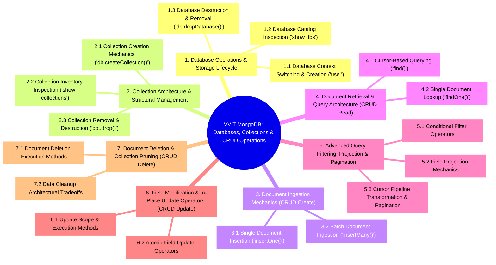
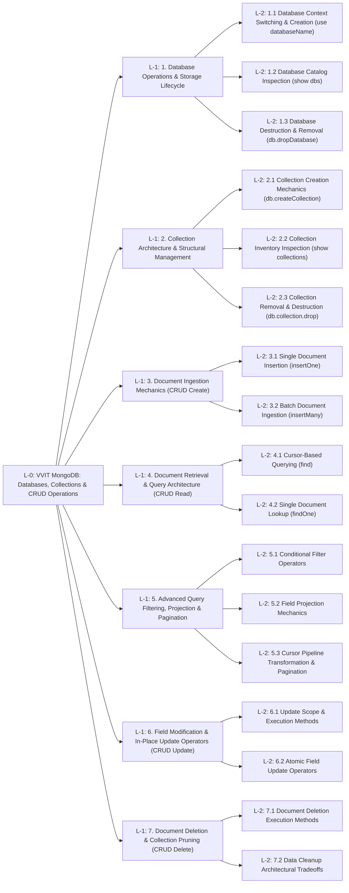

# Databases, Collections & CRUD Operations — Topic & Sub-Topic Mindmap (L-0 to L-2)

---

## 1. Visual Mindmap (Mermaid Mindmap — `L-0` to `L-2`)

---

## 2. Directed Architecture Flowchart (`L-0` $\rightarrow$ `L-1` $\rightarrow$ `L-2`)

---

## 3. Complete `L-0` $\rightarrow$ `L-1` $\rightarrow$ `L-2` Structural Mapping Table

| Level `L-1` Topic Node | Level `L-2` Sub-Topic Node | Primary Command / Operator Scope | Source Coverage |
| :--- | :--- | :--- | :--- |
| **`1.0` Database Operations & Storage Lifecycle** | **`1.1` Database Context Switching & Creation** | `use <databaseName>`, lazy materialization on first write | Slide 1, Doc Sec 1 |
| **`1.0` Database Operations & Storage Lifecycle** | **`1.2` Database Catalog Inspection** | `show dbs`, physical storage footprint (`0.000GB`), unwritten DB hiding | Slide 2, Doc Sec 1 |
| **`1.0` Database Operations & Storage Lifecycle** | **`1.3` Database Destruction & Removal** | `db.dropDatabase()`, irreversible catalog and disk extent purge | Slide 3, Doc Sec 1 |
| **`2.0` Collection Architecture & Structural Management** | **`2.1` Collection Creation Mechanics** | Implicit auto-creation vs. `db.createCollection(name, options)`, capped collections | Slide 4, Doc Sec 2 |
| **`2.0` Collection Architecture & Structural Management** | **`2.2` Collection Inventory Inspection** | `show collections`, active database namespace listing | Slide 5, Doc Sec 2 |
| **`2.0` Collection Architecture & Structural Management** | **`2.3` Collection Removal & Destruction** | `db.<collection>.drop()`, container + B-tree index removal, boolean return | Slide 6, Doc Sec 2 |
| **`3.0` Document Ingestion Mechanics (CRUD Create)** | **`3.1` Single Document Insertion** | `db.<collection>.insertOne(doc)`, 12-byte `ObjectId` `_id` generation | Slide 7, Doc Sec 3 |
| **`3.0` Document Ingestion Mechanics (CRUD Create)** | **`3.2` Batch Document Ingestion** | `db.<collection>.insertMany([doc1, doc2, ...])`, single-roundtrip array write | Slide 7, Doc Sec 3 |
| **`4.0` Document Retrieval & Query Architecture (CRUD Read)** | **`4.1` Cursor-Based Querying** | `db.<collection>.find(filter, projection)`, streaming cursor pointer | Slide 8, Doc Sec 3–4 |
| **`4.0` Document Retrieval & Query Architecture (CRUD Read)** | **`4.2` Single Document Lookup** | `db.<collection>.findOne(filter, projection)`, direct object or `null` return | Slide 13, Doc Sec 3–4 |
| **`5.0` Advanced Query Filtering, Projection & Pagination** | **`5.1` Conditional Filter Operators** | `$gt`, `$gte`, `$lt`, `$lte`, `$ne`, `$in`, `$nin`, `$or`, `$and` | Slides 11–12, Doc Sec 4 |
| **`5.0` Advanced Query Filtering, Projection & Pagination** | **`5.2` Field Projection Mechanics** | `{ field: 1 }`, `{ field: 0 }`, default `_id` inclusion vs. `{ _id: 0 }` | Slide 14, Doc Sec 4 |
| **`5.0` Advanced Query Filtering, Projection & Pagination** | **`5.3` Cursor Pipeline Transformation & Pagination** | `sort({ field: 1 \| -1 })`, `skip(n)`, `limit(n)`, deterministic `sort().skip().limit()` | Slide 15, Doc Sec 4 |
| **`6.0` Field Modification & In-Place Update Operators (CRUD Update)** | **`6.1` Update Scope & Execution Methods** | `updateOne(filter, update)`, `updateMany(filter, update)` | Slides 9, 14, Doc Sec 3 |
| **`6.0` Field Modification & In-Place Update Operators (CRUD Update)** | **`6.2` Atomic Field Update Operators** | Scalar mutators (`$set`, `$inc`) and array mutators (`$push`, `$pull`) | Slide 16, Doc Sec 3 |
| **`7.0` Document Deletion & Collection Pruning (CRUD Delete)** | **`7.1` Document Deletion Execution Methods** | `deleteOne(filter)`, `deleteMany(filter)`, `deleteMany({})` truncation | Slide 10, Doc Sec 3 |
| **`7.0` Document Deletion & Collection Pruning (CRUD Delete)** | **`7.2` Data Cleanup Architectural Tradeoffs** | `deleteMany({})` (retains indexes) vs. `drop()` vs. `dropDatabase()` | Slides 3, 6, 10, Doc Sec 1–3 |

